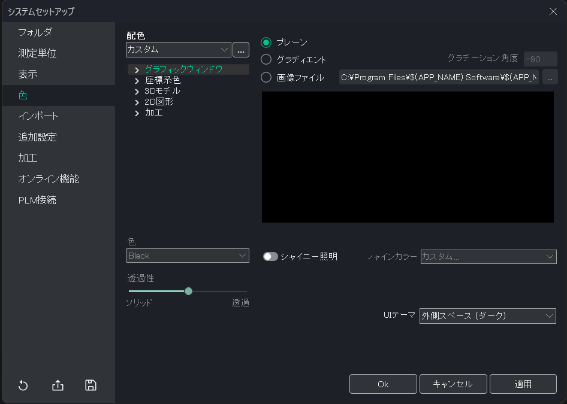

# Colors tab

In the **Color scheme** field, it is possible to select one of the predefined color schemes. By pressing the  button, it is possible to restore the default color values or, if the **Another** color scheme is selected, to load values from another color scheme.

Below the color scheme, a tree-like structure shows the color values for individual elements. These elements are grouped as follows: **Graphic window**, **Coordinate systems axes**, <strong>`3D Model`</strong>, <strong>`2D Geometry`</strong>, **Machining**. By expanding the necessary group, you can edit the color values for any element. The color of a selected element is set in the **Color** field by choosing the desired value from the drop-down list. The **Transparence** slider allows you to adjust the transparency of the selected element.

You can also choose the background of the graphic window:

- **Plain**: A solid background. The color is set in **Graphic window -> First background color**.
- **Gradient**: A gradient background. The colors are set in **Graphic window -> First background color** and **Second background color**. The **Gradient angle** field allows you to set the angle of the gradient relative to the vertical axis.
- **Image file**: Use a graphic image as the background. Supported formats are **BMP** and **JPEG**.
- **Shiny lighting**: Enables an additional light source for enhanced visuals.
