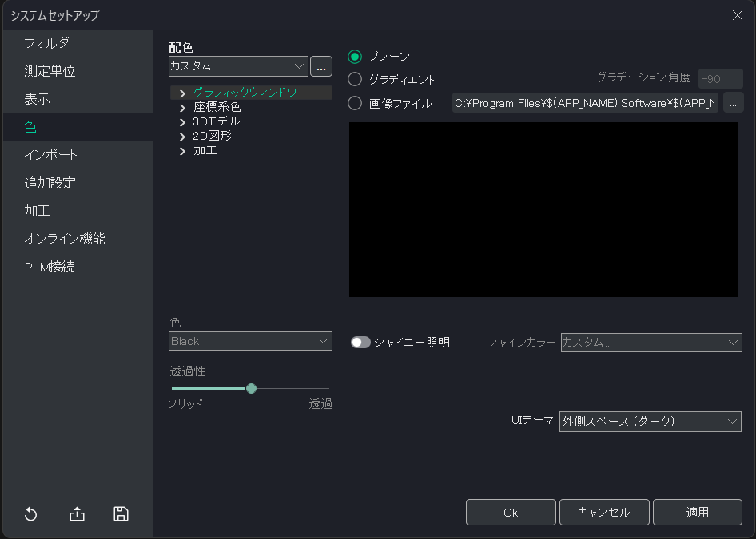
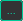

# <色>タブ

<strong>`配色`</strong> 欄で、あらかじめ用意された配色の中から一つを選択することができます。  ボタンを押すと、デフォルトのカラー値を復元できます。 <strong>`他`</strong> 配色が選択されている場合は、別の配色から値を読み込むことができます。

配色の下には、ツリー形式の構造で各要素のカラー値が表示されます。これらの要素は次のように分類されます。<strong>`グラフィックウィンドウ`</strong>, <strong>`座標軸`</strong>, <strong>`3Dモデル`</strong>, <strong>`2D図形`</strong>, <strong>`加工`</strong>.必要なグループを展開することで、各要素のカラー値を編集することができます。選択した要素の色は、 <strong>`色`</strong> 欄でドロップダウンリストから必要な値を選択することによって設定できます。 <strong>`透過性`</strong> スライダーは選択した要素の透明度を調整することができます。

画面の背景も選択できます。

- <strong>`プレーン`</strong>: 単色の背景です。 <strong>`グラフィックウィンドウ` -> `最初の背景色`</strong>で設定します。
- <strong>`グラディエント`</strong>：グラデーション背景です。色は <strong>`グラフィックウィンドウ` -> `グラデーション開始色`</strong> と <strong>`次の背景色`</strong>で設定できます。 <strong>`グラデーション角度`</strong> 欄では、垂直軸に対するグラデーションの角度を設定することができます。
- <strong>`画像ファイル`</strong>：背景に画像ファイルを使用します。対応している形式は <strong>BMP</strong> と <strong>JPEG</strong>です。
- <strong>`照明`</strong>：視覚効果を向上させるための追加光源を有効にします。
