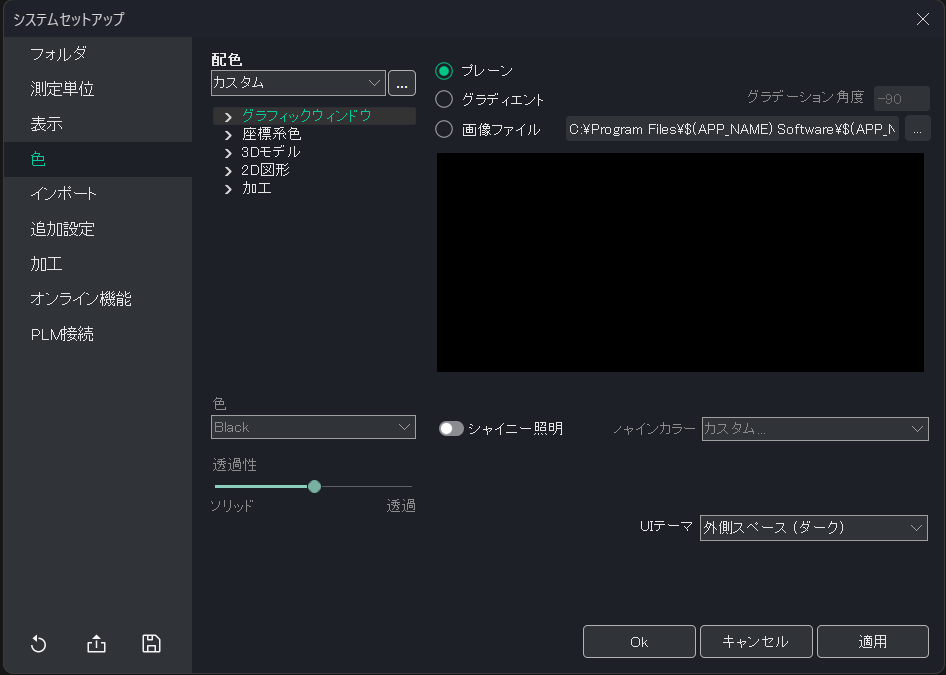

# Registerkarte Farben

Im Feld **Color scheme** (Farbschema) wählen Sie eines der vordefinierten Farbschemata aus. Mit  stellen Sie die Standardfarben wieder her. Beim Schema **Another** können Sie stattdessen die Werte eines anderen Schemas laden.

Unterhalb des Farbschemas zeigt eine Baumstruktur die Farben einzelner Elemente. Diese sind in **Graphic window** (Grafikfenster), **Coordinate systems axes** (Koordinatensystemachsen), **3D Model**, **2D Geometry** und **Machining** (Bearbeitung) gegliedert. Klappen Sie die gewünschte Gruppe auf und wählen Sie ein Element aus. Seine Farbe wird im Feld **Color** über die Dropdown-Liste eingestellt. Der Schieberegler **Transparence** steuert die Transparenz.

Für den Hintergrund des Grafikfensters stehen folgende Optionen zur Verfügung:

- **Plain (Einfarbig).** Die Farbe wird unter **Graphic window → First background color** eingestellt.
- **Gradient (Farbverlauf).** Die Farben werden unter **Graphic window → First background color** und **Second background color** eingestellt. **Gradient angle** legt den Winkel des Verlaufs zur vertikalen Achse fest.
- **Image file (Bilddatei).** Verwendet ein Bild als Hintergrund. Unterstützt werden **BMP** und **JPEG**.
- **Shiny lighting.** Aktiviert eine zusätzliche Lichtquelle zur Verbesserung der Darstellung.
