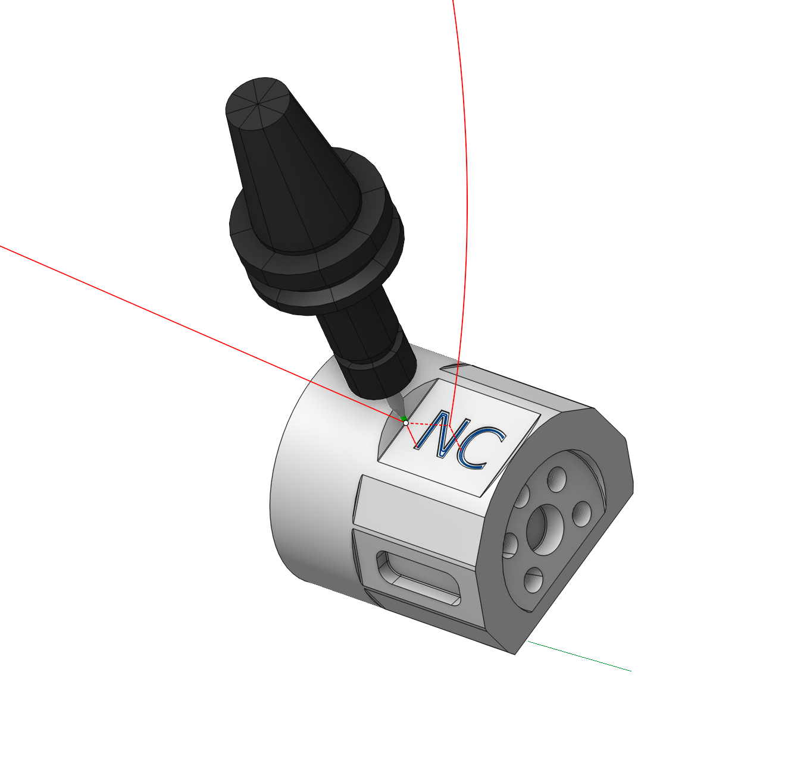

# 彫刻加工

## 適用分野：

このオペレーションは、平面上の図面や文字の彫刻、および2D／2.5D加工によるポケットや輪郭の側面仕上げ加工を行うためのものです。

## セットアップ：

<strong>セットアップ</strong> タブは、プロジェクトの主要なパラメータの設定を行います。これには、装置上での部品の配置、部品の座標系設定などが含まれます 。[詳細を見る](1022.md)

## ジョブ割り当て:

<strong>基準サーフェス</strong> 工具軌跡を投影するための基準面として使用されます。 [詳細を見る](10156.md)

<strong>ボスを追加</strong> ボスを追加できます。[詳細を見る](806.md)

<strong>ポケットを追加</strong> ポケットを追加できます。[詳細を見る](806.md)

<strong>反転追加</strong> 閉じた領域を指定し、加工ルールを反転させます。加工領域が非加工領域となり、非加工領域は加工領域になります。[詳細を見る](806.md)

<strong>上部高さ</strong> モデル要素を使用して上面高さを指定します。 [詳細を見る](10153.md)

<strong>底部高さ</strong> モデル要素を使用して底部高さを指定します。 [詳細を見る](10153.md)

<strong>プロパティ</strong> 要素のプロパティを表示します。残し代を追加することも可能です。リスト内の項目をダブルクリックすることでも、このメニューを呼び出せます。

<strong>削除</strong> リストから項目を削除します。

<strong>制限</strong> 加工してはならない領域を制限できます。[詳細を見る](101231.md)

## 加工設定：

### Vカービング

より高品質な加工結果を得るために、 ツールパスに追加のパスを生成します。特に 小さな要素の加工に効果的です。

拡大

 

### 加工深さ：

工具軸方向における加工範囲を設定します。このパラメーターグループは、<strong>ウォーターライン荒加工オペレーション</strong>と同様に機能します。 [詳細を見る](736.md)

### 深さステップ：

<strong>上部高さ</strong>と<strong>底部高さ</strong>の間で、工具軸方向に1回のパスで除去される切削量を設定します。このパラメータグループは<strong>ポケット加工</strong>と同様に機能します。

### ミーリングタイプ：

曲線加工オペレーションを除くほぼすべての加工オペレーションで設定可能です。この設定により、ツールパスの計算プロセス時に必要なフライス加工タイプ（ダウンカットまたはアップカット）を指定できます。このパラメーターグループは<strong>ウォーターライン荒取りオペレーション</strong>と同様に機能します<strong>。</strong> [詳細を見る](736.md)

### 並べ替え：

面加工時のツールパスの順序を設定します 。このパラメータグループは<strong>2D輪郭加工</strong>と同様に機能します<strong>。</strong> [詳細を見る](404.md)

### コーナー：

工具方向が急変する場合、フライス制御は回転開始前に減速し、その後再び加速します。この動作により、振動が発生しやすくなり、工具およびフライス機械の摩耗が増大する可能性があります。ツールパスの途切れを極力減らすことで、この問題を解決できます。そのため、本システムには、モデルの内側または外側のコーナーを加工する際に、指定された半径を使用してツールパスを滑らかにする機能が搭載されています。

一部のパラメータグループは<strong>2D輪郭加工 - <strong>コーナーの円滑化</strong>機能と同様に機能します。 [詳細を見る](713.md)

### 工具接触点

工具接触点（TCP）とは、加工中に工具とワーク表面または幾何要素との間の主要な相互作用点を定義する、工具上の特定の点です。

このパラメータグループは <strong>5Dサーフェシング加工</strong> と同様に機能します 。 [詳細を見る](10135.md)

### ジョブゾーン：

<strong>ジョブ割り当て</strong>タブで最初に選択した加工領域を追加修正できます。このパラメーターグループは<strong>平面仕上げオペレーション</strong>と同様に機能します。 [詳細を見る](713.md)

### 変換：

ツールパスを変換するためのダイアログです。このパラメータグループは<strong>2D輪郭加工</strong>と同様に機能します。 [詳細を見る](404.md)

## パラメータ:

このタブには、部品、ワーク、治具、およびその他の軌跡に影響を与える要素を制御するための主要なパラメータが含まれており、ツールパスを変更できます。 [詳細を見る](100112.md)

## リンク／リード：

リンク／リードタブでは、早送り動作のパラメータを設定します。これらの動作には、工具交換位置からのアプローチ、切削パス開始点までの進入、最終切削後の退避動作、加工パス間の移動、および工具交換位置への復帰が含まれます。また、座標軸に沿った動作の順序、これらの動作の軌跡、および移動量を設定できます。

拡大

<strong>次の項目で構成されます。</strong>

<strong>アプローチ／リターン</strong> このパラメータグループは、工具交換位置から進入動作開始位置への工具の移動、および復帰の動作を設定します。[詳細を見る](https://confluence.encycam.com/pages/viewpage.action?pageId=131904799)

<strong>安全動作</strong> 安全サーフェスのタイプとワークから安全サーフェスまでの距離を設定します。加工面またはツールパス間の移行を容易にし、アプローチまたはリターンの最初の段階がこのサーフェスに向かって行われます。[詳細を見る](100117.md)

<strong>高度なリンク設定</strong> このパラメータグループは、回転軸の最適な動きを考慮した、主に5軸加工のための軌道形成方法を設定します。[詳細を見る](100118.md)

<strong>リンク</strong> 進入／退出リンクおよび加工パス間のリンクに関するルールを定義します。[詳細を見る](https://confluence.encycam.com/display/SC1/.Links+based+on+the+Roughing+waterline+v19)

<strong>リード</strong> 加工移動に、各送り速度を使用して追加の進入および退避動作を追加できます。

<strong>距離</strong> 送り切替に必要な距離です。 [関連項目](https://confluence.encycam.com/display/SC1/.Distances+based+on+the+Roughing+waterline+v19)

## 送り速度設定：

このダイアログを使用して、主軸回転速度、早送り速度、およびツールパスの各領域の送り速度を設定します。主軸回転速度は、毎分回転速度または切削速度として設定できます。設定値には下線が表示されます。もう一方の値は、工具径を考慮し、設定値に基づいて再計算されます 。[詳細を見る](100142.md)

## 変換：

オペレーション内で計算された工具の軌跡に対して座標変換を行うためパラメータグループです 。[詳細を見る](10168.md)

## パーツ：

パーツは、干渉をチェック行う空間を定義する幾何要素のグループです 。[詳細を見る](330.md)

## ワーク：

オペレーションのワークモデルは、加工する素材を定義します 。[詳細を見る](738.md)

## 治具：

治具には、通常、チャック、グリップ、クランプなどの固定補助具、およびその他の種類の制限領域を指定します 。[詳細を見る](10283.md)
