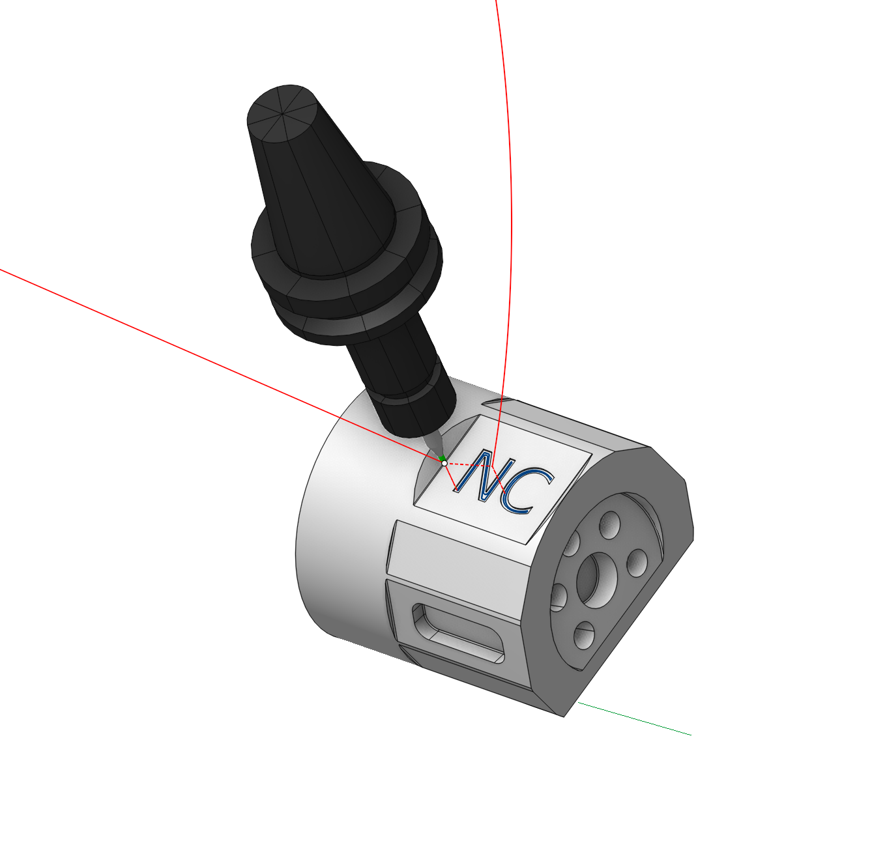

# Gravação

## Área de aplicação:

Essa operação foi projetada para a gravação de desenhos e inscrições em áreas planas e também para realizar um passe de acabamento ao longo das paredes laterais de cavidades e contornos usando a usinagem 2 / 2,5D.

### Setup:

A guia <strong>Setup</strong> é usada para configurar os parâmetros primários do projeto. Isso pode envolver o posicionamento da peça no equipamento, o sistema de coordenadas da peça, entre outros. [Detalhes](1022.md)

### Atribuição de trabalho:

<strong>Superfície de base.</strong> Essa superfície serve para projetar a trajetória sobre ela. [Detalhes](10156.md)

<strong>Adicionar ressalto.</strong> Permite adicionar um ressalto. [Detalhes](806.md)

<strong>Adicionar cavidade.</strong> Permite adicionar uma cavidade. [Detalhes](806.md)

<strong>Adicionar inversão.</strong> Indica uma área fechada dentro da qual as regras de usinagem serão invertidas, ou seja, as áreas usinadas se tornarão não usinadas e vice-versa. [Detalhes](806.md)

<strong>Nível superior.</strong> Define o nível superior por elementos do modelo. [Detalhes](10153.md)

<strong>Nível inferior.</strong> Define o nível inferior por elementos do modelo. [Detalhes](10153.md)

<strong>Propriedades.</strong> Exibe as propriedades de um elemento. É possível adicionar sobremetal. Esse menu também pode ser aberto com um clique duplo em um item da lista.

<strong>Excluir.</strong> Remove um item da lista.

<strong>Restrições.</strong> Permite definir as regiões que não devem ser usinadas. [Detalhes](101231.md)

### Estratégia:

#### Escultura em V.

Acrescenta passagens adicionais à trajetória para obter um resultado de maior qualidade, o que é particularmente eficaz na criação de elementos pequenos.

Clique aqui para expandir...

.png) .png)

#### Níveis de usinagem:

Define o intervalo ao longo do eixo da ferramenta para a usinagem. Esse grupo de parâmetros funciona de forma semelhante à operação <strong>Waterline roughing.</strong> [Detalhes](736.md)

#### Passo de profundidade:

Material removido em uma passagem ao longo do eixo da ferramenta entre os níveis <strong>Top</strong> e <strong>Bottom</strong>. Esse grupo de parâmetros funciona de forma semelhante à operação <strong>Pocketing.</strong> [Detalhes](256.md)

#### Tipo de fresagem:

Pode ser definido em quase todas as operações, exceto nas operações de usinagem de curvas. Permite controlar o tipo de fresagem necessário (concordante ou discordante) durante o cálculo do percurso da ferramenta. Esse grupo de parâmetros funciona de forma semelhante à operação <strong>Waterline roughing.</strong> [Detalhes](736.md)

#### Classificação:

Controla a sequência das passagens do percurso da ferramenta durante a usinagem da superfície. Esse grupo de parâmetros funciona de forma semelhante ao <strong>2D contouring.</strong> [Detalhes](404.md)

#### Cantos:

Quando há uma mudança repentina da direção da ferramenta, o comando da fresadora desacelera antes de iniciar a curva e depois acelera novamente. Isso pode causar vibrações e um alto desgaste da ferramenta e da fresadora. O problema pode ser resolvido se o percurso da ferramenta tiver poucas ou nenhuma quebra. Por esse motivo, o sistema tem a função de suavização do percurso da ferramenta com o raio definido para a usinagem dos cantos internos ou externos do modelo.

Alguns grupos de parâmetros funcionam de forma semelhante ao <strong>2D contouring - <strong>Corners smoothing</strong></strong>. [Detalhes](713.md)

#### Ponto de contato da ferramenta.

O ponto de contato da ferramenta (TCP) é um local específico da ferramenta de corte que define o ponto principal de interação entre a ferramenta e a superfície do bruto ou as entidades geométricas durante as operações de usinagem.

Os parâmetros desse grupo são os mesmos da operação <strong>5D Surfacing</strong>. [Detalhes.](10135.md)

#### Zona de trabalho:

Permite modificar adicionalmente a área de trabalho selecionada inicialmente na guia <strong>Job assignment</strong>. Esse grupo de parâmetros funciona de forma semelhante à operação <strong>Plane finishing.</strong> [Detalhes](713.md)

#### Transformações.

Uma janela para transformar o percurso da ferramenta. Esse grupo de parâmetros funciona de forma semelhante ao <strong>2D contouring.</strong> [Detalhes](404.md)

### Parâmetros:

Esta aba contém os principais parâmetros de controle da peça, do bruto, dos dispositivos de fixação e de outros elementos que permitem modificar o percurso da ferramenta. [Detalhes](100112.md)

### Ligações e entradas/saídas:

Na aba **Links/Leads**, são definidos os parâmetros dos movimentos rápidos: aproximação a partir da posição de troca da ferramenta, entrada no início do movimento de trabalho, saída após o último corte, transições entre passadas e retorno ao ponto de troca. É possível configurar a sequência dos movimentos ao longo das coordenadas, seus percursos e as distâncias dos deslocamentos.

Clique aqui para expandir.

**Componentes:**

**Aproximação/retorno.** Controla os movimentos da ferramenta entre a posição de troca e o início do percurso de entrada, nos dois sentidos. [Detalhes](100116.md)

**Movimentos seguros.** Define o tipo de superfície de segurança e sua distância ao bruto. Essa superfície permite as transições entre superfícies ou percursos usinados; a primeira etapa da aproximação ou do retorno é realizada em direção a ela. [Detalhes](100117.md)

**Configurações avançadas de ligações.** Define as características de formação do percurso, principalmente para operações de cinco eixos, considerando os movimentos ideais dos eixos rotativos. [Detalhes](100118.md)

**Ligações.** Define as regras das ligações de entrada e saída e das ligações entre movimentos de trabalho. [Detalhes](100131.md)

**Entradas e saídas.** Acrescenta movimentos de entrada e saída aos movimentos de trabalho, usando os avanços correspondentes. [Detalhes](100135.md)

**Distâncias.** Define as distâncias usadas nas regras de ligação e na troca de avanços. [Detalhes](100137.md)

### Avanços e velocidades:

Esta janela permite definir a rotação do fuso, o avanço rápido e os avanços dos diferentes trechos do percurso. A rotação do fuso pode ser definida em rotações por minuto ou pela velocidade de corte. O valor de referência fica sublinhado; o outro valor é recalculado a partir dele, considerando o diâmetro da ferramenta. [Detalhes](100142.md)

### Transformações:

Conjunto de parâmetros da operação que permite converter as coordenadas do percurso da ferramenta calculado na operação. [Detalhes](10168.md)

### Peça:

A peça é um grupo de elementos geométricos que define a região a ser verificada quanto a cortes indevidos. [Detalhes](330.md)

### Bruto:

O modelo do bruto de uma operação define o material a ser usinado. [Detalhes](738.md)

### Dispositivos de fixação:

Os dispositivos de fixação normalmente incluem mandris, garras, grampos e outros elementos de fixação, além de áreas de restrição de qualquer natureza. [Detalhes](10283.md)
