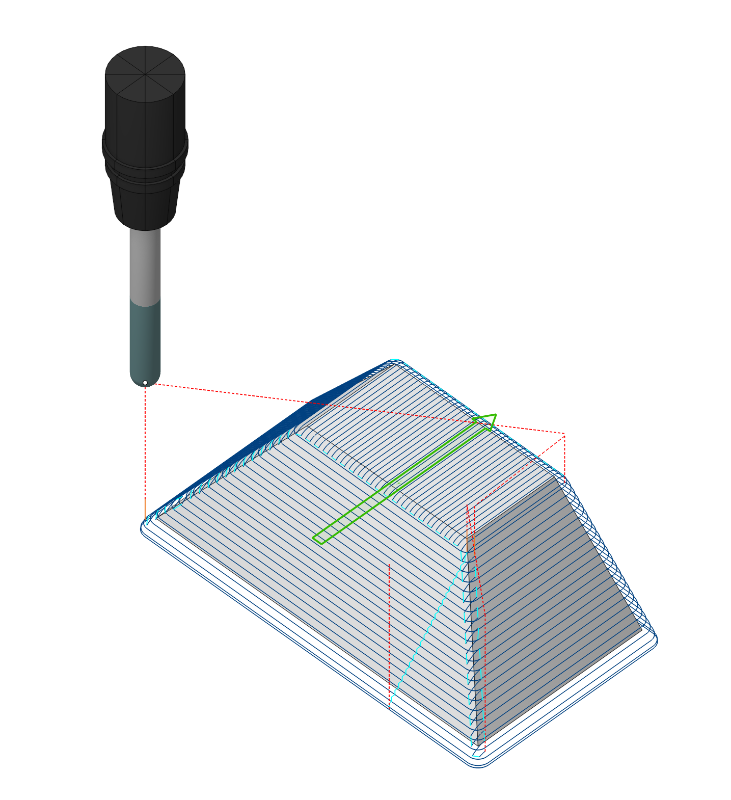
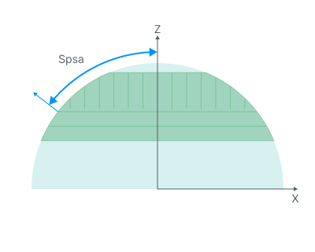

# Complex

## Application area:

The complex operation consists of two toolpaths: plane and waterline. The plane toolpath machines only areas with the slope angle less than the Split slope angle while the waterline toolpath machines areas where the surface slope angle is greater than the Split slope angle. By default the split slope angle is set to 45 degrees. This strategy ensures that shallow areas are machined with the plane toolpath, and steep areas are machined with the waterline toolpath. The benefits of such an approach are optimal cutting conditions, consistent scallop height and reduced machining time.

### Setup:

The **Setup** tab is used to configure the primary parameters of the project. This can involve the positioning of the part on the equipment, the coordinate system of the part, and more. [Details](1022.md)

### Job assignment:

**Faces.** Select various surfaces of the part as the working task. The system will calculate the trajectory based on the chosen surfaces. [Details](102121.md)

**Pocket.** A typical prismatic or turn-milling part consists of many simple shapes.To simplify this task, we can recognize the parts elements in a 3d model and automatically convert them to basic job assignment items, such as job zones and machining levels. [Details](10154.md)

**Job Zone.** Job zones are used to define the part areas that have to be machined by roughing and finishing milling operations. [Details](10151.md)

**Restrict Zone.** In addition to **Job Zones** in system you can use **Restrict Zones** to specify the workpiece areas that have not to be machined in the current operation. [Details](10152.md)

**Top Level.** Specifying the top level by model elements. [Details](10153.md)

**Bottom Level.** Specifying the bottom level by model elements. [Details](10153.md)

**Properties.** Displays the properties of an element. It is possible to add the stock. You can also call this menu by double clicking on an item in the list.

**Delete.** Removes an item from the list.

**Restrictions.** It allows you to restrict areas that should not be machined. [Details](101231.md)

### Strategy:

This parameter group works similarly to the **Plane finishing operation.** [Details](713.md)

#### Job zone

Enables additional modification of the working area initially selected on the Job assignment tab.

Click here to expand..

**Split slope angle.** Angle between vertical and horizontal passages.

**Spsa** - Split slope angle

Some parameter group works similarly to the **Plane finishing operation**. [Details](713.md)

### Parameters:

This tab contains the main parameters for controlling the part, workpiece, fixture and other items, which allow you to change the trajectory. [Details](100112.md)

### Links/Leads:

In the Links/Leads tab, you define the parameters for rapid movements. These movements include tool approach from the tool change position, engage to the start of the working stroke, retraction after the final cutting motion, transitions between working passes, and return to the tool change point. You can configure the sequence of movements along the coordinates, the trajectory of these motions, and the magnitude of displacements.

Click here to expand..

**Сonsists of:**

**Approach/Return.** This group of parameters manages the tool movements from the tool change position to the start of the engage toolpathes, and back. [Details](100116.md).

**Safe motions.** Defines the type of Safety Surface and the distance from the workpiece to it. This surface facilitates transitions between the processed surfaces or tool paths, and the first stage of approach or return occurs toward it. [Details](100117.md).

**Advanced links settings.** This group of parameters specifies the features of trajectory formation for primarily five-axis operations, considering optimal movements of rotational axes. [Details](100118.md).

**Links.** Defines the rules governing Entry/Exit links and links between work moves. [Details](100131.md).

**Leads.** Allows you to add additional engage and retract to the working moves using their feed. [Details](100135.md)

**Distances.** [Details](100137.md).

### Feeds/Speeds:

Using this dialogue the user can define the spindle rotation speed; the rapid feed value and the feed values for different areas of the toolpath. Spindle rotation speed can be defined as either the rotations per minute or the cutting speed. The defining value will be underlined. The second value will be recalculated relative to the defining value, with regard to the tool diameter. [Details](100142.md)

### Transformations:

Parameter's kit of operation, which allow to execute converting of coordinates for calculated within operation the trajectory of the tool. [Details](10168.md)

### Part:

A Part is a group of geometrical elements that defines the space to check for gouges. [Details](330.md)

### Workpiece:

A workpiece model of an operation defines the material to be machined. [Details](738.md)

### Fixtures:

As the Fixtures the fixing aids such as chucks, grips, clamps, etc., and the restriction areas of any other nature are usually specified. [Details](10283.md)
