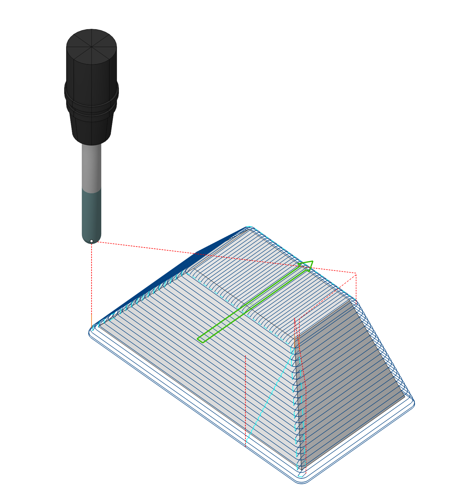
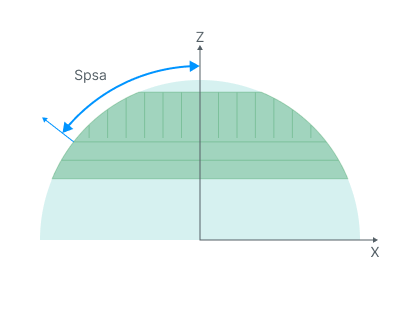

# 複合仕上げ加工（ウォータライン - 平面）

## 適用分野：

この複合仕上げオペレーションは、平面とウォーターラインの2種類のツールパスで構成されています。平面ツールパスは、サーフェスの傾斜角が分割傾斜角より小さい傾斜角を持つ領域のみを加工し、ウォーターラインツールパスは、サーフェスの傾斜角が分割傾斜角より大きい領域を加工します。分割傾斜角は、デフォルトでは45度に設定されています。この加工方法により、緩やかな傾斜を持つ領域は平面加工パスで、急な傾斜を持つ領域はウォーターラインツールパスで加工されます。このアプローチにより、最適な切削条件を維持しながら、一定のスキャロップ高さを実現し、加工時間を短縮することができます。

## セットアップ：

<strong>セットアップ</strong>タブでは、プロジェクトの主要なパラメータを設定します。これには、装置上のパーツの位置、パーツの座標系などが含まれます。[詳細を見る](1022.md)

## ジョブ割り当て:

<strong>フェイス</strong> パーツのさまざまなサーフェスを加工対象として選択します。システムは、選択されたサーフェスに基づいて軌道を計算します。[詳細を見る](102121.md)

<strong>ポケット</strong> 一般的なプリズマティック部品または旋削フライス部品は、多くの単純形状で構成されています。この作業を簡略化するために、3Dモデルから部品の要素を認識し、ジョブゾーンや加工高さなどの基本的なジョブ割り当て項目に自動変換できます。[詳細を見る](10154.md)

<strong>ジョブゾーン</strong>（加工領域） ジョブゾーンは、荒加工および仕上げ加工で加工する部品領域を定義するために使用します。[詳細を見る](10151.md)

<strong>制限領域</strong> システム内の <strong>ジョブゾーン</strong> に加えて、<strong>制限領域</strong>を使用して、現在のオペレーションでは加工しないワーク領域を指定することができます。[詳細を見る](10152.md)

<strong>上部高さ</strong> モデル要素を使用して上部高さを指定します。 [詳細を見る](10153.md)

<strong>底部高さ</strong> モデル要素を使用して底部高さを指定します。 [詳細を見る](10153.md)

<strong>プロパティ</strong> 選択した要素のプロパティを表示します。ストックを追加することも可能です。リスト内の項目をダブルクリックすることでも、このメニューを表示できます。

<strong>削除</strong> リストから項目を削除します。

<strong>制限</strong> 加工してはならない領域を制限することができます。[詳細を見る](101231.md)

## 加工設定：

このパラメーターグループは <strong>平面仕上げオペレーションと同様に機能します。</strong>[詳細を見る](713.md)

### ジョブゾーン

ジョブ割り当てタブで最初に選択したジョブゾーンの追加修正が可能です。

拡大

<strong>分割傾斜角</strong> 垂直経路と水平経路の間の角度

一部のパラメーターグループは<strong>平面仕上げオペレーション</strong>と同様に機能します。[詳細を見る](713.md)

## パラメータ:

このタブには、部品、ワーク、治具、およびその他の軌跡に影響を与える要素を制御するための主要なパラメータが含まれており、ツールパスを変更できます。 [詳細を見る](100112.md)

## リンク／リード

リンク／リードタブでは、早送り動作のパラメータを設定します。これらの移動には、工具交換位置からのアプローチ、切削パス開始点までの位置決め、最終切削後の退避動作、各パス間の移行移動、そして工具交換位置への復帰が含まれます。座標軸ごとの動作順序、各移動の軌跡、および移動量を設定できます。

拡大

<strong>以下の項目で構成されます。</strong>

<strong>アプローチ／リターン</strong> このパラメータグループは、工具交換位置から切込み開始パスへの工具の移動、および戻りの動作を管理します。[詳細を見る](https://confluence.encycam.com/pages/viewpage.action?pageId=131904799)

<strong>安全動作</strong> 安全サーフェスのタイプとワークから安全サーフェスまでの距離を設定します。加工面またはツールパス間の移行を円滑にし、アプローチまたはリターンの最初の段階は、この面に向かって行います。[詳細を見る](100117.md)

<strong>高度なリンク設定</strong> このパラメータグループは、主に5軸加工において、回転軸の最適な動きを考慮した軌道形成の特性を指定します。[詳細を見る](100118.md)

<strong>リンク</strong> 進入／退出リンクおよび加工パス間のリンクに関するルールを設定します。[詳細を見る](https://confluence.encycam.com/pages/viewpage.action?pageId=137006979)

<strong>リード</strong> 移動動作に対して、送り速度を使用した追加の突き込みおよび退避を追加できます。 [詳細を見る](https://confluence.encycam.com/display/SC1/.Leads+for+5-axis+operation+v19)

<strong>距離</strong> リンクのルールで使われる距離です。 [詳細を見る](https://confluence.encycam.com/pages/viewpage.action?pageId=137012802)

## 送り速度設定

このダイアログを使用して、主軸回転速度、早送り値、ツールパスの各領域の送り値を設定できます。主軸回転速度は、毎分回転数または切削速度のいずれかで設定できます。設定値には下線が表示されます。もう一方の値は、工具径を考慮し、設定値に基づいて再計算されます。[詳細を見る](100142.md)

## 変換：

オペレーション内で計算された工具の軌跡に対して座標変換を行うためのパラメータグループです。[詳細を見る](10168.md)

## パーツ：

パーツは、干渉をチェックする空間を定義する幾何要素のグループです。[詳細を見る](330.md)

## ワーク：

加工のワークモデルは、加工する素材を定義します。[詳細を見る](738.md)

## 治具：

治具には通常、チャック、グリップ、クランプなどの固定補助具と、その他の種類の制限領域を指定します。[詳細を見る](10283.md)
