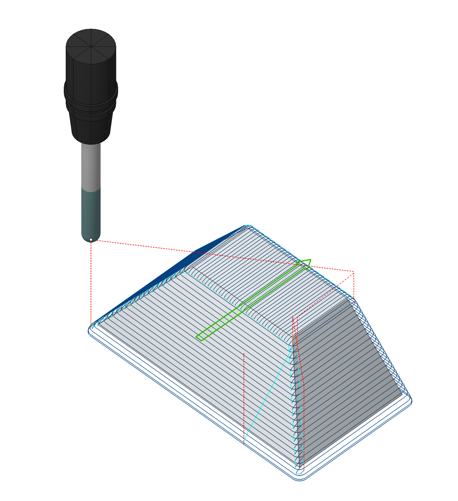

# Kombiniertes Schlichten (Complex)

## Anwendungsbereich:

Die Operation kombiniert Ebenen- und Wasserlinienbahnen. Flächen mit einer Neigung unterhalb von **Split slope angle** werden durch Ebenenbahnen bearbeitet, steilere Bereiche durch Wasserlinienbahnen. Der Trennwinkel beträgt standardmäßig 45°. So werden flache und steile Flächen jeweils mit einem geeigneten Verfahren bearbeitet. Dies verbessert die Schnittbedingungen, ergibt eine gleichmäßige Rautiefe und verkürzt die Bearbeitungszeit.

### Einrichtung:

Auf der Registerkarte **Setup** werden grundlegende Projektparameter festgelegt, beispielsweise Bauteillage und Werkstückkoordinatensystem. [Details](1022.md)

### Auftragszuweisung:

**Faces (Flächen).** Wählt die zu bearbeitenden Bauteilflächen aus. Die Bahn wird anhand dieser Flächen berechnet. [Details](102121.md)

**Pocket (Tasche).** Erkennt einfache Geometrieelemente prismatischer oder gedrehter und gefräster Bauteile und übernimmt sie als Bearbeitungsbereiche und -ebenen in die Auftragszuweisung. [Details](10154.md)

**Job Zone (Bearbeitungsbereich).** Definiert die bei Schrupp- und Schlichtoperationen zu bearbeitenden Bereiche. [Details](10151.md)

**Restrict Zone (Sperrbereich).** Definiert Bereiche, die in dieser Operation nicht bearbeitet werden sollen. [Details](10152.md)

**Top Level (Obere Ebene).** Legt die obere Bearbeitungsebene anhand von Modellelementen fest. [Details](10153.md)

**Bottom Level (Untere Ebene).** Legt die untere Bearbeitungsebene anhand von Modellelementen fest. [Details](10153.md)

**Properties (Eigenschaften).** Öffnet die Elementeigenschaften, beispielsweise zur Eingabe eines Aufmaßes. Auch durch Doppelklick auf einen Listeneintrag erreichbar.

**Delete (Löschen).** Entfernt ein Element aus der Liste.

**Restrictions (Begrenzungen).** Definiert nicht zu bearbeitende Bereiche. [Details](101231.md)

### Strategie:

Die grundlegenden Parameter entsprechen denen beim Ebenenschlichten. [Details](713.md)

#### Bearbeitungsbereich

Ermöglicht zusätzliche Anpassungen des in der Auftragszuweisung festgelegten Bereichs.

Weitere Informationen anzeigen

**Split slope angle (Trennwinkel).** Grenzwinkel der Flächenneigung zur Aufteilung in Ebenen- und Wasserlinienbearbeitung.

Weitere Parameter entsprechen denen beim Ebenenschlichten. [Details](713.md)

### Parameter:

Diese Registerkarte enthält die grundlegenden Einstellungen für Bauteil, Rohteil, Spannmittel und weitere Elemente, die die Werkzeugbahn beeinflussen. [Details](100112.md)

### Verbindungen und An-/Abfahrbewegungen:

Auf der Registerkarte **Links/Leads** werden die Verbindungsbewegungen festgelegt: Anfahren von der Werkzeugwechselposition, Einfahren zum Beginn der Arbeitsbahn, Abfahren nach dem letzten Arbeitsgang, Verbindungen zwischen den Bahnen und Rückkehr zur Werkzeugwechselposition. Einstellbar sind die Reihenfolge der Achsbewegungen, der Bahnverlauf und die Abstände.

Weitere Informationen anzeigen

**Parametergruppen:**

**Approach/Return (Anfahren/Rückkehr).** Steuert die Bewegung von der Werkzeugwechselposition zum Beginn der Werkzeugbahn und zurück. [Details](100116.md).

**Safe motions (Sichere Bewegungen).** Legt die Art der Sicherheitsfläche und ihren Abstand zum Rohteil fest. Die Fläche dient für Verbindungen zwischen bearbeiteten Flächen oder Werkzeugbahnen sowie für die erste Phase des Anfahrens bzw. der Rückkehr. [Details](100117.md).

**Advanced links settings (Erweiterte Verbindungseinstellungen).** Steuert die Bahnerzeugung insbesondere bei 5-Achsen-Operationen unter Berücksichtigung günstiger Drehachsbewegungen. [Details](100118.md).

**Links (Verbindungen).** Legt die Regeln für Ein- und Ausfahrverbindungen sowie Verbindungen zwischen Arbeitsbewegungen fest. [Details](100131.md).

**Leads (An-/Abfahrbewegungen).** Ergänzt zusätzliche Ein- und Ausfahrbewegungen an den Arbeitsbahnen mit den dafür vorgesehenen Vorschüben. [Details](100135.md).

**Distances (Abstände).** Abstände für das Umschalten der Vorschubart. [Details](100137.md).

### Vorschübe und Drehzahlen:

Legt Spindeldrehzahl, Eilgang und Vorschübe für die verschiedenen Bahnabschnitte fest. Die Drehzahl kann direkt in Umdrehungen pro Minute oder über die Schnittgeschwindigkeit vorgegeben werden. Der vorgegebene Wert wird unterstrichen; der andere wird anhand des Werkzeugdurchmessers berechnet. [Details](100142.md)

### Transformationen:

Koordinatentransformationen des berechneten Werkzeugwegs. [Details](10168.md).

### Bauteil:

Geometrische Elemente zur Prüfung auf unerwünschte Einschnitte. [Details](330.md)

### Rohteil:

Modell des zu bearbeitenden Materials. [Details](738.md)

### Spannmittel:

Hier werden Spannmittel wie Spannfutter, Greifer und Spannpratzen sowie weitere Sperrbereiche angegeben. [Details](10283.md)
