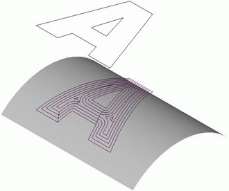
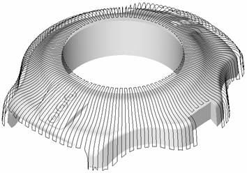
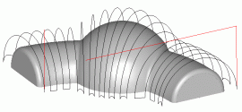

# Schlichten entlang von Leitkurven

Diese Operation eignet sich für einzelne Modellbereiche mit komplexen, langgestreckten gekrümmten Flächen, für die Nachbearbeitung bestimmter Formen sowie für Beschriftungen und Zeichnungen auf Modelloberflächen. Bei flachen Bereichen empfiehlt sich die Bearbeitung entlang der äußeren Randkurven. Steile Bereiche können mit denselben Leitkurven quer zur Kurve bearbeitet werden.

Für einzelne Geometrieobjekte oder Objektgruppen kann ein zusätzliches Aufmaß definiert werden, das zum allgemeinen Operationsaufmaß addiert wird.

Ohne definiertes Rohteil und Begrenzungsmodell wird die gesamte erreichbare Modelloberfläche bearbeitet. Andernfalls werden nur Bereiche innerhalb des Rohteils und außerhalb des Begrenzungsmodells bearbeitet.

Das Rohteil kann als Quader, Zylinder, Modell mit Aufmaß, prismatische Form, Ergebnis vorheriger Operationen oder freie Geometrie aus Volumenkörpern, Flächen, Netzen und Prismen definiert werden. Die Prismen können auf Projektionen geschlossener Kurven beruhen. Das Begrenzungsmodell kann zu prüfende Volumenkörper, Flächen und Netze sowie Bearbeitungs- und Sperrbereiche aus projizierten geschlossenen Kurven enthalten.

Wie bei der Ebenenbearbeitung wird die Oberfläche mit einzelnen Bahnen bearbeitet. Je nach Einstellung liegen sie in vertikalen Ebenen quer zu den Leitkurven oder auf vertikalen Zylinderflächen entlang dieser Kurven. Form und Lage der Zylinderflächen werden durch die Leitkurven bestimmt. Der Bahnabstand kann fest vorgegeben oder aus der gewünschten Rautiefe berechnet werden.

Bei Verwendung eines lokalen Koordinatensystems oder einer Drehachse bleibt die Modellposition unverändert. Die Werkzeugdrehachse liegt parallel zur lokalen Z-Achse. Alle Bahnen liegen in Ebenen oder auf Zylinderflächen senkrecht zur lokalen XY-Ebene.

Der Bearbeitungsbereich kann anhand des Winkels zwischen Flächennormale und Z-Achse begrenzt werden. Für flache Bereiche mit einer Neigung unter 30° werden beispielsweise minimaler und maximaler Neigungswinkel auf 0° und 30° gesetzt.

Der Frontalwinkel begrenzt zusätzlich die Abweichung der Flächennormalen relativ zur Ebene des Arbeitsdurchgangs. Sollen nur Flächen bearbeitet werden, die annähernd senkrecht zur Bahnebene stehen, wählen Sie einen kleinen Frontalwinkel, beispielsweise 5°.

Die Bahn kann außerdem so begrenzt werden, dass Bereiche des Begrenzungsmodells und Kantenumfahrungen ausgeschlossen bleiben.

Die Arbeitsbahnen können von oben nach unten oder umgekehrt verbunden werden. Verbindungen zwischen benachbarten Bahnen erfolgen auf der Oberfläche, mit Ab- und Anfahrbewegungen oder über die Sicherheitsebene.

