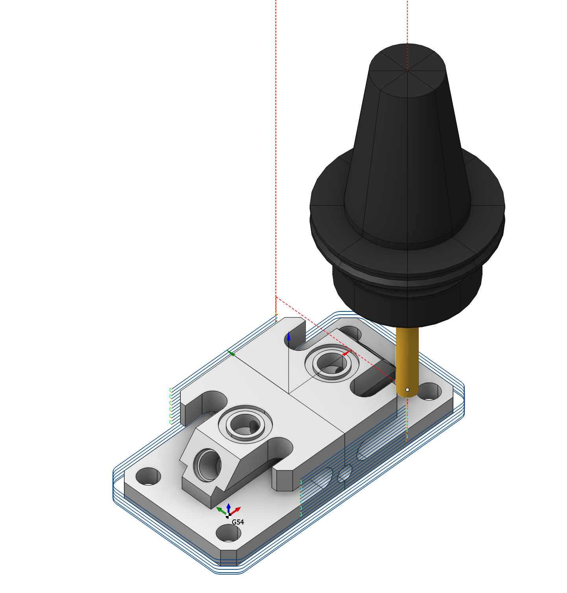
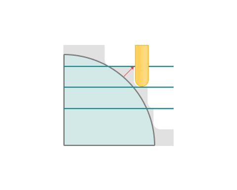
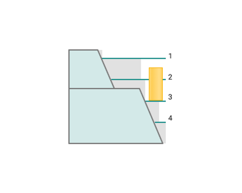
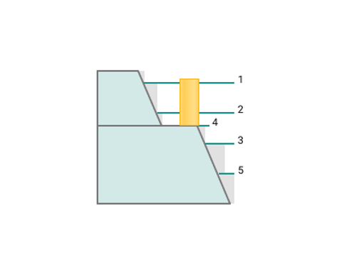
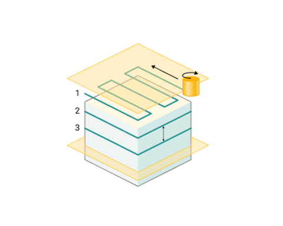
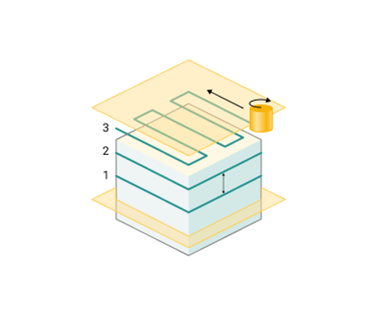

# ウォーターライン仕上げ加工

## 適用分野：

ウォーターライン仕上げ加工は、主要な表面領域が<strong>垂直に近い</strong>モデルやそのパーツを加工する際に、良好な結果をもたらします。平坦な部分の仕上げ加工には、 <strong>平面加工</strong>を使用してください。[詳細を見る](713.md)

## セットアップ：

<strong>セットアップ</strong>タブでは、プロジェクトの主要なパラメータを設定するために使用します。これには、装置上のパーツの位置、パーツの座標系などが含まれます。[詳細を見る](1022.md)

## ジョブ割り当て:

<strong>フェイス</strong> 部品の任意の面を加工対象として選択します。システムは、選択した面に基づいて軌道を計算します。[詳細を見る](102121.md)

<strong>ポケット</strong> 一般的なプリズマティック部品または旋削フライス部品は、多くの単純形状で構成されています。この作業を簡略化するために、3Dモデルから部品の要素を認識し、加工領域や加工高さなどの基本的なジョブ割り当て項目に自動変換できます。[詳細を見る](10154.md)

<strong>ジョブゾーン</strong>（加工領域） ジョブゾーンは、荒加工および仕上げ加工で加工するパーツ領域を定義するために使用します。[詳細を見る](10151.md)

<strong>制限領域</strong> システム内の <strong>ジョブゾーン</strong> に加えて、<strong>制限領域</strong>を使用して、現在のオペレーションでは加工しないワーク領域を指定できます。[詳細を見る](10152.md)

<strong>上部高さ</strong> モデル要素を使用して上部高さを指定します。 [詳細を見る](10153.md)

<strong>底部高さ</strong> モデル要素を使用して底部高さを指定します。 [詳細を見る](10153.md)

<strong>プロパティ</strong> 選択した要素のプロパティを表示します。ストックを追加することも可能です。リスト内の項目をダブルクリックすることでも、このメニューを表示できます。

<strong>削除</strong> リストから項目を削除します。

<strong>制限</strong> 加工してはならない領域を制限することができます。[詳細を見る](101231.md)

## 加工設定：

### 深さステップ：

<strong>上部高さ</strong>と<strong>底部高さ</strong>の間で、工具軸方向に一回のパスで除去する材料量を設定します。

拡大

<strong>スキャロップ無効の場合:</strong> パス間の距離は<strong>深さステップ</strong>パラメータのみで定義されます。

<strong>有効にした場合：</strong> 加工ステップは、指定した<strong>スキャロップの最大高さ</strong>に基づいて自動的に計算されます。必要に応じて、目的のスキャロップ高さを実現するために、ツールパスはより狭い間隔で生成されます。

<strong>平坦部認識</strong> 平坦面に対して追加パスが適用されます。

 

### 加工深さ：

工具軸方向の加工範囲を設定します。 このパラメーターグループは<strong>ウォーターライン荒加工オペレーションと同様に機能します。[詳細を見る](736.md)</strong>

### ミーリングタイプ：

曲線加工オペレーションを除き、ほとんどすべてのオペレーションで設定できます。この設定により、ツールパスの計算プロセス中に、必要なフライス加工タイプ（ダウンカットまたはアップカット）を設定できます。このパラメーターグループは <strong>ウォーターライン荒加工オペレーションと同様に機能します。[詳細を見る](736.md)</strong>

### 並べ替え

面加工中におけるツールパスの順序を設定します 。

拡大

<strong>下方向</strong> 垂直に近いサーフェス領域を持つモデルの場合、 上から<strong>下方向</strong>への加工を推奨します。

<strong>上方向</strong> 水平に近い造形面を持つモデルの場合は、下から<strong>上方向</strong>への加工を推奨します。

### ジョブゾーン

<strong>ジョブ割り当て</strong> タブで最初に選択した加工領域の追加修正が可能です。一部のパラメーターグループは <strong>平面仕上げオペレーション</strong>と同様に機能します。[詳細を見る](713.md)

### トリミング

加工対象外のサーフェスをスキップしたり 、 ツールパスを延長したりできます。 このパラメーターグループは<strong>ウォーターライン荒加工オペレーション</strong>と同様に機能します。[詳細を見る](736.md)

### コーナーの円滑化

工具方向が急変する場合、フライス制御は回転開始前に減速し、その後再び加速します。この動作により、振動が発生しやすくなり、工具およびフライス盤の摩耗が増大する可能性があります。ツールパスの途切れを極力減らすことで、この問題は解決できます。このため、システムにはモデルの内側や外側のコーナーを加工する際に、指定された半径を用いてツールパスを滑らかにする機能があります。

## パラメータ:

このタブには、部品、ワーク、治具、およびその他の軌跡に影響を与える要素を制御するための主要なパラメータが含まれており、ツールパスを変更できます。 [詳細を見る](100112.md)

## リンク／リード

リンク／リードタブでは、早送り動作に関するパラメータを設定します。これらの移動には、工具交換位置からのアプローチ、切削パス開始点までの位置決め、最終切削後の退避動作、各パス間の移行移動、そして工具交換位置への復帰が含まれます。座標軸ごとの動作順序、各移動の軌跡、および移動量を設定できます。

拡大

<strong>次の項目で構成されます。</strong>

<strong>アプローチ／リターン</strong> このパラメータグループでは、工具交換位置から切込み開始パスへの工具の移動、および戻りの動作を設定します。[詳細を見る](https://confluence.encycam.com/pages/viewpage.action?pageId=131904799)

<strong>安全動作</strong> <strong>安全サーフェス</strong>のタイプとワークから安全サーフェスまでの距離を設定します。このサーフェスは、加工サーフェスまたはツールパス間の移動を円滑にし、アプローチまたはリターンの最初の段階は、この面に向かって行います。[詳細を見る](100117.md)

<strong>高度なリンク設定</strong> このパラメータグループでは、主に5軸加工において、回転軸の最適な動きを考慮した軌道形成の特性を指定します。[詳細を見る](100118.md)

<strong>リンク</strong> 進入／退出リンクおよび加工パス間のリンクに関するルールを設定します。[詳細を見る](https://confluence.encycam.com/pages/viewpage.action?pageId=137006979)

<strong>リード</strong> 移動動作に対して、送り速度を使用して追加の突き込みおよび退避動作を追加できます。 [詳細を見る](https://confluence.encycam.com/display/SC1/.Leads+for+5-axis+operation+v19)

<strong>距離</strong> 送り速度を切り替えるための距離を設定します。 [詳細を見る](https://confluence.encycam.com/pages/viewpage.action?pageId=137012802)

## 送り速度設定

このダイアログを使用して、主軸回転速度、早送り値、ツールパスの異なる領域の送り値を設定できます。主軸回転速度は、毎分回転数または切削速度のいずれかで設定できます。設定値には下線が表示されます。もう一方の値は、工具径を考慮し、設定値に基づいて再計算されます。[詳細を見る](https://confluence.encycam.com/pages/viewpage.action?pageId=137012551)

## 変換：

オペレーション内で計算された工具の軌跡に対して座標変換を行うためのパラメータグループです。[詳細を見る](10168.md)

## パーツ：

パーツは、干渉をチェックする空間を定義する幾何要素のグループです。[詳細を見る](330.md)

## ワーク：

加工のワークモデルは、加工する素材を定義します。[詳細を見る](738.md)

## 治具：

治具には通常、チャック、グリップ、クランプなどの固定補助具と、その他の種類の制限領域を指定します。[詳細を見る](10283.md)
