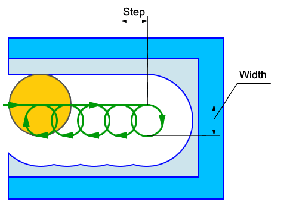

# Usinagem trocoidal (Equidistant legacy)

Os cortes de alta velocidade são formados pela adição de círculos adicionais ao percurso da ferramenta. Esse método permite reduzir bastante o volume de dados NC em comparação com a trocoide e, ao mesmo tempo, proteger a ferramenta.

A largura e o passo do percurso de cortes de alta velocidade dependem dos modos **High speed cuts**. O sistema CAM oferece 4 modos:

1. **Do not use**. Nesse modo, os círculos adicionais não são formados em nenhum caso.

Atenção: se o passo do bolsão for maior que a metade do diâmetro da ferramenta ou se for atribuído um raio de suavização, poderão restar ilhas não usinadas. É obrigatório verificar visualmente o percurso da ferramenta no modo **Simulation**.

1. **For islands removing only**. O modo gera a quantidade mínima de círculos adicionais. O diâmetro dos círculos é mínimo e suficiente para remover as ilhas. O passo dos cortes é igual ao diâmetro da ferramenta;
2. **With pocket step**. O modo garante uma carga uniforme na ferramenta. O raio dos círculos adicionais não pode ser menor que o raio de suavização. O passo dos cortes é menor ou igual ao passo do bolsão. O modo é recomendado para usinagem de alta velocidade;
3. **Reduce on the cleanup**. O percurso de cortes de alta velocidade é gerado de forma semelhante ao terceiro modo, mas o passo dos cortes na limpeza é igual ao passo de limpeza, para reduzir a vibração da ferramenta;

Atenção: se o passo de usinagem for maior que a metade do diâmetro da ferramenta ou se a ferramenta tiver raio de canto, poderão restar ilhas de material. Verifique visualmente essa usinagem no modo **Simulation**.
