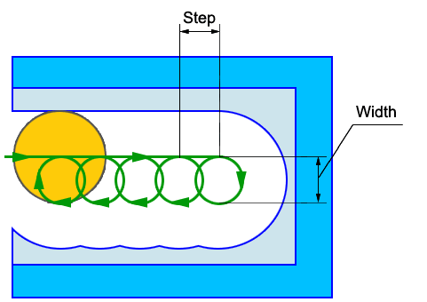

# トロコイド加工

高速切削は、ツールパスに追加の円弧を加えることで形成されます。この方法は、トロコイドと比較してNCデータを大幅に削減することができ、同時に工具を保護することができます。

高速切削のパス幅およびステップは、 `高速切削` モードによって決まります。CAMシステムには4つのモードがあります。

1. `使用しない` このモードでは、追加の円弧はいかなる場合も形成されません。

注意: ポケットのステップが工具径または円滑半径の半分を超える場合、未加工の島が残る可能性があります。 `シミュレーション`モードでツールパスを目視確認することが必須です。

1. `島除去のみ`このモードでは、追加される円弧の数が最小限に抑えられます。円弧の直径は最小限に抑えられつつ、島を除去できる大きさに設定されます。切削ステップは工具径と同じになります。
2. `ポケットステップ付き`このモードは、工具負荷の均一化を保証します。追加の円弧の半径は、 円滑化された半径より小さく設定することはできません。切削ピッチは、ポケットピッチ以下に設定されます。このモードは高速加工に推奨されます。
3. `クリーンナップ軽減`高速切削のツールパスは、第三モードと同様に生成されますが、クリーンアップ時の切削ピッチはクリーンアップピッチと同じに設定され、工具の振動を低減します。

注意: 加工ステップが工具径の半分より大きい場合、または工具にコーナー半径がある場合、未加工材の島が残る可能性があります。この加工は`シミュレーション`モードで目視確認する必要があります。
