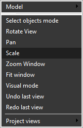

# Ampliação e redução interativas

Gire a <strong>[Roda do mouse]</strong> para ampliar. Você também pode usar <strong>[Ctrl] + [Botão direito do mouse]</strong> e arrastar na tela de visualização principal para ampliar.

Um método alternativo é ativar o modo Escala a partir do menu de contexto da janela gráfica.

Em seguida, clique e segure o <strong>[botão esquerdo do mouse]</strong> enquanto move o ponteiro verticalmente na janela gráfica para aumentar e diminuir o zoom dinamicamente. Mover o ponteiro horizontalmente neste modo não afeta a imagem.
