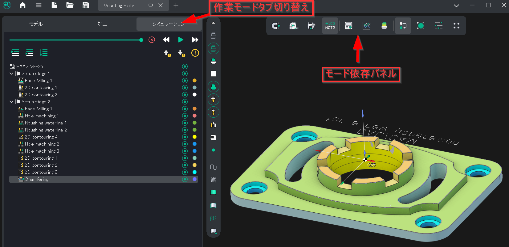
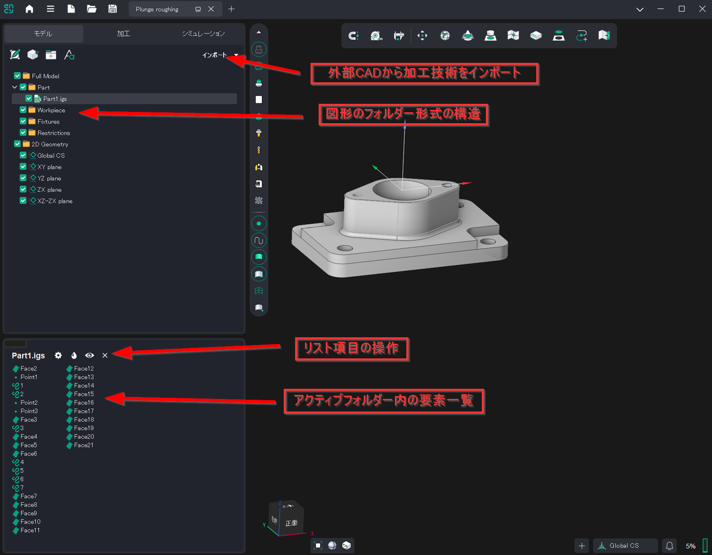
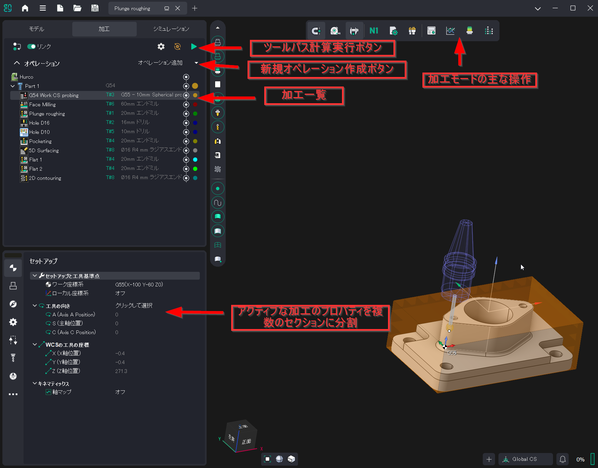
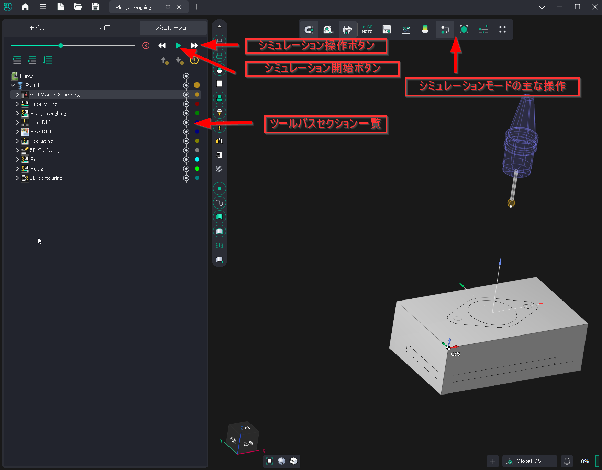

# Modalità di lavoro

Per comodità, l'interfaccia del sistema è suddivisa in diverse modalità di lavoro. Per passare da una modalità all'altra nella finestra principale si utilizzano le schede. Cambiando scheda, cambia il contenuto dei pannelli della finestra principale:

- <strong>Pagina del contenuto della modalità di lavoro</strong> sul lato sinistro della finestra.
- <strong>Barra degli strumenti della modalità di lavoro</strong> al centro del riquadro superiore della finestra.

Di conseguenza, il numero di pulsanti visualizzati contemporaneamente sullo schermo si riduce notevolmente, semplificando l'interfaccia e ampliando lo spazio per il lavoro principale. La sequenza delle schede rispecchia approssimativamente l'ordine delle azioni di base dell'utente durante il lavoro su un progetto, anche se la relazione non è rigorosamente lineare.

Di seguito sono descritti brevemente lo scopo e l'aspetto della finestra per ciascuna modalità.

## Model

Nella [modalità Model,](717.md) l'utente può: [importare](109.md) file di dati geometrici (CAD), modificare (tagliare, eliminare ecc.) la [struttura di un modello geometrico](718.md), [trasformare spazialmente](116.md) (spostare, ruotare ecc.) gli oggetti, generare nuovi elementi ([copia](10058.md), [disegno](833.md), [intersezione](289.md), [triangolazione](619.md) ecc.) a partire da quelli esistenti e gestire le [proprietà visive](57.md) degli oggetti.

## Machining

Nella [modalità Machining](10064.md) l'utente crea il processo di lavorazione per il pezzo, scegliendo da [un elenco di operazioni tecnologiche disponibili](95.md). L'operazione determina la strategia di lavorazione e il tipo di percorso utensile. Qui è inoltre possibile eseguire la messa a punto di tutti i parametri dell'operazione di lavorazione e il [calcolo del percorso utensile](12.md). Dopo aver ottenuto il percorso utensile, è possibile visualizzarlo sullo schermo insieme al [risultato preliminare della lavorazione](322.md). Dopo il debug del processo, è possibile avviare il [postprocessore](730.md) per [generare il programma NC](69.md) e il [rapporto di lavorazione](13.md).

La struttura della modalità <strong>Machining</strong> può essere approfondita in [questa sezione](1020.md).

## Simulation

Nella [modalità Simulation](10286.md) l'utente ha accesso agli strumenti integrati di simulazione della lavorazione, che consentono di controllare dinamicamente l'asportazione del materiale, le collisioni della macchina e i parametri di visualizzazione, e di verificare per blocchi il percorso utensile generato.

Alcuni pulsanti sono comuni alle modalità <strong>Machining</strong> e <strong>Simulation</strong>.

-  [Machine Control Panel](10008.md) (pannello di controllo della macchina): consente di visualizzare e modificare i valori correnti di tutte le coordinate della macchina/del robot.
-  <strong>[Graph of the axes](10010.md)</strong> (grafico degli assi): visualizza le variazioni di ciascun asse della macchina nel tempo durante l'esecuzione del percorso utensile dell'operazione corrente. Ciò aiuta a individuare i tratti sfavorevoli del percorso utensile con rimbalzi che potrebbero causare vibrazioni.
-  <strong>[Verify Compare](10006.md)</strong> (confronto di verifica): consente di visualizzare la differenza tra il pezzo originale e il risultato della lavorazione mediante una scala di colori, in cui ogni colore rappresenta uno specifico intervallo di scostamento tra gli elementi confrontati.
-  <strong>Tool Reach Inspector</strong> (ispettore della raggiungibilità dell'utensile): questo pannello consente di visualizzare le zone del pezzo in cui il portautensile non ha collisioni e di determinare l'angolo migliore per la lavorazione del pezzo.
