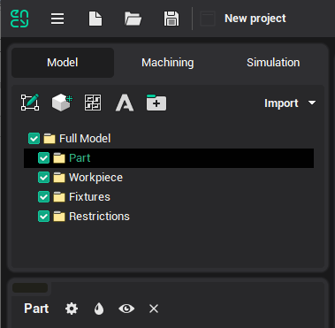
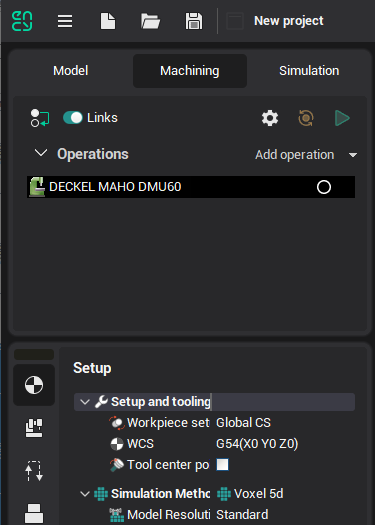
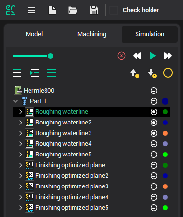

# Schnelleinstieg

Die folgenden Schritte zeigen einen typischen Ablauf zum Berechnen einer Werkzeugbahn und Erzeugen eines NC-Programms. Sie dienen zugleich zur Einarbeitung in das CAM-System.

- Wechseln Sie über die entsprechende Registerkarte der Hauptleiste in den [Arbeitsmodus](86.md) **Model**.

- [Importieren Sie ein Modell](109.md) aus einer Geometrieaustauschdatei. Klicken Sie auf  und wählen Sie die Datei. Der Import erfolgt in den aktiven Ordner. Aktivieren Sie daher vorher **Full Model/Part** für das Bauteil, **Full Model/Workpiece** für das Rohteil oder **Full Model/Fixtures** für Spannmittel. Geometrieänderungen sollten möglichst vor dem Erstellen der Bearbeitungsfolge abgeschlossen sein, da die Operationsvorgaben beim Erstellen aus Bauteil und Rohteil abgeleitet werden.

- Wechseln Sie über die Hauptleiste in den [Arbeitsmodus](86.md) **Machining**.

- Prüfen Sie [Maschinentyp und Maschinenparameter](341.md) und passen Sie sie bei Bedarf an. Die Maschine bestimmt die verfügbaren Operationen: Drehmaschinen bieten Drehoperationen, Fräsmaschinen Fräsoperationen und Dreh-Fräs-Zentren beide Arten.

- Definieren Sie im Wurzelknoten des Operationsbaums [Bauteil, Rohteil und Spannmittel](294.md), falls über die importierte Geometrie hinaus weitere Konstruktionen erforderlich sind. Möglich sind beispielsweise Prismen und Rotationskörper aus Kurven sowie umhüllende Quader oder Zylinder.

- Erstellen Sie eine oder mehrere Operationen. Klicken Sie auf  und wählen Sie den Operationstyp. Die neue Operation wird im Ordner **Machining** des Wurzelknotens angelegt, aktiviert und kann anschließend bearbeitet und berechnet werden.

- Legen Sie die Operationsparameter fest. [Part](330.md) und [Fixtures](10283.md) verweisen standardmäßig auf die entsprechenden Modelle der vorherigen Operation, bei der ersten Operation auf den Wurzelknoten. [Workpiece](738.md) verweist auf das verbleibende Material der vorherigen Bearbeitung. Die [Auftragszuweisung](301.md) umfasst zunächst das gesamte Bauteil. Die übrigen Parameter werden anhand dieser Geometrie automatisch voreingestellt. Häufig ist die Operation damit bereits berechenbar. Prüfen oder ändern Sie die Werte im Parameterbereich unten links oder in den über **Parameters** geöffneten Dialogen.

- Starten Sie die Berechnung mit . Die Fortschrittsanzeige zeigt den Berechnungsstand. Ein Klick darauf bricht die Berechnung ab.

Die Bahnberechnung bearbeitet die [Auftragszuweisung](301.md) mit der gewählten Strategie unter Berücksichtigung von [Bauteil](330.md) und [Spannmitteln](10283.md). Schruppoperationen entfernen dafür das darüberliegende Material des [Rohteils](738.md). Bei Schlichtoperationen ist die Rohteilprüfung optional. Ist sie aktiviert, werden nur Bereiche mit vorhandenem Restmaterial bearbeitet; andernfalls wird die gesamte Auftragszuweisung berücksichtigt.

- Blenden Sie das [Bearbeitungsergebnis](322.md) mit  im [Sichtbarkeitspanel](359.md) ein, um den bearbeiteten Rohteilzustand zu beurteilen.

- Prüfen Sie die Bahn satzweise im [Modus](86.md) [Simulation](10286.md). Wählen Sie die entsprechende Registerkarte und starten Sie mit . Ändern Sie bei Bedarf die Operationsparameter und berechnen Sie die Bahnen erneut.

- Öffnen Sie im Modus **Machining** den [Postprozessor](69.md) über . Wählen Sie die CNC-Steuerung über eine passende **.sppx**-Postprozessordatei und klicken Sie auf **Run**. **Output file** zeigt den Namen der NC-Datei. Standardmäßig wird der Projektname mit der im Postprozessor festgelegten Dateierweiterung verwendet.

- Speichern Sie das Projekt mit  in der [Hauptsymbolleiste](51.md). Der Schieberegler bestimmt den Speicherumfang. Je mehr Detaildaten gespeichert werden, desto größer wird die Projektdatei.

- Ein vorhandenes Projekt wird mit  in der [Hauptsymbolleiste](51.md) geöffnet.
