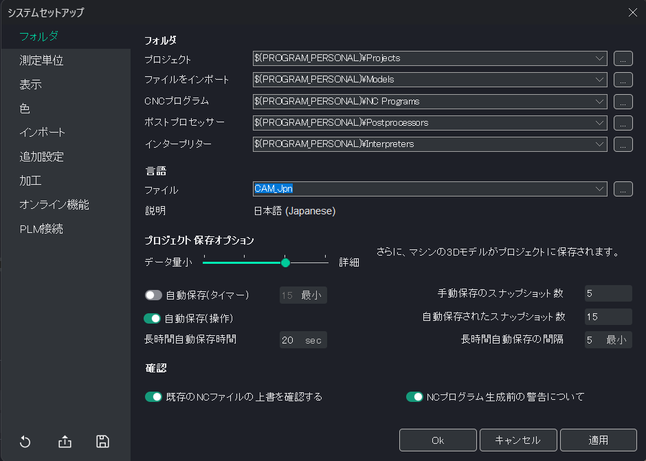

# システム設定ウィンドウ

<strong>システム設定</strong>ウィンドウは、[メインパネル](51.md)にある  をクリックすることで開くことができます。

すべてのデフォルトパラメーターは <strong>.cfg</strong> ファイルに保存されます。ユーザー定義のパラメーターは、ウィンドウの右側にあるボタンを使って保存または読み込むことができます。ユーザーは、必要に応じて複数の設定ファイルを作成することができます。

## `システム設定`ウィンドウのボタン：

-  `デフォルトの保存`</strong>: 設定をユーザー定義の設定ファイルに保存し、ウィンドウを閉じます。保存されたファイルが現在の設定となり、現在のセッションに設定が適用されます。
-  `保存されたデフォルトを読込み`</strong>: 選択した設定ファイルから設定を読み込み、現在の設定にします。読み込まれたファイルは、次回の起動時にデフォルトとして使用されます。
-  `デフォルト設定`: すべてのユーザー定義設定をデフォルト値に戻します。
- <strong>` OK`</strong>: 設定を現在の構成ファイルに保存し、現在のセッションに適用します。また、今後のセッションにも適用されます。ウィンドウを閉じます。
- <strong>`キャンセル`</strong>: ウィンドウを閉じて変更内容をキャンセルします。
- <strong>`適用`</strong>: 新しいパラメータを現在のセッションにのみ適用し、今後のセッションには保存しません。

CAMシステムの起動時に、現在の設定ファイルがない場合、新しい設定ファイルが自動的に作成され、すべてのシステム設定がデフォルト値にリセットされます。

## ウィンドウには以下のタブがあります。

- [フォルダ](715.md)
- [入力単位](22.md)
- [表示](24.md)
- [色](807.md)
- [インポート](264.md)
- [追加](23.md)
- [加工](740.md)
- [オンライン機能](10016.md)
- [PLMの拡張機能](10017.md)
- [PLMの接続](10018.md)
