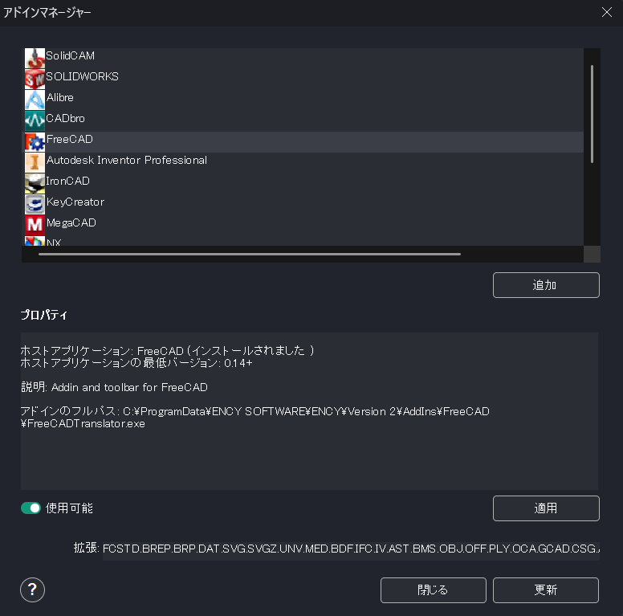
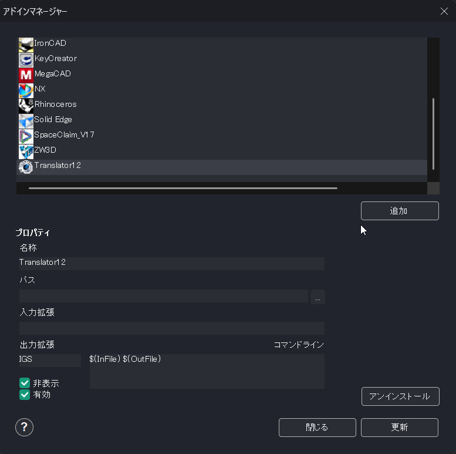

# Gerenciador de suplementos

O Addin Manager é um programa desenvolvido para controlar os [suplementos](10039.md) do sistema CAM e os tradutores externos de CAD.

Você pode executar o Addin Manager a partir do sistema CAM: use o item de menu no painel principal.

Janela Addin Manager:

Suplementos

Sequência de trabalho para instalar um suplemento: Selecione o suplemento necessário na lista superior. Clique no botão **Install**. Edite os parâmetros (opcional). Clique no botão **Apply** para salvar as alterações (opcional). Clique no botão **Close** (opcional).

Sequência de trabalho para desinstalar um suplemento:

Selecione o suplemento necessário na lista superior. Clique no botão **Uninstall**. Clique no botão **Close** (opcional).

Antes da instalação ou desinstalação, o sistema para o qual a barra de ferramentas será instalada deve estar fechado; o instalador informará sobre isso. Caso contrário, a instalação/desinstalação será cancelada.

Os suplementos são mostrados na lista superior. Quando um deles é selecionado, são exibidas informações adicionais no painel **Parameters**. Normalmente, são o nome e a versão do aplicativo com o qual o suplemento funciona, a descrição dos recursos do suplemento etc. Os parâmetros editáveis (se houver) também ficam nesse painel.

Se o suplemento já estiver instalado, ele pode ser ativado/desativado pela caixa de seleção **Enabled** sem perder as alterações de seus parâmetros padrão (a sequência de botões **Uninstall** e **Install** redefine todas as alterações e, como resultado, o suplemento é instalado com os parâmetros padrão).

O campo **Extensions** fica destacado somente se o suplemento selecionado suportar alguma manipulação de arquivos com extensões (tipos) específicas, por exemplo, a importação de arquivos. Nesse caso, o usuário pode editar os tipos de arquivo que serão importados pelo suplemento selecionado.

**Default** preenche as propriedades do suplemento selecionado com os valores padrão. Por exemplo, se as extensões de arquivo foram alteradas, clicar em **Default** as redefine para os valores padrão do suplemento.

**Apply** salva as alterações do suplemento selecionado.

**Install** / **Uninstall** – registra/cancela o registro do suplemento selecionado para uso.

**Close** – fecha o Addin Manager do sistema CAM. Se houver alterações, será exibida a caixa de diálogo `Save/No/Cancel`.

**Refresh** – relê todos os suplementos. Observação: todas as alterações serão perdidas.

**Help** – exibe esta ajuda. Em alguns casos, é necessário recarregar o aplicativo (host do suplemento) quando as propriedades do suplemento são alteradas. Por exemplo, após a instalação da barra de ferramentas do sistema CAM para o SOLIDWORKS®, o suplemento SOLIDWORKS® deve ser recarregado. Todos os suplementos devem estar na pasta 'Addins' (a pasta do Addin Manager do sistema CAM) e/ou em suas subpastas. O Addin Manager do sistema CAM examina essas pastas em busca de suplementos e os lista. Basta colocar qualquer suplemento (do sistema CAM ou de qualquer outra fonte) nessas pastas para que ele fique acessível no Addin Manager do sistema CAM (clique no botão **Refresh** se o Addin Manager do sistema CAM estiver em execução).

Tradutores externos de CAD

Você pode usar o Addin Manager para conectar tradutores externos de CAD. Um tradutor de CAD é um programa capaz de converter um formato de arquivo (por exemplo, CATIA, Pro/E, NX etc.) em um dos formatos nativos do sistema CAM (por exemplo, IGS, STL, 3DM etc.) e que suporta a interface de linha de comando (por exemplo, você pode digitar convert.exe Model.CATIA Model.IGS na linha de comando e o tradutor gerará um arquivo IGS a partir do arquivo CATIA). Depois de registrar um tradutor de CAD no Addin Manager, você poderá importar diretamente para o sistema CAM os arquivos CAD suportados pelo tradutor.

Portanto, para adicionar um tradutor de CAD externo ao sistema CAM, você deve: Abrir o Addin Manager. Clicar no botão **Add**. Preencher os parâmetros do tradutor.

Os parâmetros são os seguintes: **Name** - esse nome aparecerá na caixa de diálogo de importação, na lista de formatos suportados (por exemplo, Translator1 (external) (.model.ipt) **Path** - caminho completo do executável do tradutor. Você pode preencher esse campo clicando no botão de reticências ao lado da caixa de texto e navegando até o executável no explorador de arquivos padrão do Windows. **Input extensions** - aqui você deve inserir as extensões de arquivo de entrada suportadas pelo tradutor. As extensões devem ser separadas por pontos. Por exemplo, model.ipt.step.sat. **Output extension** - nesse campo, você deve especificar a extensão do arquivo de saída do tradutor. Ela deve ser um dos formatos suportados nativamente pelo sistema CAM, por exemplo, IGS, 3dm, STL, STEP, X_T. **Command line** - nessa caixa, você deve especificar o comando que será passado ao tradutor. Use a macro $(InFile) em vez do nome do arquivo de entrada e a macro $(OutFile) em vez do nome do arquivo de saída. Por exemplo, -i $(InFile) -o $(OutFile)
