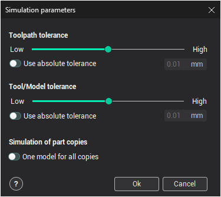
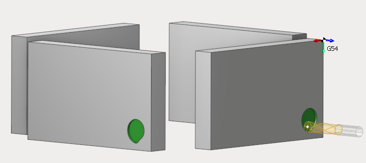

# Atribuição de parâmetros do material bruto

A janela de edição das configurações de simulação é aberta ao clicar no botão  na [janela de simulação](352.md) da usinagem.

A tolerância da simulação pode ser especificada com o controle deslizante, que varia de **Low** a **High**, ou em unidades absolutas, se a caixa **Use absolute tolerance** estiver marcada. A tolerância escolhida afeta a ferramenta, o bruto inicial e o percurso da ferramenta. Quanto menor o valor, mais rápida a simulação, porém menor a qualidade do modelo resultante. Por padrão, é usado o valor relativo especificado com o controle deslizante. Nesse caso, os valores reais de tolerância absoluta para a ferramenta, o bruto e o percurso da ferramenta são escolhidos automaticamente de acordo com suas dimensões. Isso garante um bom resultado para a maioria dos brutos e percursos da ferramenta. No entanto, é possível definir um valor de tolerância exato comum para garantir um resultado confiável em casos difíceis.

O valor de tolerância usado pode ser modificado dinamicamente durante a simulação de um percurso da ferramenta. Assim, os fragmentos mais interessantes podem ser simulados com tolerâncias mais altas.

O parâmetro **One model for all copies** é muito útil ao trabalhar em um projeto com muitas cópias de uma peça. Esse parâmetro permite usar menos RAM e, como resultado, acelerar o processo de simulação.

<em><strong>Observação</strong>:</em>

- <em>Não recomendamos usar alta tolerância de simulação em computadores de baixo desempenho</em>
- <em>Se você fez alterações nesta janela, redefina os parâmetros do bruto na página de simulação clicando no botão de redefinição</em>
