# 新しいオペレーションの作成

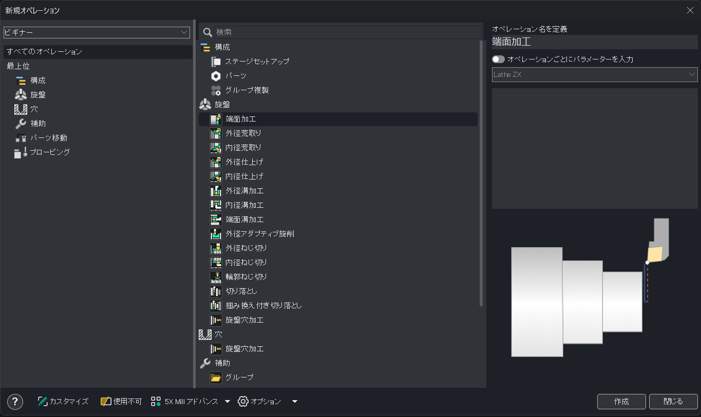

<strong>適用分野:</strong>

技術プロセスに新しい加工操作を追加するには、CAMシステムの専用作成ウィンドウを使用します。このウィンドウでは、加工操作の参照、検索、および設定を行ったうえで、プロジェクトに追加できます。

オペレーションの作成方法には、2つの方法があります。

- 1つ目は、初心者に適した方法です。

拡大

新しい加工操作の作成ウィンドウを開くには、  ボタンをクリックします。

作成ウィンドウが表示されます。このモードは、オペレーションの詳細を確認しながら作業できるため、初めて使用するユーザーに適しています。

作成ウィンドウでは、次の2つの方法でオペレーションを作成できます。

- 技術プロセス内の加工操作をダブルクリックすると、対応する種類のオペレーションが追加されます。この場合、オペレーション作成ウィンドウは開いたままになります。
- 一覧から加工操作を選択して「作成」ボタンをクリックすると、オペレーションが作成され、作成ウィンドウは閉じます。

- 2つ目は、システムの操作に慣れたユーザー向けの方法です。

拡大

新しいオペレーションを作成するには、もう一つ簡単で素早い方法があります。 の横にある▼（矢印）をクリックし、表示されるメニューから目的のオペレーションタイプを選択してください。

この方法を使用すると、オペレーション作成ウィンドウを何度も開閉する必要がなくなるため、作業を大幅に効率化できます。

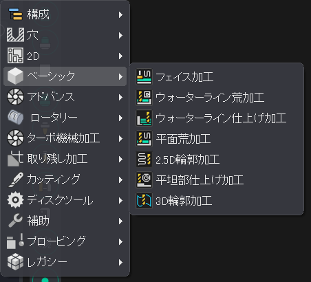

オペレーション作成ウィンドウは、3つのペインで構成されています。

- <strong>左ペイン</strong> — カテゴリを選択するためのオペレーショングループを表示します。
- <strong>中央ペイン</strong> — 左ペインで選択したグループに属するオペレーションを表示します。
- <strong>右ペイン</strong>— 現在選択しているオペレーションの詳細情報を表示します。

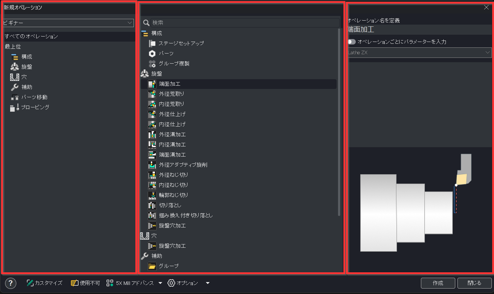

## 右ペイン

このペインには、選択したオペレーションの詳細が表示され、次の機能を利用できます。

<strong>オペレーション名を定義</strong> <strong>オペレーション名を定義</strong>フィールドで、オペレーション名を任意に設定できます。

<strong>既存オペレーションからの設定コピー オペレーションごとにパラメーターを入力</strong>チェックボックスを有効にすると、既存のオペレーションの設定をコピーできます。コピー元のオペレーションは、ドロップダウンリストから選択します。

<strong>説明用画像および動画再生</strong> ペイン下部には、説明用の画像または動画が表示されます。動画はクリックすると再生、停止を切り替えることができます。

## ツールバー

ウィンドウ<strong>下部のツールバー</strong>では、表示内容を管理するための機能を利用できます。主な項目は次のとおりです。

<strong>？ボタン</strong> このトピックに対応するヘルプを表示します。

<strong>カスタム</strong> このウィンドウおよび<strong>オペレーション作成</strong>ドロップダウンメニューに表示するオペレーションやグループを設定します。

拡大

更新されたウィンドウレイアウトでは、オペレーションおよびグループをより柔軟に管理できるよう、以下の機能が追加されています。

- <strong>オペレーションおよびグループの横に追加された操作コントロール</strong> — オペレーション名およびグループ名の横に、新しいボタンとチェックボックスが表示されます。チェックボックスを使用して、各オペレーションやグループをインターフェース上に表示するかどうかを設定できます。
- <strong>ドラッグ＆ドロップによるオペレーションの移動</strong> — オペレーションは、ドラッグ＆ドロップ操作で別のグループへ移動できます。
- <strong>グループの作成、削除</strong> — ウィンドウ上部にある専用ボタンを使用して、新しいグループを作成したり、既存のグループを削除したりできます。
- <strong>グループ名の変更</strong> — グループ名をクリックして新しい名前を入力することで、名称を変更できます。
- <strong>グループの移動およびネスティング</strong> — ドラッグ＆ドロップ操作により、グループを別の位置へ移動したり、他のグループの配下に配置して階層構造を作成したりできます。

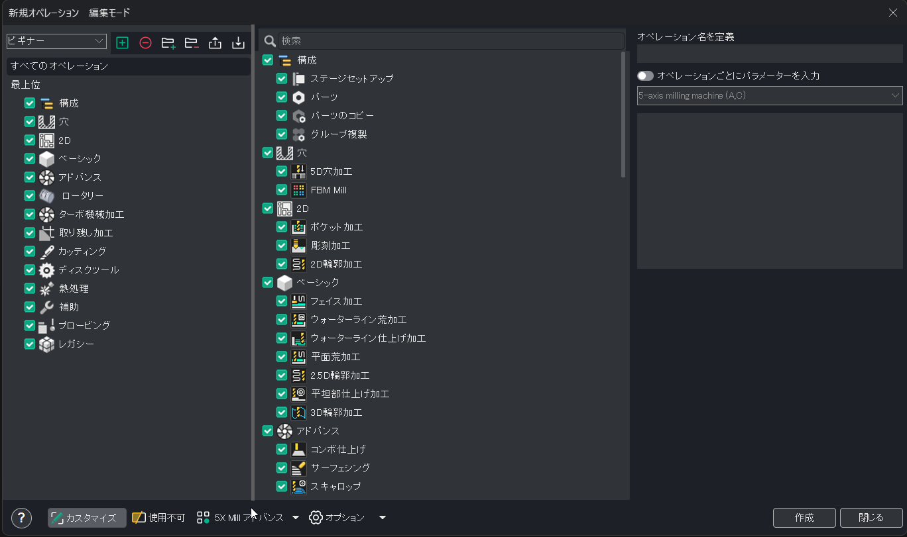

<strong>設定を作成</strong> 新しい設定を作成します。現在の設定のすべての設定がコピーされ、新しい設定として追加されます。

<strong>設定を削除</strong> 現在選択されている設定を削除します。なお、一覧に最後に残っている設定は削除できません。

<strong>グループ追加</strong> 新しいオペレーショングループを追加します。追加したグループは、「オペレーション作成」ドロップダウンメニューのサブメニューとして利用できます。グループ名をクリックすると名称を変更できます。また、オペレーションを任意のグループへドラッグ＆ドロップで移動できます。

<strong>グループ削除</strong> 選択したオペレーショングループを削除します。

<strong>現在の設定をエクスポート</strong> 現在の設定を外部ファイルとしてエクスポートします。エクスポート時には ZIP アーカイブ が作成されます。また、インスペクターのユーザーデフォルト設定もあわせてエクスポートされます<strong>。</strong> [詳細を見る](100159.md)

<strong>現在の設定をインポート</strong> 現在の設定をシステムにインポートします。

<strong>独自の設定を作成する例</strong>

まず、<strong>設定を作成</strong>を作成します。作成すると、構成一覧に 「新しい設定」 という名前の構成が追加されます。

すべてのグループを無効にします。

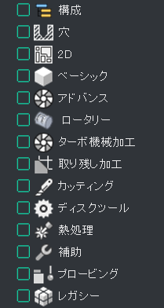

ツールバーの 「<strong>グループを追加</strong>」 を使用して、新しいグループを作成します。作成したグループ名を <strong>「</strong> Mill Quickly<strong>」</strong> に変更します。

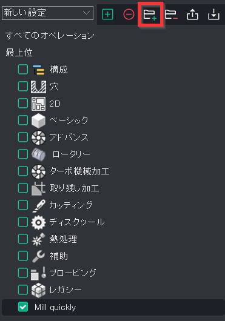

必要なオペレーションをドラッグ＆ドロップして、このグループへ追加します。

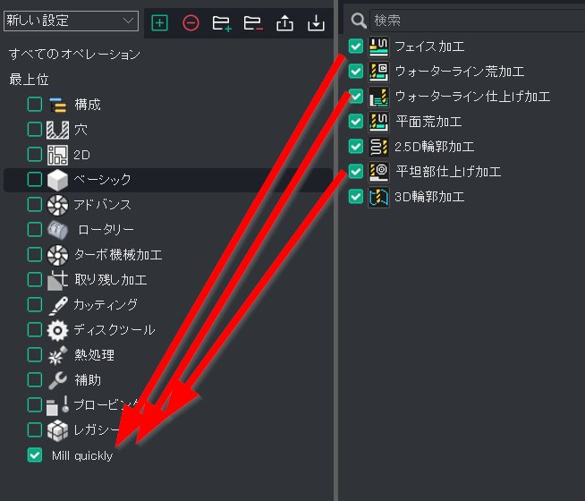

<strong>カスタマイズ</strong>ボタンをクリックすると、作成したオペレーショングループを含む設定が、<strong>オペレーション作成ウィンドウ</strong>に反映されます。

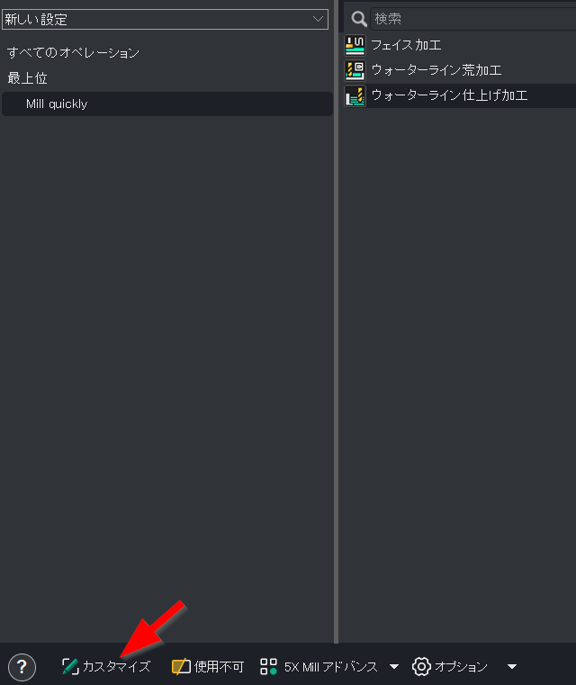

ドロップダウンリストにも表示されます。

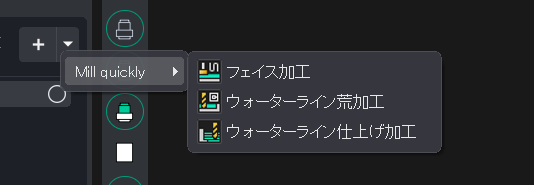

設定名は任意の名前に変更できます。

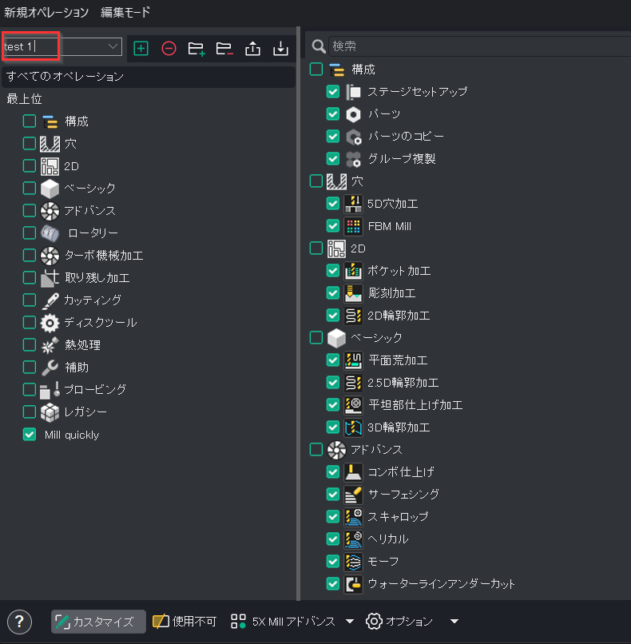

<strong>利用不可</strong> 現在利用できないオペレーションを表示します。オペレーションは、機械タイプまたはライセンスの有無により利用できない場合があります。

拡大

利用できない理由は、右パネルに表示されます。

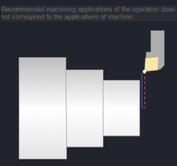

<strong>オペレーションプリセット</strong> 加工用にあらかじめ設定されたオペレーションを表示します。( Express、カッティング、 5Dカッティング、 2.5X Mill、 3X Mill、 3X Mill アドバンス、 ロータリー、 5X Mill、 5X Mill アドバンス)

<strong>オプション</strong> 各種オプションを有効にできます。

拡大

利用可能なオプションの中には、<strong>割出</strong><strong>モード</strong>があります。

ユーザーが対応ライセンス（例：<strong>3X Mill アドバンス</strong>）を保有しており、このオプションが有効（ON）になっている場合、作成されるオペレーションの<strong>セットアップタブ</strong>に<strong>ローカル座標系</strong>パラメータが表示されます。 [詳細を見る](1022.md) これにより、割出モードでの加工が可能になります。

このオプションが<strong>オフ</strong>の場合<strong>、</strong><strong>ローカル座標系</strong>パラメータは表示されません。

また、このオプションは次のパラメータにも影響します。

- <strong>安全動作近似</strong>
- <strong>安全サーフェス（円筒、球体）</strong>
- <strong>ロータリー変換</strong>

