# Neue Operation erstellen

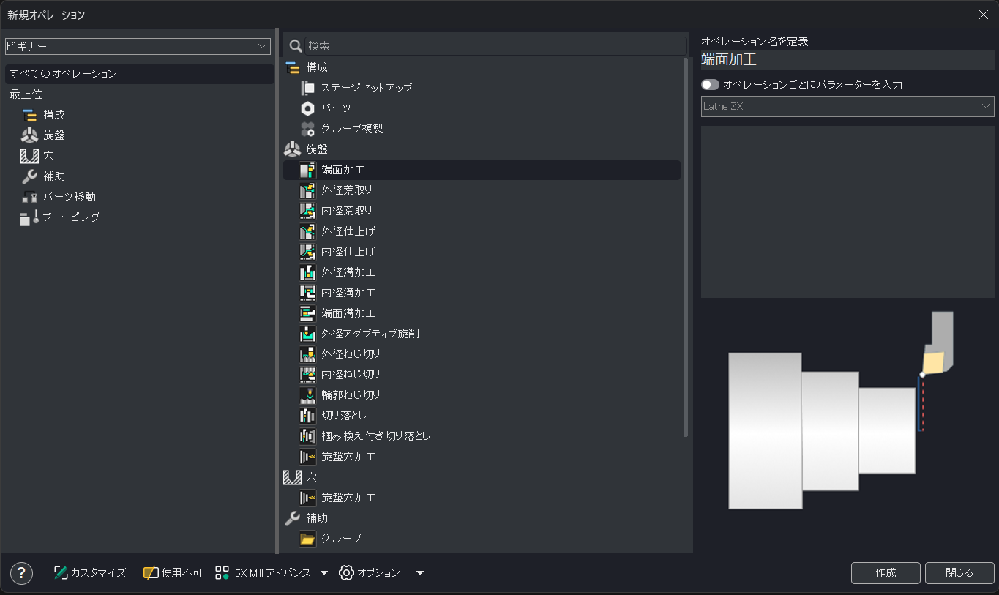

## Anwendungsbereich:

Im Erstellungsfenster können Bearbeitungsoperationen gesucht, ausgewählt und vor dem Hinzufügen zum Projekt eingerichtet werden.

Es stehen zwei Vorgehensweisen zur Verfügung:

- Das Erstellungsfenster eignet sich besonders für die Einarbeitung.

Weitere Informationen anzeigen

Öffnen Sie es mit .

Das Fenster zeigt zusätzliche Informationen zu den Operationen und erleichtert damit die Auswahl.

Eine Operation kann auf zwei Arten angelegt werden:

- Doppelklicken Sie auf den gewünschten Operationstyp. Die Operation wird hinzugefügt und das Fenster bleibt geöffnet.
- Wählen Sie den Typ und klicken Sie auf **Create**. Die Operation wird erstellt und das Fenster geschlossen.

- Das Schnellmenü eignet sich für erfahrene Anwender.

Weitere Informationen anzeigen

Klicken Sie auf den Pfeil neben  und wählen Sie den gewünschten Operationstyp direkt im Menü.

Dadurch entfällt das wiederholte Öffnen und Schließen des Erstellungsfensters.

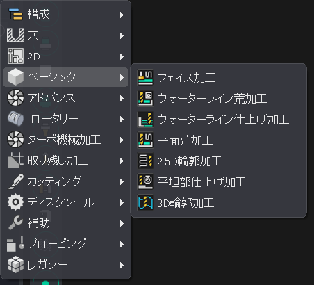

Das Erstellungsfenster besitzt drei Bereiche:

- Links: Operationsgruppen zur Auswahl einer Kategorie.
- Mitte: Operationen der ausgewählten Gruppe.
- Rechts: Informationen zur markierten Operation.

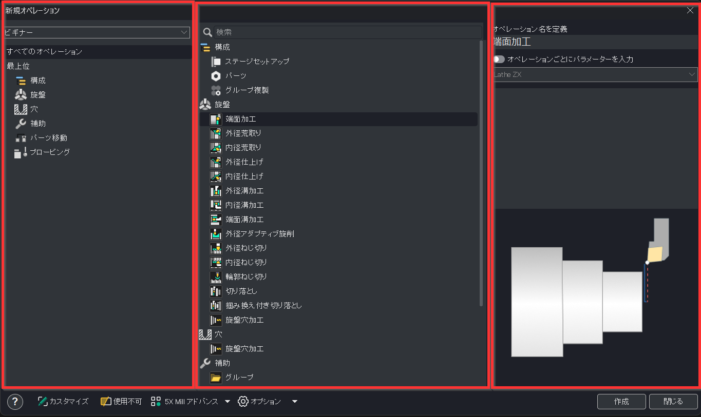

### Rechter Bereich.

Hier stehen folgende Informationen und Einstellungen zur Verfügung:

**Operationsname.** Unter **Define the operation name** kann der Name vorgegeben werden.

**Einstellungen übernehmen.** **Fill parameters by operation** kopiert Parameter aus einer vorhandenen Operation, die in der Liste ausgewählt wird.

**Erläuternde Abbildung mit Video.** Ein Klick auf die Abbildung unten startet oder stoppt die Videowiedergabe.

### Symbolleiste.

Die untere Symbolleiste steuert die im Fenster angezeigten Inhalte:

**Hilfeschaltfläche.** Öffnet die Hilfe zu diesem Thema.

**Customize…** Legt fest, welche Operationen und Gruppen im Fenster und im Menü **Create operation** erscheinen.

Weitere Informationen anzeigen

Im Anpassungsmodus stehen folgende Funktionen zur Verfügung:

- Schaltflächen und Kontrollkästchen neben Gruppen und Operationen steuern deren Sichtbarkeit.
- Operationen können per Drag-and-drop zwischen Gruppen verschoben werden.
- Gruppen werden über die Schaltflächen oben angelegt oder entfernt.
- Ein Klick auf einen Gruppennamen ermöglicht dessen Änderung.
- Gruppen können per Drag-and-drop umgeordnet oder ineinander verschachtelt werden.

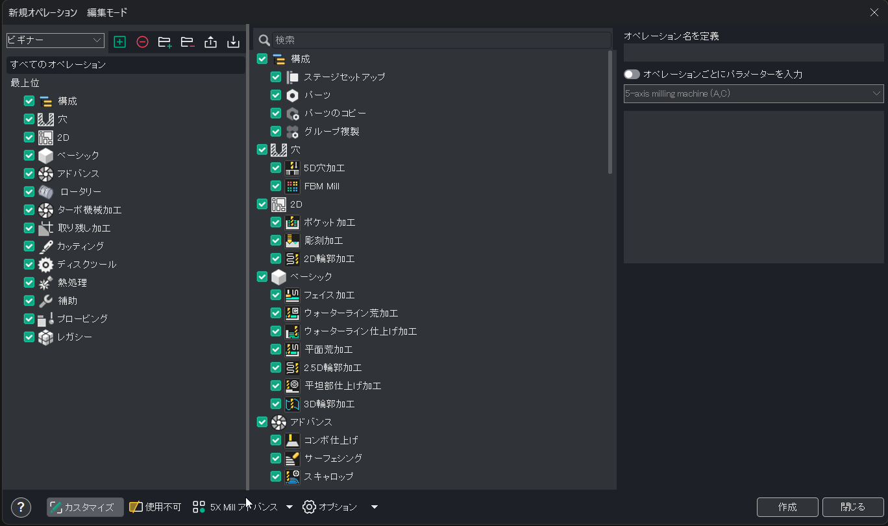

**Create configuration.** Erstellt eine Konfiguration als Kopie der aktuellen Einstellungen.

**Remove configuration.** Entfernt die aktuelle Konfiguration. Der letzte verbleibende Eintrag kann nicht entfernt werden.

**Add group.** Erstellt eine Operationsgruppe und damit ein Untermenü in **Create operation**. Der Name kann durch Anklicken geändert werden; Operationen werden hineingezogen.

**Remove group.** Entfernt die ausgewählte Gruppe.

**Export current configuration.** Exportiert die Konfiguration als ZIP-Archiv. Auch die Benutzervorgaben des Inspektors werden übernommen. [Details](100159.md)

**Import current configuration.** Importiert eine Konfiguration in das System.

**Beispiel einer eigenen Konfiguration:**

Erstellen Sie zunächst eine Konfiguration. Sie erscheint mit dem Namen **New Configuration**.

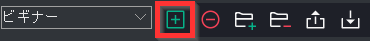

Deaktivieren Sie alle Gruppen.

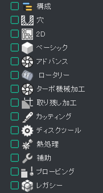

Erstellen Sie mit **Add Group** eine Gruppe namens **Mill Quickly**.

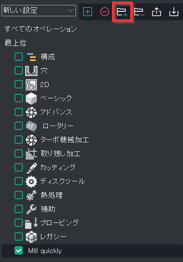

Ziehen Sie die gewünschten Operationen in diese Gruppe.

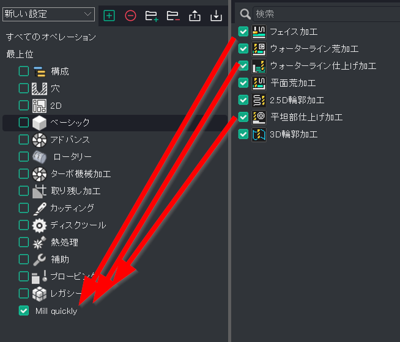

Klicken Sie auf **Customize…**, um zur normalen Ansicht zurückzukehren. Die eigene Gruppe wird im Erstellungsfenster angezeigt.

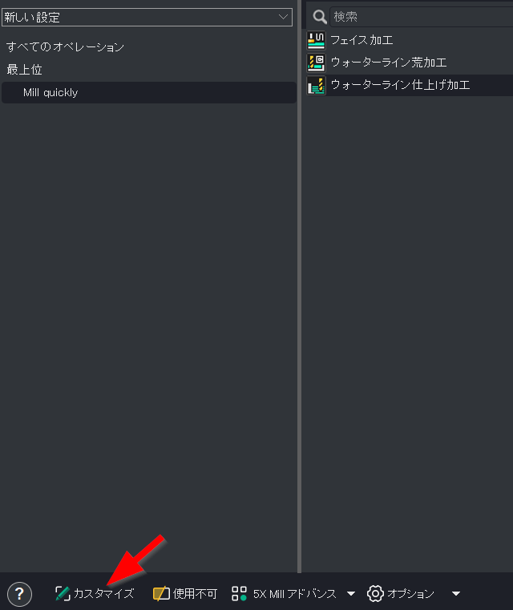

Sie erscheint auch im Dropdown-Menü.

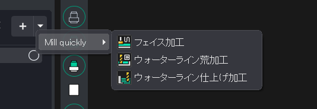

Die Konfiguration kann umbenannt werden.

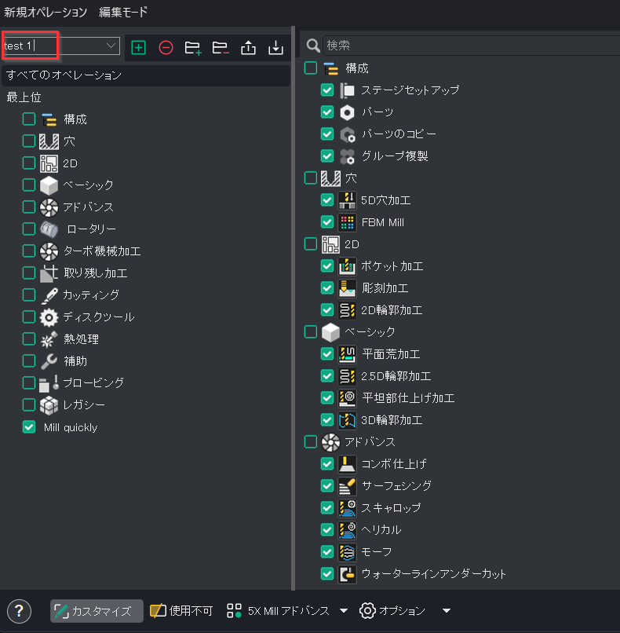

**Unavailable.** Blendet derzeit nicht verfügbare Operationen ein. Gründe können Maschinentyp oder fehlende Lizenz sein.

Weitere Informationen anzeigen

Der Grund für die fehlende Verfügbarkeit wird rechts angezeigt.

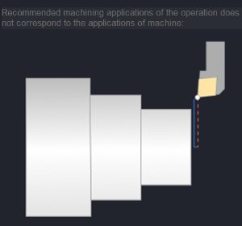

**Operation preset.** Wählt eine Operationszusammenstellung: Express, Cutting, Cutting 5D, 2.5X Mill, 3X Mill, 3X Mill Advanced, Rotary, 5X Mill oder 5X Mill Advanced. Die Auswahl bestimmt die angezeigten Gruppen und Operationen.

**Options.** Aktiviert zusätzliche Optionen.

Weitere Informationen anzeigen

Hier steht unter anderem **3+2 mode** zur Verfügung.

Bei geeigneter Lizenz, beispielsweise 3X Mill Advanced, und aktiviertem 3+2-Modus wird **Local CS** auf der Registerkarte **Setup** neuer Operationen eingeblendet. Dies ermöglicht indexierte 3+2-Bearbeitung. [Details](1022.md)

Bei deaktivierter Option wird **Local CS** nicht angezeigt.

Die Option beeinflusst außerdem:

- **Approximate safe motions**;
- **Safe surface** mit Cylinder und Sphere;
- **Rotary Transformations**.

