# 適用分野:

以下は、CAMシステムの現行バージョンに実装されているオペレーションの一覧です。

| <strong>[構成](1023.md)</strong> |   |
|---|---|
| [セットアップステージ](1024.md) |   |
| 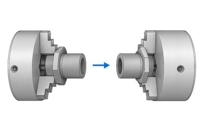 | このグループは、パーツが固定位置に保持される製造工程のステージを定義するためのものです。前のセットアップで使用したパーツ、ワーク、およびその他のオブジェクトを非表示にすることで、前のセットアップが後続のセットアップに干渉することなく、パーツをさまざまな方向から加工できます。このグループ内では、サブプロジェクト（パーツ、パーツのコピー）で考慮される治具を追加できます。 |
|   |   |
| [パーツ](1025.md) |   |
| 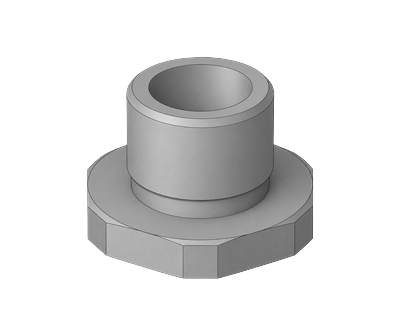 | このグループは、複数の異なるパーツまたは標準パーツを、技術に基づくオペレーション単位（コンベヤ方式に類似）に分けた多パーツプロジェクトを作成するために使用します。このグループの［セットアップ］タブでは、装置上でのパーツ配置、パーツ座標系など、プロジェクトの主要パラメータを設定します。また、ツールパス座標を変換するための変換セットも利用できます。 |
|   |   |
| [パーツのコピー](1026.md) |   |
| 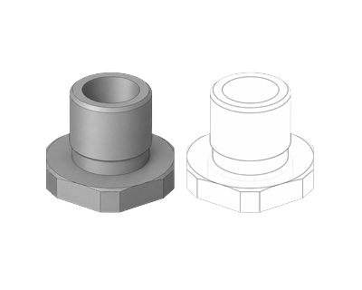 | 複数の同一パーツを含むプロジェクトを準備するための特殊なグループです。通常は、必要なオペレーションを持つ原型パーツを作成し、その原型をテンプレートとして「パーツのコピー」を作成します。コピーは原型と同期され、コピー内でオペレーションを追加または削除することはできません。原型でオペレーションを作成または削除すると、すべてのコピーで対応するオペレーションのコピーが自動的に作成または削除されます。コピー側ではツールパスを独自に計算せず、原型のツールパスをコピーの位置に適用します。原型の計算をリセットした場合は、コピーを手動で再計算する必要があります。ポストプロセッサが対応している場合、コピー出力はサブルーチン呼び出しで構成できます。「パーツのコピー」の［セットアップ］タブでは、コピーの位置、ワーク、座標系を指定します。 |
|   |   |
| [グループ複製](1027.md) |   |
| 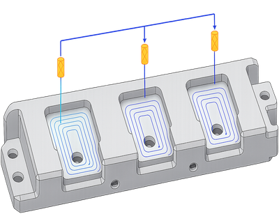 | パスのコピー方法を定義するグループで、その規則はグループ内のオペレーションに継承されます。これにより、各オペレーションで部品の個々の形状要素を加工しながら、グループが定義済みの規則に従って結果をすべての標準形状へ自動展開できます。コピーは［変換］タブの規則に従って実行されます。 |

| <strong>[旋盤](10175.md)</strong> |   |
|---|---|
| [端面加工](307.md) |   |
| 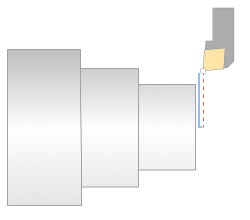 | <strong>端面加工</strong>オペレーションは、ワークの不均一な端面（左側または右側）を整えるためのものです。工具を垂直方向に移動させ、材料を層ごとに除去します。現在のワークと部品に基づいて端面加工用のツールパスを自動生成します。荒加工と仕上げ加工の両方に使用でき、穴あけやその他の旋削サイクルの前によく使用されます。 |
|   |   |
| [外径、内径荒取り](316.md) |   |
| 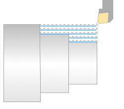 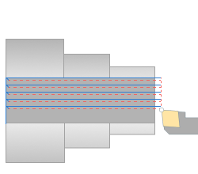 | ワークの大部分を除去するためのオペレーションです。ワーク形状と部品形状が大きく異なる場合に使用できます。平行な工具移動を連続して行い、短時間で大量のワーク材を除去します。 |
|   |   |
| [外径、内径仕上げ](310.md) |   |
| 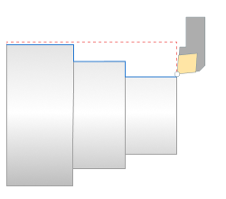 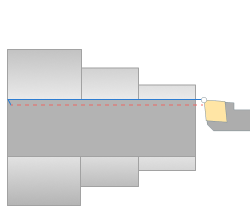 | 最終仕上げ加工用のオペレーションです。部品の母線に沿ったオフセット移動で加工します。部品とワークの差が小さい場合に最良の結果を得られます。ワーク照合を行わずにツールパスを生成することもでき [4軸旋削](10202.md)にも対応します。 |
|   |   |
| [外径、内径溝加工、端面加工](312.md) |   |
| 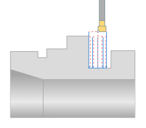 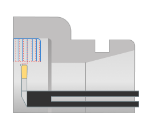 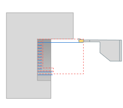 | 溝や、他の旋削オペレーションでは加工できない領域を加工するためのオペレーションです。溝入れ工具が前面で切削できる能力に応じてツールパスを生成します。ワーク材を除去する荒加工パスと形状を仕上げる仕上げパスを組み合わせることができます。複数層に分け、異なる加工方法と切削方向で材料を除去でき、切りくず分断やドウェルも設定できます。 |
|   |   |
| [アダプティブ荒取り（旋盤）](10205.md) |   |
| 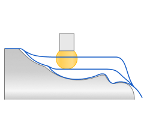 | 工具負荷を一定に保ちながら、最適化された滑らかなツールパスを生成するアダプティブ荒旋削オペレーションです。工具寿命を延ばし、切削速度を大幅に向上させます（従来の溝入れ加工の2倍以上の速度）。ウォーターライン荒加工に似たアダプティブ方式を使用し、丸チップ工具向けに設計されています。 |
|   |   |
| [外径、内径ねじ切り加工](319.md) |   |
| 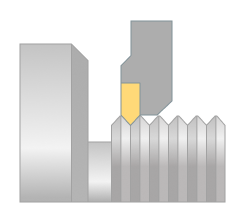 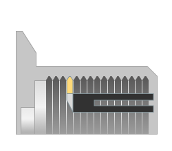 | 旋削工具またはねじ切りチェーサで各種ねじを加工するためのオペレーションです。ISOまたはインチ規格のデータベースからねじパラメータを選択でき、特殊ねじ用に手動設定することもできます。加工は複数ストロークで実行でき、進入、切込み、退避、戻りには複数の方式を利用できます。 |
|   |   |
| [輪郭ねじ切り加工](10199.md) |   |
| 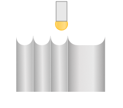 | <strong>輪郭ねじ切り</strong>オペレーションでは、工具形状とは異なるプロファイル形状のねじを形成できます。ねじ溝全体の材料を連続した複数パスで除去し、各パスの配置は工具形状とねじ溝形状に基づいて計算されます。 |
|   |   |
| [切り落とし](313.md) |   |
| 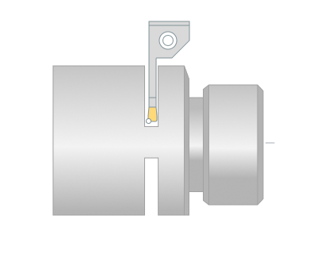 | 追加の面取りまたは丸め加工を行いながらパーツを切り離します。溝幅、チップ切断パラメータ、ドウェル値を設定できます。 |
|   |   |
| [掴み換え付き切り落とし](1060.md) |   |
| 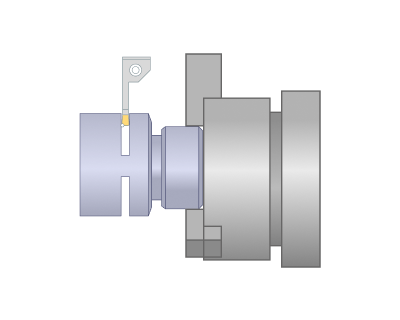 | <strong>掴み換え付き切り落とし</strong>オペレーションは、加工済みパーツを残りのワークから切り離しながら、端面（面取りまたは丸めを含む）を同時に形成します。切断領域は、あらかじめ溝を加工するなどして準備できます。標準の旋削突切りと異なり、オペレーション完了時にワークを別の主軸へ受け渡します。 |
|   |   |
| [旋盤穴加工](10176.md) |   |
| 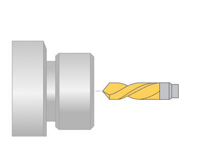 | 軸方向の穴を加工するNC指令を生成するオペレーションです。単純穴あけ、チップ切断または排出を伴う深穴加工、タップによるねじ切りなどのサイクルに対応します。サイクル出力は、個別指令または固定サイクルから選択できます。 |

| <strong>Holes</strong> |   |
|---|---|
| [穴加工](10100.md) |   |
| 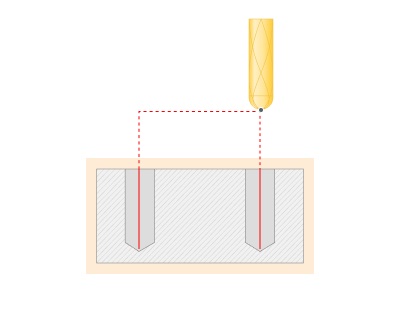 | 穴加工用の一連の指令を作成します。穴あけ、ボーリング、センタリング、タップ、ねじ切りミルなどに対応します。通常の穴加工だけでなく、ポケット加工やウォーターライン荒加工で工具をプランジする位置の予備穴加工にも使用できます。軸が同一平面に垂直でない穴など、異なる向きの穴も加工でき、直交平面上にない穴にも対応します。 |
|   |   |
| [FBM Mill](10089.md) |   |
| 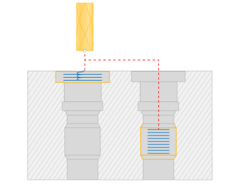 | FBM Mill 加工を作成すると、システムがパーツ内の既知の加工フィーチャーを自動認識し、FBMプロシージャライブラリから定義済みまたは保存済みの加工手順を選択できます。認識されたフィーチャーに必要なオペレーションを自動生成し、工具交換の最小化など、現在の規則に従って整理します。 |

| <strong>2D</strong> |   |
|---|---|
| [ポケット加工](256.md) |   |
| 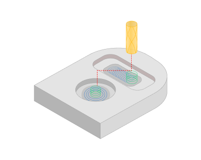 | 定義された領域またはポケット内部の材料を、等高線方式で除去します。ポケット領域の形状は、水平（XY）平面上に作成した曲線から形成されます。ポケットや独立領域の2D／2.5D加工、および彫刻（2D仕上げ）前の予備除去に使用します。 |
|   |   |
| [彫刻](810.md) |   |
| 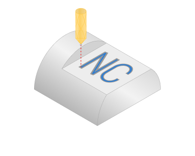 | 平面上の2D形状や文字を彫刻するためのオペレーションです。彫刻画像は、曲線を水平（XY）平面へ投影して形成します。工具の水平移動でモデル側面の主要部分を加工し、鋭い内角や狭い領域には3Dフライス加工を使用します。平面図形や文字の彫刻、ポケット側壁の仕上げパス、2D／2.5D加工における独立領域の加工に利用します。 |
|   |   |
| [2D 輪郭](404.md) |   |
| 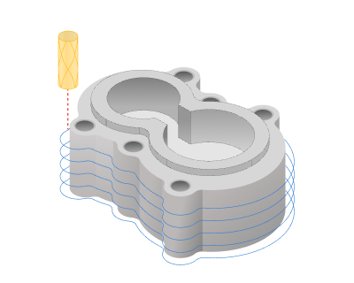 | 水平輪郭、または水平面に投影した曲線を加工します。工具の水平移動は加工形状に基づいて作成され、工具中心または工具外周を輪郭に沿わせることができます。垂直側面を持つ部品の作成や、一定のZ深さでの加工パスなどに使用します。 |

| <strong>[2.5D](769.md)</strong> |   |
|---|---|
| [2.5D 輪郭](10115.md) |   |
| 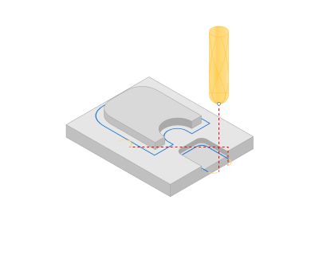 | <strong>2.5D</strong><strong>輪郭</strong>オペレーションは、多段階の部品輪郭を加工する機能を拡張します。異なる高さにある閉じたプロファイルで囲まれた平坦領域から成るモデルを対象とし、複数の水平パス（層）で加工します。パス数とZ高さは、オペレーションパラメータの加工深さとステップによって決まります。 |

| <strong>[3D エントリー](10116.md)</strong> |   |
|---|---|
| [フェイス加工](10117.md) |   |
| 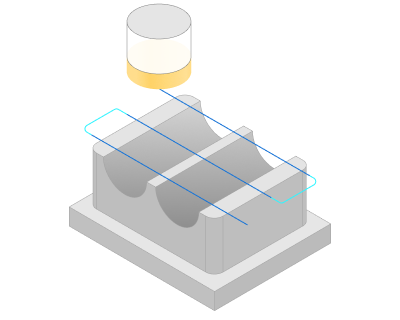 | <strong>フェイス加工</strong>オペレーションは、指定した水平面上の材料を、次のいずれかの方式で除去します 一方向 ジグザグ 最適化ジグザグ 渦巻き |
|   |   |
| [ウォーターライン荒加工](736.md) |   |
| 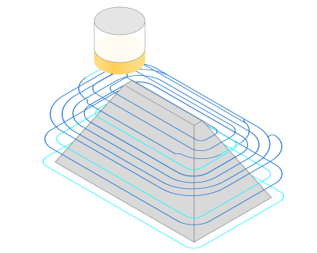 | 3Dモデルの外側にあるワーク材を等高線方式で除去します。ポケット加工と同様に、材料の主要部分は[工具](37.md)の水平（XY）移動で除去します。ワークとの差が大きい複雑なモデルの初期荒加工によく使用します。 |
|   |   |
| [ウォーターライン仕上げ](841.md) |   |
| 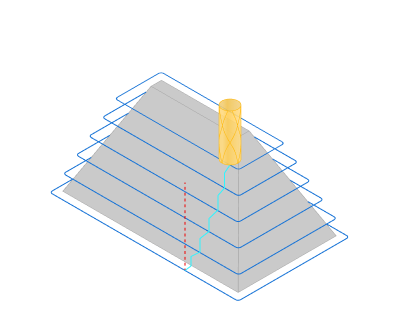 | 立体モデルのサーフェスをウォーターラインで加工します。工具の水平移動によってフライス加工を行い、主なサーフェスが垂直に近いモデルまたはその一部で良好な結果が得られます。複雑なモデルでは、平面加工またはドライブ加工と併用することを推奨します。 |
|   |   |
| [平面荒加工](735.md) |   |
| 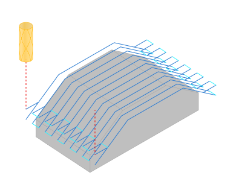 | 3Dモデル外側のワーク材を平面状に除去します。断面は互いに平行な垂直面に配置されます。工具への負荷を抑えるため、あらかじめ設定した小さなZ切込みで加工できます。同等のパラメータを持つウォーターライン加工よりも、仕上がり形状を完成モデルに近づけやすい方式です。元モデルとの差が小さい荒加工ワークを得たい場合や、軟質材料のフライス加工に適しています。 |
|   |   |
| [平面仕上げ](713.md) |   |
| 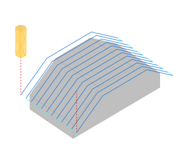 | 立体モデルのサーフェスを平面状に加工します。パスは互いに平行な垂直面上に配置されます。平坦部だけでなく、ツールパスに直交し垂直に近い領域でも良好な結果が得られます。複雑形状モデルでは、ウォーターライン加工または最初のオペレーションと直交するツールパスを持つ別の平面加工と組み合わせるのが最適です。 |
|   |   |
| [平坦部](759.md) |   |
| 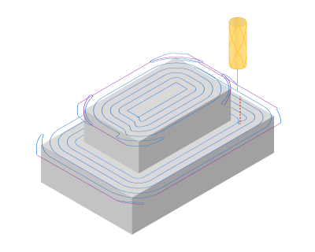 | パーツの水平な平坦面を仕上げ加工します。平坦領域は自動認識され、ツールパスは一連の水平パッチで構成されます。加工中の食い込みを防ぐため、モデル内の非水平領域もすべて確認されます。 |
|   |   |
| [平面最適化](714.md) |   |
| 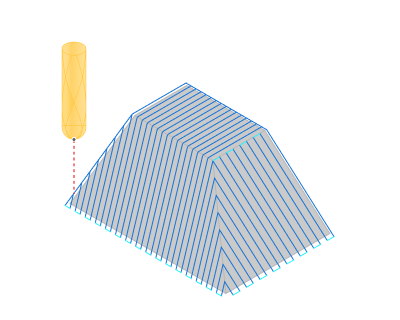 | 3Dパーツのサーフェス加工用に、ツールパスが互いに直交する2つの平面加工オペレーションを同時に作成します。各オペレーションが最適な結果を得られるモデルサーフェスだけを加工するよう既定パラメータが設定され、モデルサーフェス全体で均一な加工品質が得られます。複雑なサーフェス形状のモデルを高品質に加工し、加工時間も短縮できます。 |
|   |   |
| [複合仕上げ](839.md) |   |
| 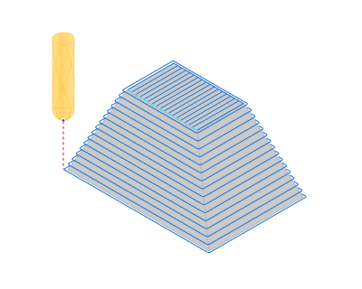 | 3Dモデルのサーフェス加工用に、平面加工とウォーターライン加工の2つを作成します。平坦部は平面加工、垂直に近い領域はウォーターライン加工となるようパラメータが自動設定され、加工面全体で均衡の取れた品質が得られます。工具負荷を抑えられるため、より細径で長い工具を使用でき、あらゆるサーフェス角度を高品質に加工しながら加工時間も短縮します。 |
|   |   |
| [3D 輪郭](700.md) |   |
| 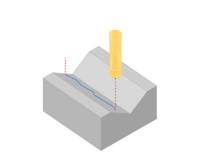 | 自由曲線に沿った一連の工具移動を生成します。平面上のツールパスは2D輪郭加工に似ており、工具中心または工具外周が輪郭に沿うよう移動します。各点のZ座標は、曲線上の対応点のZ座標を基準とする変位として計算されます。金型部品のエッジ加工や複雑形状の溝加工などに使用できます。 |

| <strong>3D/5D アドバンス</strong> |   |
|---|---|
| [スキャロップ](10118.md) |   |
| 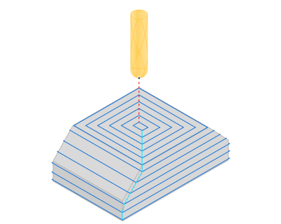 | <strong>スキャロップ</strong>（3D一定ピッチ）ツールパスは、サーフェス上の曲線から開始し、曲線が収束するまで内側へ繰り返しオフセットします。サーフェス全体で一定のピッチを保ち、複雑な金型や自由曲面モデルの高速加工に適しています。 主な機能: ツールパスを非常に高速に計算します。 進入・退出は各1回。部品全体を、進入点と退出点が1つずつの連続したスパイラル状ツールパスで加工できます。 高速加工。コーナーを丸めたツールパスを生成できます。 |
|   |   |
| [3D ヘリカル](10119.md) |   |
| 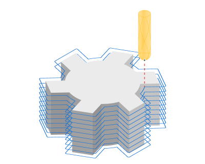 | <strong>3D</strong><strong>ヘリカル</strong>加工は、アンダーカットのない円筒形部品の加工に適しています。ジョブ割り当てにはモデル全体を選択します。 モデル全体に対して単一パスのらせん状ツールパスを生成できます。移行なしでは加工できない領域は、現在のパス加工後に処理されます。スキャロップ高さは制御せず、均一な高さ変化も保証しません。 |
|   |   |
| [モーフ](10138.md) |   |
| 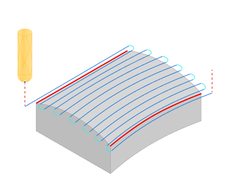 | <strong>モーフ</strong>オペレーションは、指定した2本の曲線間を滑らかに変形するツールパスを高速リンク付きで生成します。平行、直角、らせんの各方式を使用できます。 3～5軸ツールパスに対応し、工具軸方向は固定、ドライブ曲線法線4D、回転軸、ドライブ曲線5D、サーフェス5Dから選択できます。 利点：タービンホイール、タービンブレード、スクリュー、複雑な流路など、多様な加工に使用でき、高速リンクにも対応します。 |
|   |   |
| [5D サーフェーシング](10135.md) |   |
| 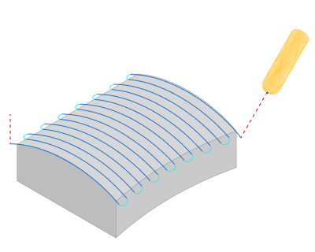 | 平面に平行、カーブに平行、モーフなど多様な方式と、固定、面法線、回転軸方向、指定点通過、指定曲線通過などの工具軸方向を用いて、サーフェスモデルを仕上げ加工します。 |
|   |   |
| [ウォーターラインアンダーカット](100150.md) |   |
| 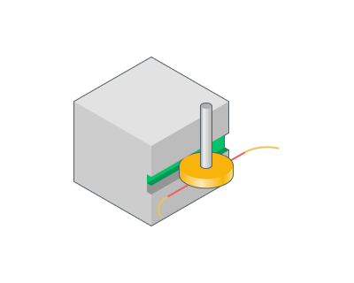 | <strong>ウォーターラインアンダーカット</strong>オペレーションは、アンダーカット用フライス工具で凹部、溝、空洞を作成するためのもので、アンダーカット工具専用のウォーターラインを生成します。 |
|   |   |
| [スワーフ](1040.md) |   |
| 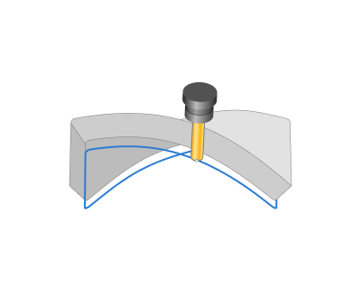 | <strong>スワーフ</strong>オペレーションは、工具側面を使用して複雑なガイド面を加工する5軸オペレーションです。主に仕上げ用ですが荒加工パスにも対応し、ツールパスに沿ったベクトルによる自動または手動の工具傾斜を設定できます。加工領域の定義方式は次の2つです。 下エッジ 2つのカーブで |
|   |   |
| [複合軸](102025.md) |   |
| 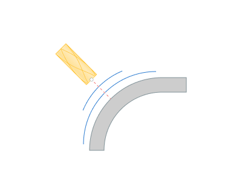 | 5軸荒加工のロジックに基づき、曲面底を持つポケットを加工するための専用5軸荒加工オペレーションです。「底面」（通常はポケット底）を割り当て、閉じた加工領域（ジョブゾーン）内で動作します。 |
|   |   |
| [5Dメッシュ加工](10142.md) |   |
| 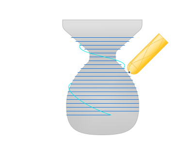 | 複雑形状および三角形メッシュ（メッシュ／STL）向けの汎用5軸仕上げオペレーションです。彫刻物、スキャンモデル、複雑曲面の仕上げに適し、スキャロップ、3Dヘリカル、ウォーターライン状のパターン、自動／手動の工具軸方向、および工具ホルダーの自動衝突回避に対応します。 |
|   |   |
| [6D 輪郭](10129.md) |   |
| 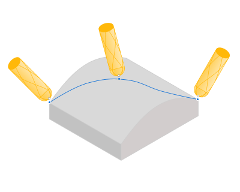 | 空間曲線および曲面に対し、拡張された工具軸方向方式と回転軸制約管理を用いて、連続した多波形ツールパスを生成します。 |
|   |   |
| [インペラ加工](1041.md) |   |
| 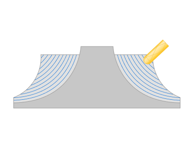 | <strong>インペラ加工</strong>オペレーションは、ブリスクとインペラを効率的に5軸加工するためのものです。ワークの荒加工、ブレードとハブの仕上げ、フィレットの研削・仕上げ方式を含みます。工具、ホルダー、ワークの衝突チェックに対応し、ブレード面、ハブ面（回転面であること）、シュラウド面を加工領域として正確に指定できます。 |

| <strong>[4D ロータリー](10124.md)</strong> |   |
|---|---|
| [ロータリーウォーターライン](10143.md) |   |
| 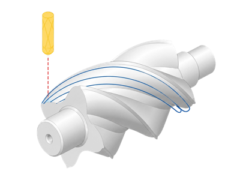 | ロータリー加工オペレーションは、カムシャフト、クランクシャフト、ウォーム軸、羽根、装飾部品などの加工に使用します。機械に連続回転軸が1軸以上ある場合に利用できます。 |
|   |   |
| [ロータリー荒加工](10137.md) |   |
| 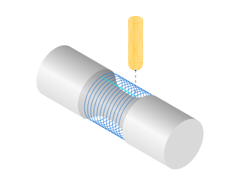 | <strong>ロータリー荒加工</strong>は、ワーク材を層ごとに除去する4軸ツールパスです。ウォーターライン荒加工に似ていますが、加工層は平面ではなく回転軸を中心とする円筒面です。 |
|   |   |
| [ロータリー仕上げ](10136.md) |   |
| 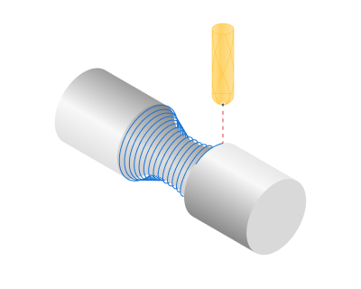 | 同時回転軸を1軸以上持つ機械向けの4軸仕上げオペレーションです。軸物や回転体（カムシャフト、クランクシャフト、ウォームギヤ、ブレード、装飾部品など）の仕上げに使用します。 |
|   |   |
| [4Dモーフ](10146.md) |   |
| 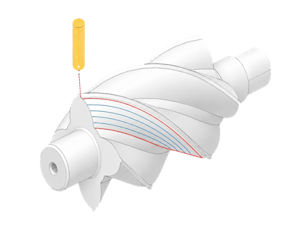 | 同時回転軸を持つ機械（4軸・5軸構成）向けに調整したモーフの4軸仕上げ版です。指定した2本の曲線間、または選択した加工面の接触曲線間に滑らかなツールパスを生成し、品質向上用の同期線と、平行・直角・らせんなどのモーフ方式に対応します。 |
|   |   |
| [4D サーフェーシング](10145.md) |   |
| 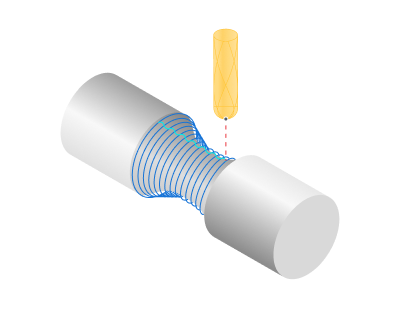 | 同時回転軸を持つ機械（4軸・5軸構成）向けに、5Dサーフェス加工を調整した仕上げオペレーションです。明確な回転軸を持つ、または軸方向に延びる複雑なサーフェスの仕上げ用に設計されています。サーフェスパスを生成し、カーブに平行、2つのサーフェス間のモーフ、2つのサーフェス間のスパイラルなどの方式に対応するとともに、工具軸方向を制御できます。ただし、5D方式の一部である通過点、通過カーブ、ツールパス直交は使用できません。 |
|   |   |
| [4D 輪郭](10144.md) |   |
| 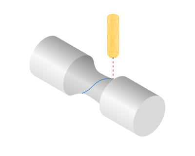 | <strong>4D</strong><strong>輪郭加工</strong>オペレーションは、明確な回転軸を持つ表面、または軸方向に押し出されたサーフェス上の空間曲線を加工するための連続ツールパスを生成します。選択した曲線に沿う単一パス、サーフェスの等パラメータ線に沿う複数パス加工、および曲線に沿う多段加工に対応します。 |

| <strong>[取り残し加工](727.md)</strong> |   |
|---|---|
| [コーナー仕上げ](10121.md) |   |
|  | 前工程の工具径をパラメータとして、前の工具では削り残す領域にパスを生成します。 |
|   |   |
| [ペンシル](10120.md) |   |
|  | パーツの内コーナーに沿って残り加工パスを生成します。 |
|   |   |
| [面取り](10123.md) |   |
|  | 面取りオペレーションは、部品エッジに面取りやフィレットを作成したり、ばりを除去したりするために使用します。フラットエンド、ブル、ボールエンド工具によるツールパスを生成し、鋭利なエッジの鈍化やばり取りなど、通常は最終工程で使用します。 |

| <strong>[カッティング](10224.md)</strong> |   |
|---|---|
| [ジェット加工](326.md) |   |
|  | シートから部品を切り出すためのオペレーションです。外周および穴の輪郭は、閉じた曲線または開いた曲線で定義できます。工具を部品輪郭に沿って移動させ、先に穴を切断してから外周を切断します。 |
|   |   |
| [4D ジェット加工](10225.md) |   |
|  | <strong>4D</strong><strong>ジェット加工</strong>は、水、レーザー、プラズマなど、工具が噴流またはビームである切断に使用できます。単純形状だけでなく傾斜側面を持つ複雑形状も加工できます。加工輪郭はワイヤ放電加工と同様に設定しますが、生成パスは「点＋法線」または「点＋機械回転軸」の形式になります。 |
|   |   |
| [5D ジェット加工](10226.md) |   |
|  | <strong>5D</strong><strong>ジェット加工</strong>は、形状を持つ空間曲面上の切断用です。 [5D 輪郭](10129.md)を基に、この用途では不要な複数パス加工機能を除いたものです。 |
|   |   |
| [2D ナイフ切断](10241.md) |   |
|  | <strong>2D</strong><strong>ナイフ切断</strong>は、ナイフ、帯のこ、丸のこなどの工具でシート材を切断するためのオペレーションです。ツールパスの鋭角部には、ナイフの急旋回による材料の曲がりを防ぐ特殊な遷移を生成します。 [2D 輪郭加工](404.md)を基にしており、直線X・Y・Z軸に加え、工具を回転させる回転軸を機械に必要とします。[ナイフ](10240.md)の使用には、工作機械に追加の要件が必要です。直線軸（X、Y、Z軸）に加えて、工具を回転させるための回転軸を備えている必要があります。 |
|   |   |
| [6D ナイフ切断](10242.md) |   |
|  | <strong>6D</strong><strong>ナイフ切断</strong>は、形状を持つ空間曲面上の切り出し用で、 [5D 輪郭加工](10129.md)を基にしています。鋭角部では材料の曲がりを防ぐ特殊な遷移を生成し、ツールパス各点で刃先を移動方向へ向けます。6自由度が必要なため、機械には少なくとも3直線軸と3回転軸が必要で、産業用ロボットがよく使用されます。 |

| <strong>[ディスク工具](10277.md)</strong> |   |
|---|---|
| [ディスク荒加工](10281.md) |   |
|  | ディスク工具加工グループのオペレーションで、ディスク工具を用いて石材などの素材を準備します。除去領域に一連の切込みを入れ、薄い層を手作業で割り落とした後、通常は適切な工具で仕上げます。 |
|   |   |
| [2D ディスクカッティング](10279.md) |   |
|  | 円形工具（ソー）でシート材を切断するオペレーションです。 |
|   |   |
| [6D ディスクカッティング](10280.md) |   |
|  | <strong>6D</strong><strong>ディスク切断</strong>は、ディスク工具で平面部品および立体部品を切断するためのオペレーションです。 |

| <strong>[ワイヤー放電加工](10244.md)</strong> |   |
|---|---|
| [ワイヤー放電2D輪郭](10246.md) |   |
|  | <strong>ワイヤー放電2D輪郭加工</strong>は、平面輪郭に沿った2D加工、およびワイヤ傾斜角を持つテーパーまたは3D輪郭加工のワイヤー経路を生成します。生成されるワイヤー経路は、同一平面上の輪郭を基にします。 |
|   |   |
| [ワイヤー放電4D輪郭](10247.md) |   |
|  | <strong>ワイヤー放電4D輪郭加工</strong>は、2つの平面輪郭に沿って同時にワイヤー経路を生成します。一方は下側ガイドの移動、すなわち加工（XY）輪郭面を指定し、もう一方は上側ガイドの移動である案内（UV）輪郭を指定します。これにより、ワイヤーの上下端を異なる経路で移動できます。 |

| <strong>[アディティブ](10272.md)</strong> |   |
|---|---|
| [エリアクラッディング](10273.md) |   |
|  | 切削で材料を除去する代わりに、加工中にワークへ材料を付加する積層造形を実現します。高硬度、強度、耐摩耗性、低摩擦性、耐食性、耐熱性などの特性を持つ層を形成でき、高価な部品や工具の寸法復元、ブレード、金型、歯車、軸などの補修にも使用できます。加工領域とパラメータはポケット加工に似ており、3Dモデルの曲線やエッジで肉盛り領域を制限できます。基準面に応じて平面、円筒、回転体上に配置でき、「ツールパスを部品へ投影」を有効にすると任意形状面へ適用できます。領域充填には平行方式とオフセット方式があり、総レイヤー数と壁面角度も指定できます。 |
|   |   |
| [カーブクラッディング](10274.md) |   |
|  | ジョブ割り当て内で定義した曲線に沿って下から上へツールパスを生成する積層オペレーションで、薄肉モデルに適しています。元曲線は平面、円筒、回転体上に配置できます。「ツールパスをパーツに投影」を有効にすると任意形状面へ適用でき、層ごとのパスまたはヘリカルスパイラルを生成できます。 |
|   |   |
| [3D クラッディング](10275.md) |   |
|  | 3Dモデルを入力とする積層オペレーションです。ウォーターライン荒加工に似ていますが、下から上へ処理します。元モデルを層ごとに交差計算し、各レベルの交差領域を埋めるツールパスを生成します。領域充填には平行方式とオフセット方式があります。 |
|   |   |
| [5D クラッディング](10276.md) |   |
|  | <strong>5D</strong><strong>クラッディング</strong>は、3軸または5軸機でサーフェスに材料層を形成します。薄肉モデルに適し、個別サーフェスへの肉盛り後にフライス加工を行えます。高負荷領域への肉盛りによるサーフェス硬化にも使用できます。同じ場所を工具が何度も通過するのを避けるスパイラル方式のほか、平面平行、モーフ、曲線平行の各方式を使用できます。 |
|   |   |
| [非平面スライス](1052.md) |   |
|  | 非平面スライスは、任意の非平面基板上に積層造形パスを作成します。非平面スライサーを使用して非平面の造形パスを生成し、必要に応じて追加パラメータ付きの従来型平面方式にも対応します。 |

| <strong>[溶接](10270.md)</strong> |   |
|---|---|
| [ポイント溶接](20041.md) |   |
|  | スポット溶接に使用し、仮付け溶接と点溶接の両方に対応します。 |
|   |   |
| [6D 溶接](10271.md) |   |
|  | 特定の溶接装置に依存せず、溶接線形状を自動計算します。レーザー、アーク、ガスバーナー、超音波装置などへの個別指令は生成しません。溶接部品間のエッジをジョブ割り当てへ追加すると、溶接ヘッドが隣接壁面の中央に近い位置を保ち、衝突しないよう各曲線点の角度を自動計算します。シミュレーションでは、溶接ヘッド先端が接触する位置への材料付加を確認できます。 |

| <strong>[スプレー](10400.md)</strong> |   |
|---|---|
| [輪郭スプレー](10400.md) |   |
|  | 輪郭スプレーは [6D 輪郭加工](10129.md)を基にしています。ツールパス各点で工具位置をより柔軟に制御したい場合に使用します。 |
|   |   |
| [サーフェススプレー](10400.md) |   |
|  | サーフェススプレーは [5D クラッディング](10276.md) を基にしており、さまざまな方式でサーフェス塗装用ツールパスを作成できます。 |
|   |   |
| [モーフスプレー](10400.md) |   |
|  | モーフスプレーは [モーフ](10138.md)オペレーションを基にしています。 |
|   |   |
| [ロータリースプレー](10400.md) |   |
|  | ロータリースプレーは [ロータリー仕上げ](10136.md)オペレーションを基にしています。 |

| <strong>補助機能</strong> |   |
|---|---|
| [グループ](844.md) |   |
|  | <strong>グループ</strong>は、類似パラメータを持つ複数のオペレーションを体系化するためのものです。グループによりツリー構造のジョブ一覧を作成でき、グループのパラメータを変更すると、含まれるすべてのオペレーションの同種パラメータも変更されます。 |
|   |   |
| グループ複製 |   |
|  | パスのコピー方法を定義するグループで、その規則はグループ内のオペレーションに継承されます。各オペレーションで部品の個別フィーチャを加工しながら、定義した規則に従って結果を標準フィーチャー全体へ自動展開します。コピーは［変換］タブの規則に従います。 |
|   |   |
| [補助オペレーション](10075.md) |   |
|  | <strong>補助オペレーション</strong>は、特定の機械や会社向けのCLData指令列を名前付き一覧として保存し、繰り返し利用するためのものです。チャックの締付け、工具交換、心押台の接近、部品反転、アクティブなワーク座標系G54～G59の設定などに使用できます。 |
|   |   |
| [Gコードベース、Gコードベース旋盤](10379.md) |   |
|  | ジョブ割り当てとして使用するNCテキストと選択したインタープリターに基づいてツールパスを作成します。NCテキストは手入力または外部ファイルから読み込み、必要に応じて編集できます。4軸・5軸マシニングセンターの割出し加工および同時加工にも使用でき、材料層の積み上げを再現する積層造形を含む、すべてのシミュレーション方式に対応します。 これらのオペレーションでは、Gコードによる機械シミュレーションの直接制御、NCプログラムの確認・最適化、異なる制御機間でのNCテキスト変換、独自インタープリター作成時のデバッグを行えます。 |
|   |   |
| 総形工具の作成 |   |
|  | ENCYで総形Mill工具を作成するには、作図モードで工具輪郭を母線として描きます（モデルから曲線を取得するか、スケッチで作成できます）。次に工具一覧を右クリックして［工具として保存］を選択し、形状タイプ、名前、工具構成を指定します。保存後、輪郭は工具ライブラリから選択でき、輪郭／プロファイル加工に使用できます。 |

| <strong>[パーツ移動](10402.md)</strong> |   |
|---|---|
| [ポイントピックアンドプレース](10404.md) |   |
|  | ポイントピックアンドプレースは、ジョブ割り当てを一連の点ノードに基づいて行うピックアンドプレースオペレーションの一種です。点の一覧には、開始点、把持点、移動点（把持点基準）、移動点（配置点基準）、配置点、終了点が含まれ、これらを軌跡の連鎖（把持→移動→配置など）として構成します。 |
|   |   |
| ピックアンドプレース－<strong>レガシー</strong> |   |
|  | <strong>ピックアンドプレース</strong>（汎用ピックアンドプレース）は、グリッパーを制御して機械の作業領域内でワークを移動するオペレーションです。 |
|   |   |
| [バーフィード](10408.md) |   |
|  | <strong>バーフィード</strong>は、バー材を主軸へ最初に送り込むオペレーションです（スイス型旋盤プロジェクトでは最初のオペレーションにする必要があります）。ワークの位置決めと固定、バー突出し量、工具接触位置の設定、初期クランプの制御などを行います。 |
|   |   |
| [サブスピンドルの動作](10407.md) |   |
|  | <strong>サブスピンドル動作</strong>は、サブスピンドルを備えた複合旋盤向けにピックアンドプレースを調整したオペレーションです。このオペレーションでは、次の操作を実行できます。 主軸とサブスピンドルを同期 両方の主軸で後続加工を行うため、サブスピンドルでワークを把持 主軸とサブスピンドルの間でパーツを移動 |
|   |   |
| [掴み換え](10406.md) |   |
|  | <strong>掴み換え</strong>は、主軸間でパーツを受け渡し・受け取るオペレーション（旋削プロジェクト向けピックアンドプレース）です。主軸とサブスピンドルの同期、パーツの受取りまたは返却、プロジェクト内の次のパーツからのワークコネクターとセットアップ座標系の自動取得、突切りオペレーションとの連携、クランプ（CLData）の管理、および移動指令（Multigoto／Goto）の生成を行います。 |
|   |   |
| 次工程へ配置－<strong>レガシー</strong> |   |
|  | <strong>次工程へ配置</strong>は、次のオペレーション（セットアップステージ／部品）から配置位置を取得する特殊なピックアンドプレースです。ロボットおよびフライス盤で使用します。旋削プロジェクトでは、旋削掴み換えの使用を推奨します。 |

| <strong>[プロービング](1410.md)</strong> |   |
|---|---|
| [工具プロービング](1410.md) |   |
|  | <strong>工具プロービング</strong>は、工具の確認と校正を行うサイクル／オペレーションです。工具の長さと半径を測定し、工具の健全性や破損を確認し、工具の初期寸法を校正します。 |
|   |   |
| [パーツプロービング](1410.md) |   |
|  | <strong>パーツプロービング</strong>（ワーク／部品測定）は、ワーク形状を測定するサイクルです。表面や穴の寸法、要素の位置と方向、部品の実際の位置（オフセット／回転補正）、角度などを確認します。 |
|   |   |
| [旋盤工具プロービング](1410.md) |   |
|   | <strong>旋盤工具プロービング</strong>は、旋盤工程で工具を測定・校正するオペレーションです。工具の長さや半径を測定し、工具の健全性や破損を確認して、後続オペレーションの工具補正に使用する実測パラメータを取得します。 |
|   |   |
| [旋盤パーツプロービング](1410.md) |   |
|   | <strong>旋盤パーツプロービング</strong>は、旋削治具上でワーク形状を測定する工程です。穴、端面、表面などの形状・寸法を測定し、クランプ内での部品の位置と方向を確認します。また、偏差補正用の寸法を取得し、レポートを生成します。 |
