# 加工オペレーションの種類一覧

以下に、現行バージョンのCAMシステムに実装されているオペレーションを示します。

| <strong>[構成](1023.md)</strong> |   |
|---|---|
| [セットアップステージ](1024.md) |   |
| 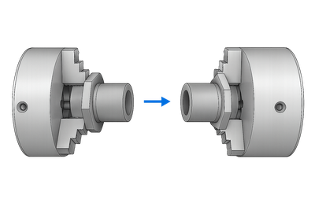 | このグループは、パーツが固定位置に保持される製造工程のステージを定義するためのものです。前のセットアップで使用したパーツ、ワーク、およびその他のオブジェクトを非表示にすることで、前のセットアップが後続のセットアップに干渉することなく、パーツをさまざまな方向から加工できます。このグループ内では、サブプロジェクト（パーツ、パーツのコピー）で考慮される治具を追加できます。 |
|   |   |
| [パーツ](1025.md) |   |
| 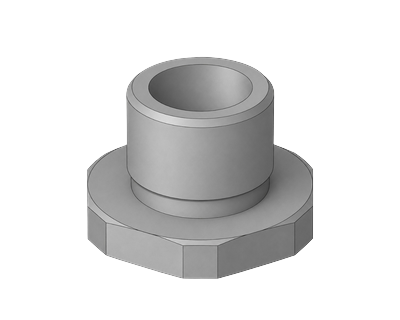 | このグループは、複数の異なるパーツまたは標準パーツを、技術に基づくオペレーション単位（コンベヤ方式に類似）に分けた多パーツプロジェクトを作成するために使用します。このグループの［セットアップ］タブでは、装置上でのパーツ配置、パーツ座標系など、プロジェクトの主要パラメータを設定します。また、ツールパス座標を変換するための変換セットも利用できます。 |
|   |   |
| [パーツのコピー](1026.md) |   |
| 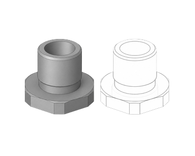 | 複数の同一パーツを含むプロジェクトを準備するための特殊なグループです。通常は、必要なオペレーションを持つ原型パーツを作成し、その原型をテンプレートとして「パーツのコピー」を作成します。コピーは原型と同期され、コピー内でオペレーションを追加または削除することはできません。原型でオペレーションを作成または削除すると、すべてのコピーで対応するオペレーションのコピーが自動的に作成または削除されます。コピー側ではツールパスを独自に計算せず、原型のツールパスをコピーの位置に適用します。原型の計算をリセットした場合は、コピーを手動で再計算する必要があります。ポストプロセッサが対応している場合、コピー出力はサブルーチン呼び出しで構成できます。「パーツのコピー」の［セットアップ］タブでは、コピーの位置、ワーク、座標系を指定します。 |
|   |   |
| [グループ複製](1027.md) |   |
| 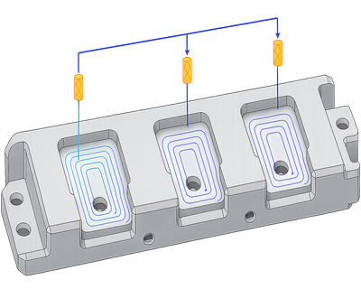 | パスのコピー方法を定義するグループで、その規則はグループ内のオペレーションに継承されます。これにより、各オペレーションで部品の個々の形状要素を加工しながら、グループが定義済みの規則に従って結果をすべての標準形状へ自動展開できます。コピーは［変換］タブの規則に従って実行されます。 |

| <strong>[旋盤](10175.md)</strong> |   |
|---|---|
| [端面加工](307.md) |   |
| 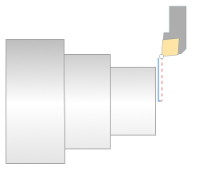 | <strong>端面加工</strong>オペレーションは、ワークの不均一な端面（左側または右側）を整えるためのものです。工具を垂直方向に移動させ、材料を層ごとに除去します。現在のワークと部品に基づいて端面加工用のツールパスを自動生成します。荒加工と仕上げ加工の両方に使用でき、穴あけやその他の旋削サイクルの前によく使用されます。 |
|   |   |
| [外径、内径荒取り](316.md) |   |
| 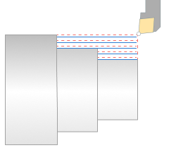 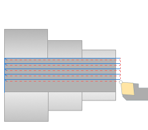 | ワークの大部分を除去するためのオペレーションです。ワーク形状と部品形状が大きく異なる場合に使用できます。平行な工具移動を連続して行い、短時間で大量のワーク材を除去します。 |
|   |   |
| [外径、内径仕上げ](310.md) |   |
| 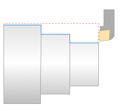 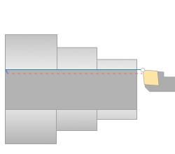 | 最終仕上げ加工用のオペレーションです。部品の母線に沿ったオフセット移動で加工します。部品とワークの差が小さい場合に最良の結果を得られます。ワーク照合を行わずにツールパスを生成することもでき [4軸旋削](10202.md)にも対応します。 |
|   |   |
| [外径、内径溝加工、端面加工](312.md) |   |
| 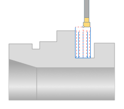 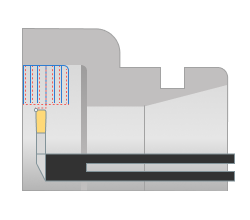 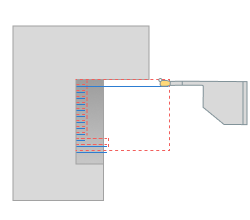 | 溝や、他の旋削オペレーションでは加工できない領域を加工するためのオペレーションです。溝入れ工具が前面で切削できる能力に応じてツールパスを生成します。ワーク材を除去する荒加工パスと形状を仕上げる仕上げパスを組み合わせることができます。複数層に分け、異なる加工方法と切削方向で材料を除去でき、切りくず分断やドウェルも設定できます。 |
|   |   |
| [アダプティブ荒取り（旋盤）](10205.md) |   |
| 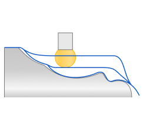 | 工具負荷を一定に保ちながら、最適化された滑らかなツールパスを生成するアダプティブ荒旋削オペレーションです。工具寿命を延ばし、切削速度を大幅に向上させます（従来の溝入れ加工の2倍以上の速度）。ウォーターライン荒加工に似たアダプティブ方式を使用し、丸チップ工具向けに設計されています。 |
|   |   |
| [外径、内径ねじ切り加工](319.md) |   |
| 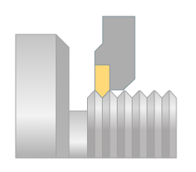 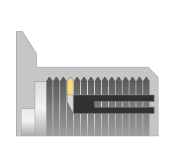 | 旋削工具またはねじ切りチェーサで各種ねじを加工するためのオペレーションです。ISOまたはインチ規格のデータベースからねじパラメータを選択でき、特殊ねじ用に手動設定することもできます。加工は複数ストロークで実行でき、進入、切込み、退避、戻りには複数の方式を利用できます。 |
|   |   |
| [輪郭ねじ切り加工](10199.md) |   |
| 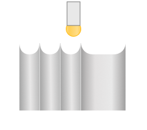 | <strong>輪郭ねじ切り</strong>オペレーションでは、工具形状とは異なるプロファイル形状のねじを形成できます。ねじ溝全体の材料を連続した複数パスで除去し、各パスの配置は工具形状とねじ溝形状に基づいて計算されます。 |
|   |   |
| [切り落とし](313.md) |   |
| 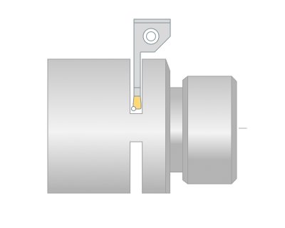 | 追加の面取りまたは丸め加工を行いながらパーツを切り離します。溝幅、チップ切断パラメータ、ドウェル値を設定できます。 |
|   |   |
| [掴み換え付き切り落とし](1060.md) |   |
| 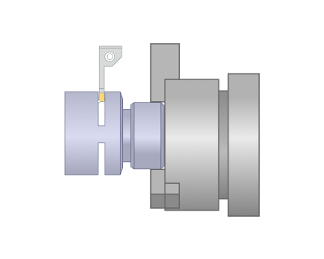 | <strong>掴み換え付き切り落とし</strong>オペレーションは、加工済みパーツを残りのワークから切り離しながら、端面（面取りまたは丸めを含む）を同時に形成します。切断領域は、あらかじめ溝を加工するなどして準備できます。標準の旋削突切りと異なり、オペレーション完了時にワークを別の主軸へ受け渡します。 |
|   |   |
| [旋盤穴加工](10176.md) |   |
| 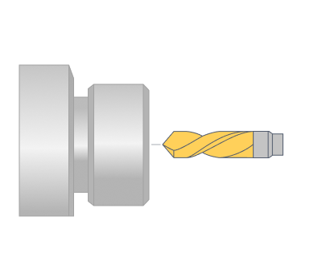 | 軸方向の穴を加工するNC指令を生成するオペレーションです。単純穴あけ、チップ切断または排出を伴う深穴加工、タップによるねじ切りなどのサイクルに対応します。サイクル出力は、個別指令または固定サイクルから選択できます。 |

| <strong>[穴](100168.md)</strong> |   |
|---|---|
| [穴加工オペレーション](10100.md) |   |
| 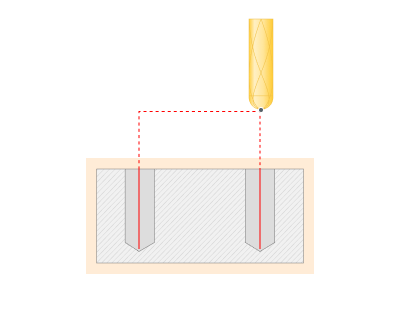 | 穴加工用の加工コマンドを作成します。穴あけ、ボーリング、センタリング、タップ加工、ねじ切りミーリングなどに対応します。通常の穴加工に加え、ポケット加工やウォーターライン荒加工で工具を切り込ませる位置の下穴加工にも使用できます。軸が同一平面に垂直でない穴など、向きが異なる穴も加工できます。互いに直交する平面上にない穴も加工可能です。 |
|   |   |
| [FBM （フィーチャーベースマシニング）](10089.md) |   |
| 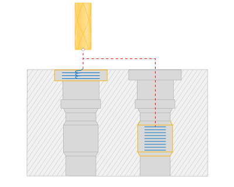 | FBM Millを作成すると、パーツ内の既知の加工フィーチャーを自動認識し、FBMプロシージャライブラリから定義済みまたは保存済みの加工手順を選択できます。認識したフィーチャーに必要なオペレーションを自動生成し、工具交換の最小化など、現在のルールに従って並べ替えます。 |

| <strong>[2D](100169.md)</strong> |   |
|---|---|
| [ポケット加工](256.md) |   |
| 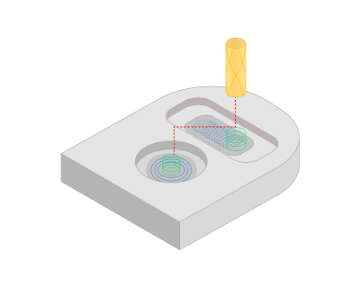 | 定義した領域またはポケット内の材料をウォーターライン方式で除去します。ポケット領域の形状は、水平（XY）平面上に作成したカーブから構成します。ポケットや独立した領域の2D・2.5D加工、および彫刻加工（2D仕上げ）前の材料除去に使用します。 |
|   |   |
| [彫刻加工](810.md) |   |
| 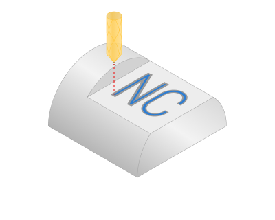 | 平坦な領域に2D形状や文字を彫刻するためのオペレーションです。彫刻する形状は、カーブを水平（XY）平面に投影して作成します。モデルの側壁の主要部分は工具の水平移動で加工します。鋭い内角や幅の狭い領域には3Dミーリングを使用します。平面図形や文字の彫刻、および2D・2.5D加工におけるポケットや独立した領域の側壁仕上げに使用します。 |
|   |   |
| [2D輪郭](404.md) |   |
| 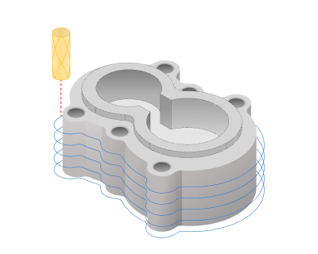 | 水平輪郭、または水平平面に投影したカーブを加工します。加工する形状に基づいて工具の水平移動を作成し、工具中心または工具刃先を輪郭に沿わせることができます。垂直な側壁を持つパーツの加工や、一定のZ深さでの加工パスなどに使用します。 |

| <strong>[基本](100170.md)</strong> |   |
|---|---|
| [フェイス加工](10117.md) |   |
| 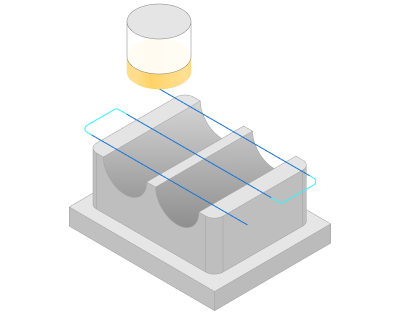 | <strong>フェイス加工</strong>は、指定した水平面上の材料を除去します。一方向、ジグザグ、最適化ジグザグ、スパイラルの各方法を使用できます。 |
|   |   |
| [ウォーターライン荒加工](736.md) |   |
| 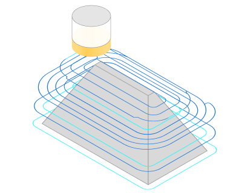 | 3Dモデルの外側にあるワーク材料をウォーターライン方式で除去します。ポケット加工と同様に、材料の大部分は[工具](https://confluence.encycam.com/display/SC1/.Tool+v18)の水平（XY）移動で除去します。ワークと形状が大きく異なる複雑なモデルの初期荒加工によく使用します。 |
|   |   |
| [ウォーターライン仕上げ加工](841.md) |   |
| 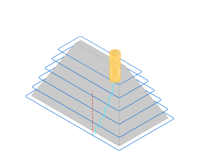 | 立体モデルのサーフェスを、工具の水平移動によってウォーターライン加工します。主要なサーフェス領域が垂直に近いモデルや部分の加工に適しています。複雑なモデルでは、平面加工またはドライブ加工と併用することを推奨します。 |
|   |   |
| [平面荒加工](735.md) |   |
| 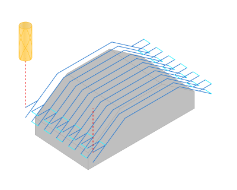 | 3Dモデルの外側にあるワーク材料を平面方式で除去します。断面は互いに平行な垂直平面上にあります。工具負荷を抑えるため、あらかじめ指定した小さなZ切込みで加工できます。同様のパラメータのウォーターライン荒加工と比べ、加工後の形状が完成モデルに近くなる傾向があります。元のモデルとの差が小さい荒加工ワークを得たい場合や、軟質材料の加工に適しています。 |
|   |   |
| [2.5D輪郭](10115.md) |   |
| 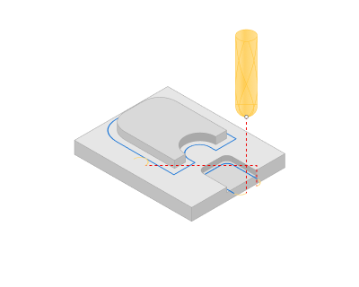 | <strong>2.5D輪郭加工</strong>は、高さが異なる複数のパーツ輪郭に対応します。異なる高さの閉じたプロファイルで囲まれた平坦領域からなるモデルを加工し、一連の水平パス（レイヤー）を作成します。パス数と各Z高さは、オペレーションの加工レベルとステップによって決まります。 |
|   |   |
| [平坦面加工](759.md) |   |
| 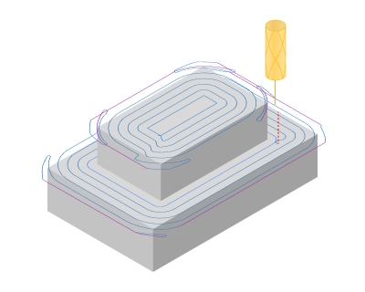 | パーツの平坦な水平サーフェスを仕上げ加工します。平坦な領域は自動認識され、複数の水平領域からなるツールパスを作成します。加工時の食い込みを防ぐため、モデルの水平でない領域もすべて確認します。 |
|   |   |
| [3D輪郭](700.md) |   |
| 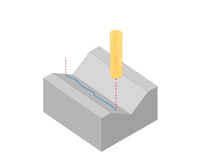 | 自由曲線に沿う一連の工具移動を生成します。平面上のツールパス形状は2D輪郭加工に似ており、工具中心または工具刃先を輪郭に沿わせます。ツールパスの各点のZ座標は、対応する曲線上の点のZ座標を基準とした変位として計算されます。金型部品のエッジや、複雑な形状の溝などの加工に使用できます。 |

| <strong>[高度な加工](100171.md)</strong> |   |
|---|---|
| [コンボ仕上げ](100126.md) |   |
| 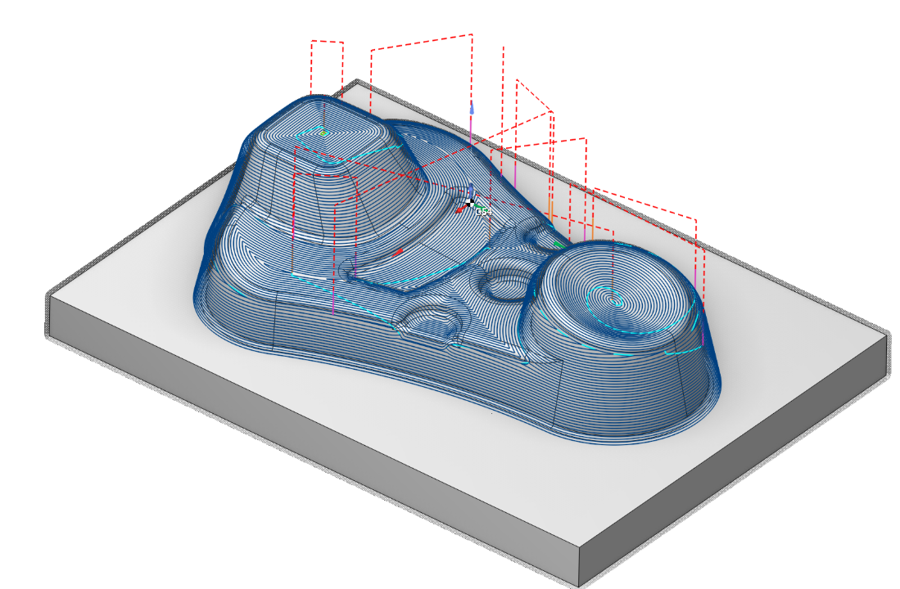 | 平面、ウォーターライン、スキャロップの各仕上げ加工方法を組み合わせます。 |
|   |   |
| [5Dサーフェシング加工](10135.md) |   |
| 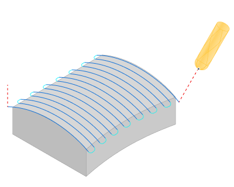 | サーフェスモデルを、平面に平行、カーブに平行、モーフなどの各種方法と、固定、サーフェスに垂直、回転軸へ、点を通過、カーブを通過などの工具軸方向で仕上げ加工します。 |
|   |   |
| [スキャロップ仕上げ加工](10118.md) |   |
| 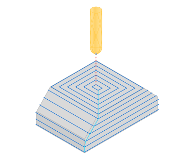 | <strong>スキャロップ</strong>（3D等間隔ピックフィード）のツールパスは、パーツのサーフェス上のカーブを開始形状とし、カーブが消失するまで内側へ繰り返しオフセットします。サーフェス全体で一定のピックフィードを保つため、複雑な金型や自由曲面モデルの高速加工に適しています。ツールパスの計算が非常に高速で、進入点と退出点を各1か所に抑え、パーツ全体を連続したスパイラル状のツールパスで加工できます。高速加工に適した、コーナーを丸めたツールパスも生成できます。 |
|   |   |
| [3Dヘリカル加工](10119.md) |   |
| 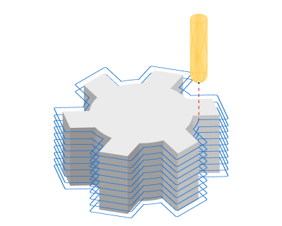 | <strong>3Dヘリカル</strong>加工は、アンダーカットのない円筒形状のパーツに適しています。モデル全体をジョブ割り当てとして選択し、全体を1本のスパイラル状のパスで加工できます。移行動作なしでは加工できない領域は、現在のパスの加工後に処理します。このオペレーションはスキャロップ高さを制御せず、高さの変化が一定になることも保証しません。 |
|   |   |
| [モーフ加工](10138.md) |   |
| 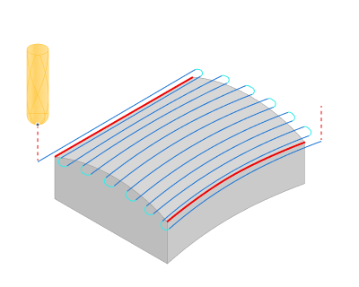 | <strong>モーフ</strong>は、指定した2本のカーブ間を滑らかに変形するツールパスと高速リンクを生成します。横断、沿う、スパイラルの方法を使用できます。3～5軸ツールパスに対応し、工具軸方向は固定、ドライブカーブに垂直4D、回転軸、ドライブカーブ5D、サーフェス5Dなどを選択できます。タービンホイール、ブレード、スクリュー、複雑な流路などの加工に適し、高速リンクに対応します。 |
|   |   |
| [ウォータラインアンダーカット加工](100150.md) |   |
| 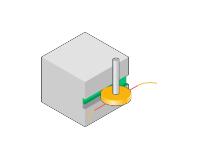 | <strong>ウォーターラインアンダーカット</strong>は、アンダーカット工具を使用して凹部、溝、空洞を加工するためのオペレーションです。アンダーカット工具専用のウォーターラインツールパスを生成します。 |
|   |   |
| [スワーフ](1040.md) |   |
| 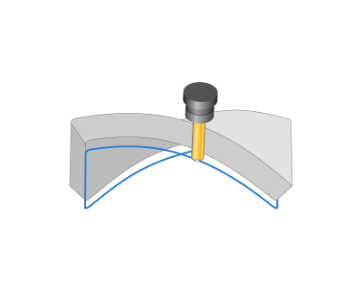 | <strong>スワーフ</strong>は、工具側面を使用して複雑なルールドサーフェスを加工する5軸オペレーションです。主に仕上げに使用し、荒加工パスにも対応します。工具の傾斜は自動、またはツールパス上のベクトルを使って手動で設定できます。加工領域は、下エッジ基準または2つのカーブ基準の2種類の方法で定義します。 |
|   |   |
| [5D ウォーターライン荒加工](102025.md) |   |
| 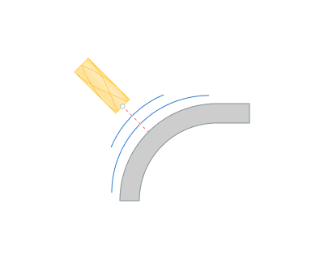 | ウォーターライン加工を基にした、底面が曲面となるポケット用の5軸荒加工オペレーションです。ジョブ割り当てに底面サーフェス（通常はポケット底面）を指定し、閉じたジョブゾーン内で加工します。 |
|   |   |
| [5Dメッシュ加工](10142.md) |   |
| 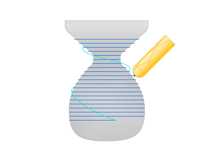 | 複雑な形状や三角形メッシュ（メッシュ／STL）を加工する汎用5軸仕上げオペレーションです。彫刻、スキャンモデル、複雑なサーフェスの仕上げに適しています。スキャロップ、3Dヘリカル、ウォーターライン状のパターン、工具軸方向の自動／手動設定、および工具・ホルダーの干渉の自動回避に対応します。 |
|   |   |
| [5D輪郭と6D輪郭操作](10129.md) |   |
| 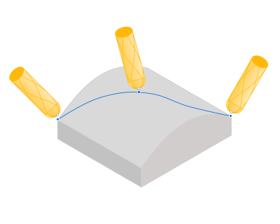 | 空間カーブやサーフェスに対して、連続した複数の波状パスからなるツールパスを生成します。豊富な工具軸方向の設定と、回転軸の制限管理に対応します。 |
|   |   |
| [輪郭研磨](164691982.md) |   |
| 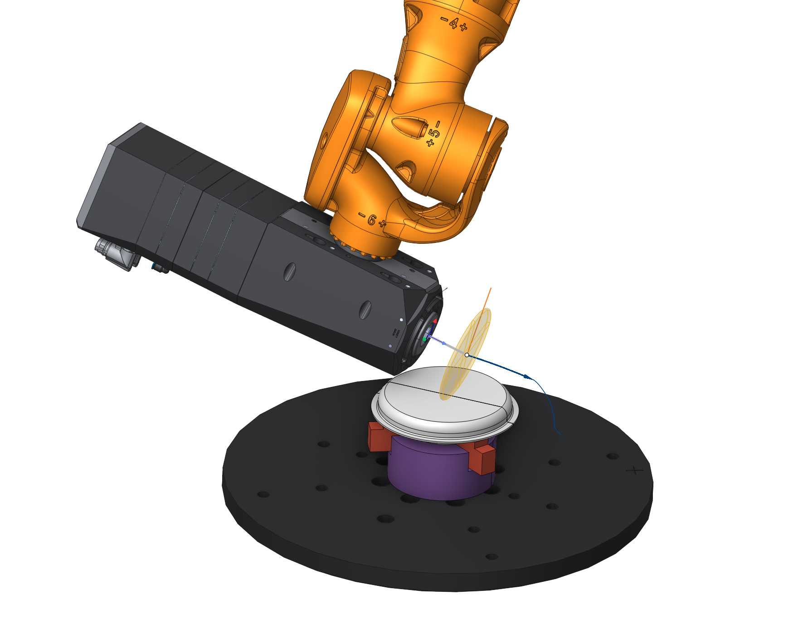 | ディスク工具を使用し、輪郭に沿ってパーツの壁面とエッジを仕上げます。 |

| <strong>[回転加工](100172.md)</strong> |   |
|---|---|
| [ロータリーウォータライン加工](10143.md) |   |
| 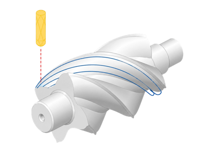 | カムシャフト、クランクシャフト、ウォームシャフト、羽根、装飾部品などの回転体を加工します。連続回転軸を少なくとも1軸備えたマシンで使用できます。 |
|   |   |
| [ロータリー荒取り加工](10137.md) |   |
| 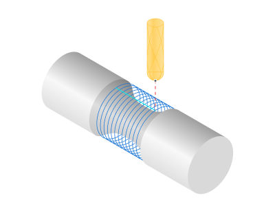 | <strong>ロータリー荒加工</strong>は、ワーク材料をレイヤーごとに除去する4軸ツールパスです。ウォーターライン荒加工と似ていますが、加工レイヤーは平面ではなく、回転軸を中心とする円筒面となります。 |
|   |   |
| [ロータリー仕上げ](10136.md) |   |
| 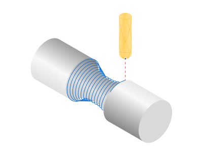 | 連続回転軸を少なくとも1軸備えたマシン用の4軸仕上げオペレーションです。カムシャフト、クランクシャフト、ウォームギヤ、ブレード、装飾部品など、軸物や回転体の仕上げに使用します。 |
|   |   |
| [4Dモーフ加工](10146.md) |   |
| 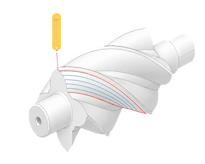 | モーフ加工を、連続回転軸のあるマシン（4軸・5軸構成）向けにした4軸仕上げオペレーションです。指定した2本のカーブ（1番目／2番目のカーブ）、または選択した加工サーフェスの接触カーブ間に滑らかなツールパスを生成します。モーフの品質を高める同期線と、横断、沿う、スパイラルなどの方法に対応します。 |
|   |   |
| [4Dサーフェシング加工](10145.md) |   |
| 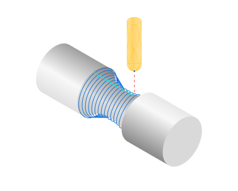 | 5Dサーフェシングを、連続回転軸のあるマシン（4軸・5軸構成）向けにした仕上げオペレーションです。明確な回転軸を持つ、または軸方向に延びた複雑なサーフェスの仕上げに使用します。サーフェス上のパスを生成し、カーブに平行、2つのサーフェス間のモーフ、2つのサーフェス間のスパイラルなどの方法と、工具軸方向の制御に対応します。ただし、点を通過、カーブを通過、ツールパスに垂直など、一部の5D加工方法は使用できません。 |
|   |   |
| [4D輪郭](10144.md) |   |
| 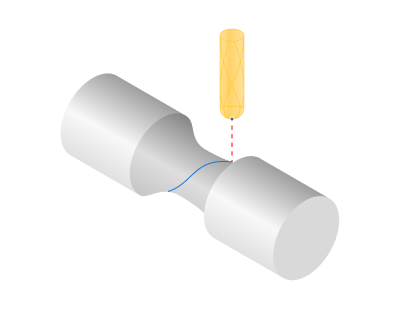 | <strong>4D輪郭加工</strong>は、明確な回転軸を持つ、または軸方向に押し出されたサーフェス上の空間カーブを加工する連続ツールパスを生成します。選択したカーブに沿う単一パス、サーフェスの等パラメータ線に沿う複数パス、カーブに沿う複数レベルの加工に対応します。 |

| <strong>[ターボ機械ミーリング](100173.md)</strong> |   |
|---|---|
| [インペラ加工](1041.md) |   |
| 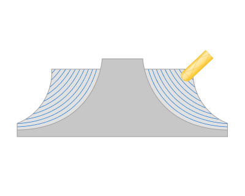 | <strong>インペラ加工</strong>は、ブリスクやインペラを効率よく5軸加工するためのオペレーションです。ワークの荒加工、ブレードとハブの仕上げ、フィレットの研削・仕上げの各方法を備えています。工具、ホルダー、ワークの干渉制御に対応し、ブレードサーフェス、ハブサーフェス（回転面である必要があります）、シュラウドサーフェスによって加工領域を正確に定義できます。 |
|   |   |
| [ブレードミーリング](100127.md) |   |
| 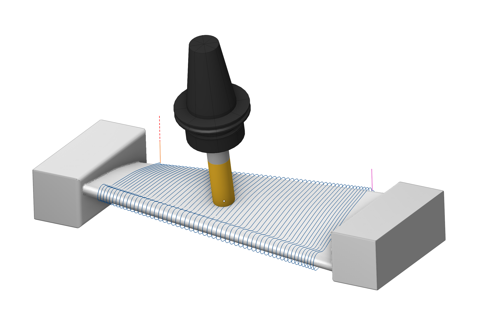 | ブレードの翼面、根元領域、ハブ、およびエッジを仕上げます。 |

| <strong>[取り残し加工](727.md)</strong> |   |
|---|---|
| [コーナー仕上げ](10121.md) |   |
|  | 前工程の工具径をパラメータとして、前の工具では削り残す領域にパスを生成します。 |
|   |   |
| [ペンシル](10120.md) |   |
|  | パーツの内コーナーに沿って残り加工パスを生成します。 |
|   |   |
| [面取り](10123.md) |   |
|  | 面取りオペレーションは、部品エッジに面取りやフィレットを作成したり、ばりを除去したりするために使用します。フラットエンド、ブル、ボールエンド工具によるツールパスを生成し、鋭利なエッジの鈍化やばり取りなど、通常は最終工程で使用します。 |

| <strong>[レガシーオペレーション](123124.md)</strong> |   |
|---|---|
| [平面仕上げ加工](713.md) |   |
|  | 立体モデルのサーフェスを、互いに平行な垂直平面内のパスで加工します。平坦な領域や、ツールパスに垂直で垂直面に近い領域に適しています。複雑な形状では、ウォーターライン加工、または最初のツールパスと直交する別の平面加工と併用すると効果的です。 |
|   |   |
| [平面最適化加工（平面・平面）](714.md) |   |
|  | 3Dパーツのサーフェスに対し、互いに直交するツールパスを持つ2つの平面加工オペレーションを同時に作成します。各オペレーションが最適な結果を得られる領域だけを加工するよう、デフォルトパラメータが設定されています。モデルのサーフェス全体で均一な加工品質を得られ、複雑な曲面の高品質な加工と加工時間の短縮が可能です。 |
|   |   |
| [複合仕上げ加工（ウォータライン - 平面）](839.md) |   |
|  | 3Dモデルのサーフェス加工用に、平面加工とウォーターライン加工の2つのオペレーションを作成します。平坦な領域は平面加工、垂直に近い領域はウォーターライン加工で処理するよう、パラメータを自動設定します。サーフェス全体で均一な加工品質を得られます。工具負荷を軽減するため、より長く小径の工具を使用でき、さまざまなサーフェス角度での高品質な加工と加工時間の短縮が可能です。 |

| <strong>[カッティング](10224.md)</strong> |   |
|---|---|
| [ジェット加工](326.md) |   |
|  | シートから部品を切り出すためのオペレーションです。外周および穴の輪郭は、閉じた曲線または開いた曲線で定義できます。工具を部品輪郭に沿って移動させ、先に穴を切断してから外周を切断します。 |
|   |   |
| [4D ジェット加工](10225.md) |   |
|  | <strong>4D</strong><strong>ジェット加工</strong>は、水、レーザー、プラズマなど、工具が噴流またはビームである切断に使用できます。単純形状だけでなく傾斜側面を持つ複雑形状も加工できます。加工輪郭はワイヤ放電加工と同様に設定しますが、生成パスは「点＋法線」または「点＋機械回転軸」の形式になります。 |
|   |   |
| [5D ジェット加工](10226.md) |   |
|  | <strong>5D</strong><strong>ジェット加工</strong>は、形状を持つ空間曲面上の切断用です。 [5D 輪郭](10129.md)を基に、この用途では不要な複数パス加工機能を除いたものです。 |
|   |   |
| [2D ナイフ切断](10241.md) |   |
|  | <strong>2D</strong><strong>ナイフ切断</strong>は、ナイフ、帯のこ、丸のこなどの工具でシート材を切断するためのオペレーションです。ツールパスの鋭角部には、ナイフの急旋回による材料の曲がりを防ぐ特殊な遷移を生成します。 [2D 輪郭加工](404.md)を基にしており、直線X・Y・Z軸に加え、工具を回転させる回転軸を機械に必要とします。[ナイフ](10240.md)の使用には、工作機械に追加の要件が必要です。直線軸（X、Y、Z軸）に加えて、工具を回転させるための回転軸を備えている必要があります。 |
|   |   |
| [6D ナイフ切断](10242.md) |   |
|  | <strong>6D</strong><strong>ナイフ切断</strong>は、形状を持つ空間曲面上の切り出し用で、 [5D 輪郭加工](10129.md)を基にしています。鋭角部では材料の曲がりを防ぐ特殊な遷移を生成し、ツールパス各点で刃先を移動方向へ向けます。6自由度が必要なため、機械には少なくとも3直線軸と3回転軸が必要で、産業用ロボットがよく使用されます。 |

| <strong>[ディスク工具](10277.md)</strong> |   |
|---|---|
| [ディスク荒加工](10281.md) |   |
|  | ディスク工具加工グループのオペレーションで、ディスク工具を用いて石材などの素材を準備します。除去領域に一連の切込みを入れ、薄い層を手作業で割り落とした後、通常は適切な工具で仕上げます。 |
|   |   |
| [2D ディスクカッティング](10279.md) |   |
|  | 円形工具（ソー）でシート材を切断するオペレーションです。 |
|   |   |
| [6D ディスクカッティング](10280.md) |   |
|  | <strong>6D</strong><strong>ディスク切断</strong>は、ディスク工具で平面部品および立体部品を切断するためのオペレーションです。 |

| <strong>[ワイヤー放電加工](10244.md)</strong> |   |
|---|---|
| [ワイヤー放電2D輪郭](10246.md) |   |
|  | <strong>ワイヤー放電2D輪郭加工</strong>は、平面輪郭に沿った2D加工、およびワイヤ傾斜角を持つテーパーまたは3D輪郭加工のワイヤー経路を生成します。生成されるワイヤー経路は、同一平面上の輪郭を基にします。 |
|   |   |
| [ワイヤー放電4D輪郭](10247.md) |   |
|  | <strong>ワイヤー放電4D輪郭加工</strong>は、2つの平面輪郭に沿って同時にワイヤー経路を生成します。一方は下側ガイドの移動、すなわち加工（XY）輪郭面を指定し、もう一方は上側ガイドの移動である案内（UV）輪郭を指定します。これにより、ワイヤーの上下端を異なる経路で移動できます。 |

| <strong>[アディティブ](10272.md)</strong> |   |
|---|---|
| [エリアクラッディング](10273.md) |   |
|  | 切削で材料を除去する代わりに、加工中にワークへ材料を付加する積層造形を実現します。高硬度、強度、耐摩耗性、低摩擦性、耐食性、耐熱性などの特性を持つ層を形成でき、高価な部品や工具の寸法復元、ブレード、金型、歯車、軸などの補修にも使用できます。加工領域とパラメータはポケット加工に似ており、3Dモデルの曲線やエッジで肉盛り領域を制限できます。基準面に応じて平面、円筒、回転体上に配置でき、「ツールパスを部品へ投影」を有効にすると任意形状面へ適用できます。領域充填には平行方式とオフセット方式があり、総レイヤー数と壁面角度も指定できます。 |
|   |   |
| [カーブクラッディング](10274.md) |   |
|  | ジョブ割り当て内で定義した曲線に沿って下から上へツールパスを生成する積層オペレーションで、薄肉モデルに適しています。元曲線は平面、円筒、回転体上に配置できます。「ツールパスをパーツに投影」を有効にすると任意形状面へ適用でき、層ごとのパスまたはヘリカルスパイラルを生成できます。 |
|   |   |
| [3D クラッディング](10275.md) |   |
|  | 3Dモデルを入力とする積層オペレーションです。ウォーターライン荒加工に似ていますが、下から上へ処理します。元モデルを層ごとに交差計算し、各レベルの交差領域を埋めるツールパスを生成します。領域充填には平行方式とオフセット方式があります。 |
|   |   |
| [5D クラッディング](10276.md) |   |
|  | <strong>5D</strong><strong>クラッディング</strong>は、3軸または5軸機でサーフェスに材料層を形成します。薄肉モデルに適し、個別サーフェスへの肉盛り後にフライス加工を行えます。高負荷領域への肉盛りによるサーフェス硬化にも使用できます。同じ場所を工具が何度も通過するのを避けるスパイラル方式のほか、平面平行、モーフ、曲線平行の各方式を使用できます。 |
|   |   |
| [非平面スライス](1052.md) |   |
|  | 非平面スライスは、任意の非平面基板上に積層造形パスを作成します。非平面スライサーを使用して非平面の造形パスを生成し、必要に応じて追加パラメータ付きの従来型平面方式にも対応します。 |

| <strong>[溶接](10270.md)</strong> |   |
|---|---|
| [ポイント溶接](20041.md) |   |
|  | スポット溶接に使用し、仮付け溶接と点溶接の両方に対応します。 |
|   |   |
| [6D 溶接](10271.md) |   |
|  | 特定の溶接装置に依存せず、溶接線形状を自動計算します。レーザー、アーク、ガスバーナー、超音波装置などへの個別指令は生成しません。溶接部品間のエッジをジョブ割り当てへ追加すると、溶接ヘッドが隣接壁面の中央に近い位置を保ち、衝突しないよう各曲線点の角度を自動計算します。シミュレーションでは、溶接ヘッド先端が接触する位置への材料付加を確認できます。 |

| <strong>[スプレー](10400.md)</strong> |   |
|---|---|
| [輪郭スプレー](10400.md) |   |
|  | 輪郭スプレーは [6D 輪郭加工](10129.md)を基にしています。ツールパス各点で工具位置をより柔軟に制御したい場合に使用します。 |
|   |   |
| [サーフェススプレー](10400.md) |   |
|  | サーフェススプレーは [5D クラッディング](10276.md) を基にしており、さまざまな方式でサーフェス塗装用ツールパスを作成できます。 |
|   |   |
| [モーフスプレー](10400.md) |   |
|  | モーフスプレーは [モーフ](10138.md)オペレーションを基にしています。 |
|   |   |
| [ロータリースプレー](10400.md) |   |
|  | ロータリースプレーは [ロータリー仕上げ](10136.md)オペレーションを基にしています。 |

| <strong>補助機能</strong> |   |
|---|---|
| [グループ](844.md) |   |
|  | <strong>グループ</strong>は、類似パラメータを持つ複数のオペレーションを体系化するためのものです。グループによりツリー構造のジョブ一覧を作成でき、グループのパラメータを変更すると、含まれるすべてのオペレーションの同種パラメータも変更されます。 |
|   |   |
| グループ複製 |   |
|  | パスのコピー方法を定義するグループで、その規則はグループ内のオペレーションに継承されます。各オペレーションで部品の個別フィーチャーを加工しながら、定義した規則に従って結果を標準フィーチャー全体へ自動展開します。コピーは［変換］タブの規則に従います。 |
|   |   |
| [補助オペレーション](10075.md) |   |
|  | 補助オペレーションは、特定の機械や会社向けのCLData指令列を名前付き一覧として保存し、繰り返し利用するためのものです。チャックの締付け、工具交換、心押台の接近、部品反転、アクティブなワーク座標系G54～G59の設定などに使用できます。 |
|   |   |
| [Gコードベース、Gコードベース旋盤](10379.md) |   |
|  | ジョブ割り当てとして使用するNCテキストと選択したインタープリターに基づいてツールパスを作成します。NCテキストは手入力または外部ファイルから読み込み、必要に応じて編集できます。4軸・5軸マシニングセンターの割出し加工および同時加工にも使用でき、材料層の積み上げを再現する積層造形を含む、すべてのシミュレーション方式に対応します。これらのオペレーションでは、Gコードによる機械シミュレーションの直接制御、NCプログラムの確認・最適化、異なる制御機間でのNCテキスト変換、独自インタープリター作成時のデバッグを行えます。 |
|   |   |
| 総形工具の作成 |   |
|  | ENCYで総形ミーリング工具を作成するには、作図モードで工具輪郭を母線として描きます（モデルから曲線を取得するか、スケッチで作成できます）。次に工具一覧を右クリックして［工具として保存］を選択し、形状タイプ、名前、工具構成を指定します。保存後、輪郭は工具ライブラリで使用可能になり、［工具］ウィンドウで選択して輪郭／プロファイル加工に使用できます。 |

| <strong>[パーツ移動](10402.md)</strong> |   |
|---|---|
| [ポイントピックアンドプレース](10404.md) |   |
|  | ポイントピックアンドプレースは、ジョブ割り当てを一連の点ノードに基づいて行うピックアンドプレースオペレーションの一種です。点の一覧には、開始点、把持点、移動点（把持点基準）、移動点（配置点基準）、配置点、終了点が含まれ、これらを軌跡の連鎖（把持→移動→配置など）として構成します。 |
|   |   |
| ピックアンドプレース－<strong>レガシー</strong> |   |
|  | <strong>ピックアンドプレース</strong>（汎用ピックアンドプレース）は、グリッパーを制御して機械の作業領域内でワークを移動するオペレーションです。 |
|   |   |
| [バーフィード](10408.md) |   |
|  | <strong>バーフィード</strong>は、バー材を主軸へ最初に送り込むオペレーションです（スイス型旋盤プロジェクトでは最初のオペレーションにする必要があります）。ワークの位置決めと固定、バー突出し量、工具接触位置の設定、初期クランプの制御などを行います。 |
|   |   |
| [サブスピンドルの動作](10407.md) |   |
|  | <strong>サブスピンドル動作</strong>は、サブスピンドルを備えた複合旋盤向けにピックアンドプレースを調整したオペレーションです。このオペレーションでは、主軸とサブスピンドルの同期、両方の主軸で後続加工を行うためのサブスピンドルによるワークの把持、主軸とサブスピンドルの間でのパーツ移動を実行できます。 |
|   |   |
| [掴み換え](10406.md) |   |
|  | <strong>掴み換え</strong>は、主軸間でパーツを受け渡し・受け取るオペレーション（旋削プロジェクト向けピックアンドプレース）です。主軸とサブスピンドルの同期、パーツの受取りまたは返却、プロジェクト内の次のパーツからのワークコネクターとセットアップ座標系の自動取得、突切りオペレーションとの連携、クランプ（CLData）の管理、および移動指令（Multigoto／Goto）の生成を行います。 |
|   |   |
| 次工程へ配置－<strong>レガシー</strong> |   |
|  | <strong>次工程へ配置</strong>は、次のオペレーション（セットアップステージ／部品）から配置位置を取得する特殊なピックアンドプレースです。ロボットおよびフライス盤で使用します。旋削プロジェクトでは、掴み換えの使用を推奨します。 |

| <strong>[プロービング](1410.md)</strong> |   |
|---|---|
| [工具プロービング](1410.md) |   |
|  | <strong>工具プロービング</strong>は、工具の確認と校正を行うサイクル／オペレーションです。工具の長さと半径を測定し、工具の健全性や破損を確認し、工具の初期寸法を校正します。 |
|   |   |
| [パーツプロービング](1410.md) |   |
|  | <strong>パーツプロービング</strong>（ワーク／部品測定）は、ワーク形状を測定するサイクルです。表面や穴の寸法、要素の位置と方向、部品の実際の位置（オフセット／回転補正）、角度などを確認します。 |
|   |   |
| [旋盤工具プロービング](1410.md) |   |
|   | <strong>旋盤工具プロービング</strong>は、旋盤工程で工具を測定・校正するオペレーションです。工具の長さや半径を測定し、工具の健全性や破損を確認して、後続オペレーションの工具補正に使用する実測パラメータを取得します。 |
|   |   |
| [旋盤パーツプロービング](1410.md) |   |
|   | <strong>旋盤パーツプロービング</strong>は、旋削治具上でワーク形状を測定する工程です。穴、端面、表面などの形状・寸法を測定し、クランプ内での部品の位置と方向を確認します。また、偏差補正用の寸法を取得し、レポートを生成します。 |

