# Übersicht der Bearbeitungsoperationen

Die folgende Übersicht beschreibt die in dieser Version des CAM-Systems verfügbaren Operationen.

| <strong>[Struktur der Operationsgruppen](1023.md)</strong> |   |
|---|---|
| [Aufspannung](1024.md) |   |
| 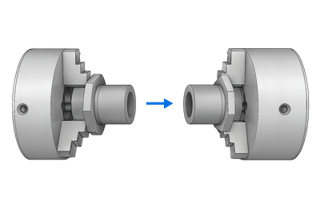 | Definiert einen Fertigungsabschnitt, in dem das Bauteil in einer festen Aufspannung bleibt und von verschiedenen Seiten bearbeitet werden kann. Bauteil, Werkstück und weitere Objekte vorheriger Aufspannungen werden ausgeblendet, damit sie nachfolgende Aufspannungen nicht beeinflussen. Innerhalb der Gruppe können Vorrichtungen angelegt werden, die in untergeordneten Projekten vom Typ Bauteil oder Bauteilkopie berücksichtigt werden. |
|   |   |
| [Bauteilgruppe](1025.md) |   |
| 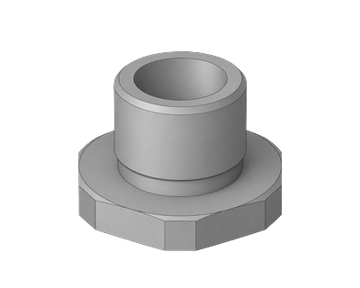 | Erstellt Projekte mit mehreren unterschiedlichen oder gleichartigen Bauteilen, deren Operationen nach technologischen Gesichtspunkten gegliedert werden, ähnlich einer Fertigungslinie. Auf der Registerkarte **Einrichtung** werden unter anderem Bauteillage und Koordinatensystem festgelegt. Außerdem stehen Transformationen der Werkzeugbahnkoordinaten zur Verfügung. |
|   |   |
| [Bauteilkopie](1026.md) |   |
| 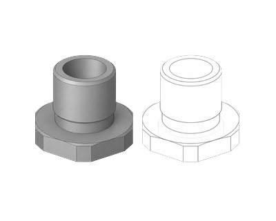 | Erstellt Projekte mit mehreren identischen Bauteilen. Zunächst wird ein Musterbauteil mit den erforderlichen Operationen angelegt; anschließend wird daraus eine Bauteilkopie erzeugt. Die Kopien bleiben mit dem Muster synchronisiert: Operationen können in einer Kopie nicht eigenständig hinzugefügt oder gelöscht werden. Änderungen am Operationsbestand des Musters werden auf alle Kopien übertragen. Die Kopien berechnen keine eigenen Bahnen, sondern übernehmen die Bahnen des Musters an ihrer jeweiligen Position. Wird die Berechnung des Musters zurückgesetzt, müssen die Kopien manuell neu berechnet werden. Sofern der Postprozessor dies unterstützt, kann die Ausgabe über Unterprogrammaufrufe erfolgen. Die Registerkarte **Einrichtung** legt Lage, Werkstück und Koordinatensystem der Kopie fest. |
|   |   |
| [Vervielfältigungsgruppe](1027.md) |   |
| 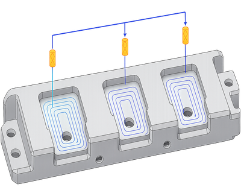 | Definiert Regeln zum Vervielfältigen von Bahnen, die an die enthaltenen Operationen vererbt werden. Die Operationen bearbeiten einzelne Bauteilmerkmale; die Gruppe überträgt die Ergebnisse gemäß den vorgegebenen Regeln auf alle gleichartigen Merkmale. Die Regeln werden auf der Registerkarte **Transformationen** festgelegt. |

| <strong>[Drehoperationen](10175.md)</strong> |   |
|---|---|
| [Plandrehen](307.md) |   |
| 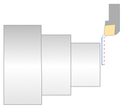 | Bereitet eine unebene linke oder rechte Stirnfläche des Werkstücks durch schichtweisen Abtrag mit radialen Werkzeugbewegungen vor. Die Bahn wird automatisch aus dem aktuellen Werkstück- und Bauteilmodell berechnet. Die Operation unterstützt Schruppen und Schlichten und wird häufig vor dem Bohren oder weiteren Drehzyklen eingesetzt. |
|   |   |
| [Außen- und Innenschruppen](316.md) |   |
| 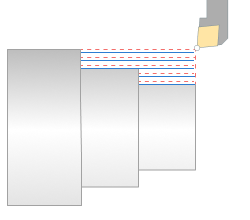 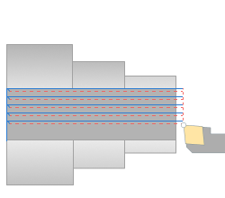 | Entfernt große Materialmengen, wenn sich das Werkstück deutlich von der fertigen Bauteilform unterscheidet. Eine Folge paralleler Werkzeugbewegungen trägt das Material effizient ab. |
|   |   |
| [Außen- und Innenschlichten](310.md) |   |
| 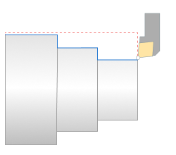 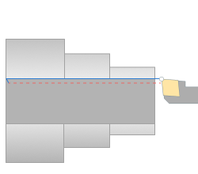 | Dient zur abschließenden Schlichtbearbeitung mit versetzten Bahnen entlang der Bauteilmantellinie. Besonders geeignet, wenn nur geringe Unterschiede zwischen Werkstück und Fertigteil bestehen. Die Bahn kann ohne Berücksichtigung des Werkstückmodells erzeugt werden. Auch [4-Achsen-Drehen](10202.md) ist möglich. |
|   |   |
| [Außen-, Innen- und Planeinstechen](312.md) |   |
| 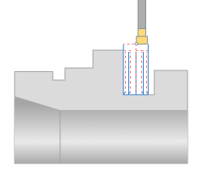 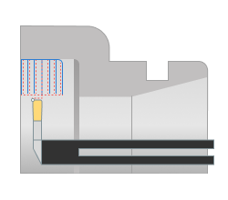 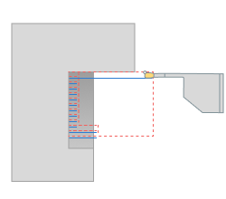 | Bearbeitet Nuten und Bereiche, die mit anderen Drehverfahren nicht erreichbar sind, einschließlich Stirnnuten. Die Bahn kann Schruppdurchgänge zum Materialabtrag und Schlichtdurchgänge zur Formgebung kombinieren. Das Material lässt sich schichtweise mit unterschiedlichen Strategien und Schnittrichtungen entfernen. Spanbrechen und Verweilzeiten können aktiviert werden. |
|   |   |
| [Adaptives Außendrehen](10205.md) |   |
| 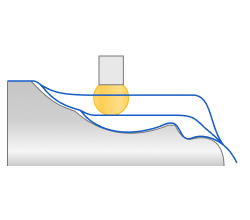 | Adaptives Schruppdrehen mit einer optimierten, glatten Bahn und möglichst gleichmäßiger Werkzeugbelastung. Dies kann die Standzeit erhöhen und die Bearbeitung gegenüber herkömmlichem Einstechen deutlich beschleunigen; unter geeigneten Bedingungen ist eine mehr als doppelte Bearbeitungsgeschwindigkeit möglich. Die adaptive Strategie ähnelt der beim Wasserlinien-Schruppen und ist für Werkzeuge mit runden Wendeschneidplatten vorgesehen. |
|   |   |
| [Außen- und Innengewindedrehen](319.md) |   |
| 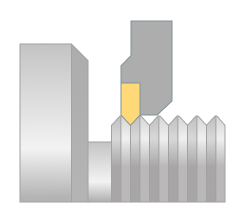 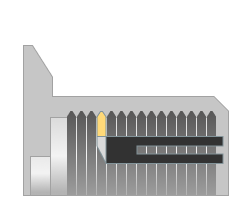 | Erzeugt unterschiedliche Gewinde durch Drehen mit Gewindedrehwerkzeugen. Die Gewindeparameter können aus metrischen ISO- oder zölligen Tabellen ausgewählt oder für Sondergewinde manuell eingegeben werden. Mehrere Zustellungen sowie unterschiedliche An- und Rückfahrbewegungen sind möglich. |
|   |   |
| [Profilgewindedrehen](10199.md) |   |
| 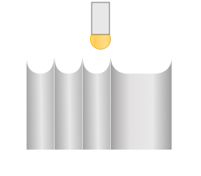 | Erzeugt Gewinde, deren Profil vom Werkzeugprofil abweicht. Das Material innerhalb der gesamten Gewindenut wird in mehreren aufeinanderfolgenden Durchgängen abgetragen. Deren Lage wird aus Werkzeug- und Nutprofil berechnet. |
|   |   |
| [Abstechen](313.md) |   |
| 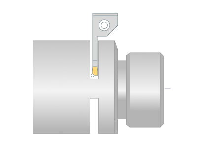 | Trennt das Bauteil ab und kann dabei Fasen oder Verrundungen erzeugen. Nutabmessungen, Spanbrechparameter und Verweilzeiten sind einstellbar. |
|   |   |
| [Abstechen mit Werkstückübernahme](1060.md) |   |
| 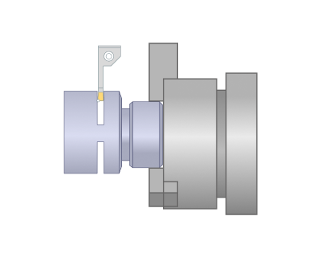 | Trennt das fertig bearbeitete Bauteil vom verbleibenden Werkstück ab und erzeugt dabei die Stirnfläche einschließlich optionaler Fase oder Verrundung. Der Trennbereich kann zuvor beispielsweise durch Einstechen vorbereitet werden. Im Unterschied zum einfachen Abstechen wird das Werkstück am Ende der Operation an eine andere Spindel übergeben. |
|   |   |
| [Bohrungsbearbeitung auf Drehmaschinen](10176.md) |   |
| 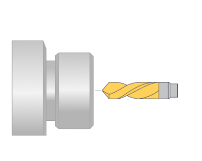 | Erzeugt NC-Befehle für axiale Bohrungen auf Drehmaschinen. Unterstützt unter anderem einfaches Bohren, Tieflochbohren mit Spanbrechen oder Entspanen und Gewindebohren. Die Ausgabe kann als Einzelbewegungen oder als feste Zyklen erfolgen. |

| <strong>[Bohrungen](100168.md)</strong> |   |
|---|---|
| [Bohrungsbearbeitung](10100.md) |   |
| 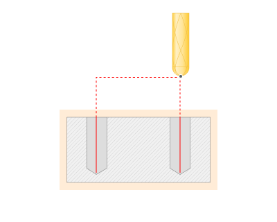 | Erzeugt Bearbeitungsbefehle für Bohren, Ausbohren, Zentrieren, Gewindebohren und Gewindefräsen. Neben Modellbohrungen können Eintauchpunkte für Taschenfräsen und Wasserlinien-Schruppen vorgebohrt werden. Unterstützt unterschiedlich ausgerichtete Bohrungen, deren Achsen nicht gemeinsam senkrecht auf einer Ebene stehen, auch in nicht rechtwinklig zueinander angeordneten Ebenen. |
|   |   |
| [FBM Mill](10089.md) |   |
| 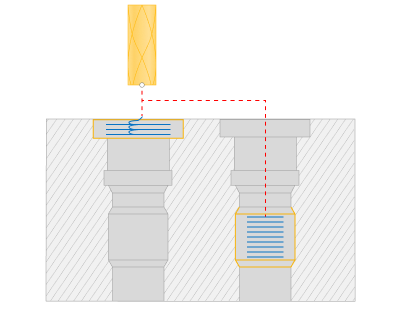 | Erkennt beim Erstellen einer FBM-Fräsgruppe bekannte Fertigungsmerkmale im Bauteil. Vorgegebene oder gespeicherte Bearbeitungsverfahren können aus der FBM-Verfahrensbibliothek ausgewählt werden. Das System erzeugt die erforderlichen Operationen automatisch und ordnet sie nach den geltenden Regeln, beispielsweise zur Minimierung von Werkzeugwechseln. |

| <strong>[2D](100169.md)</strong> |   |
|---|---|
| [Taschenfräsen](256.md) |   |
| 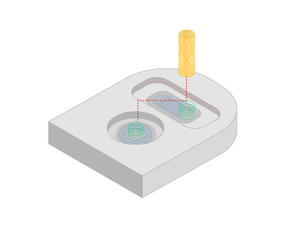 | Trägt Material innerhalb eines definierten Bereichs oder einer Tasche schichtweise ab. Die Bereichsform entsteht aus Kurven in der horizontalen XY-Ebene. Die Operation dient zur 2D- und 2,5D-Bearbeitung von Taschen und Inseln sowie zum vorbereitenden Materialabtrag vor dem Gravieren. |
|   |   |
| [Gravieren](810.md) |   |
| 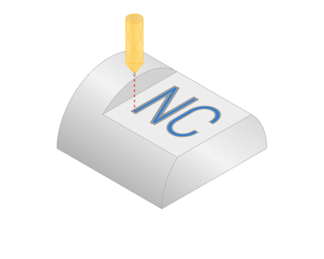 | Graviert 2D-Geometrien und Beschriftungen auf ebenen Flächen. Die Geometrie entsteht aus Kurvenprojektionen auf die XY-Ebene. Horizontale Bewegungen bearbeiten die Seitenwände; räumliche Bewegungen bilden scharfe Innenecken und kleine Bereiche aus. Die Operation eignet sich für Gravuren und Beschriftungen sowie zum Schlichten der Seitenwände von Taschen und Inseln bei der 2D- und 2,5D-Bearbeitung. |
|   |   |
| [2D-Konturbearbeitung](404.md) |   |
| 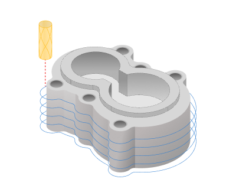 | Bearbeitet horizontale Konturen oder Kurvenprojektionen auf die horizontale Ebene. Die horizontalen Werkzeugbewegungen werden anhand der Geometrie erzeugt; wahlweise folgt der Werkzeugmittelpunkt oder der Werkzeugumfang der Kontur. Geeignet für senkrechte Bauteilwände und Bearbeitungen mit konstanter Z-Tiefe. |

| <strong>[Grundlegende Fräsverfahren](100170.md)</strong> |   |
|---|---|
| [Planfräsen](10117.md) |   |
| 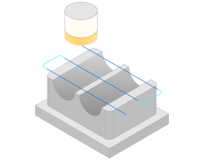 | Trägt Aufmaß auf einer vorgegebenen horizontalen Ebene ab. Verfügbare Strategien sind Einweg, Zickzack, optimierter Zickzack und Spirale. |
|   |   |
| [Wasserlinien-Schruppen](736.md) |   |
| 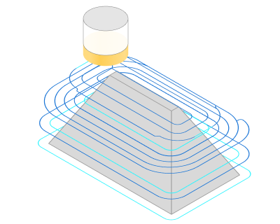 | Entfernt das außerhalb des 3D-Bauteilmodells liegende Werkstückmaterial schichtweise. Wie beim Taschenfräsen erfolgt der wesentliche Abtrag durch horizontale XY-Bewegungen des [Werkzeugs](https://confluence.encycam.com/display/SC1/.Tool+v18). Häufig zur ersten Grobbearbeitung komplexer Modelle eingesetzt, deren Form deutlich vom Ausgangswerkstück abweicht. |
|   |   |
| [Wasserlinien-Schlichten](841.md) |   |
| 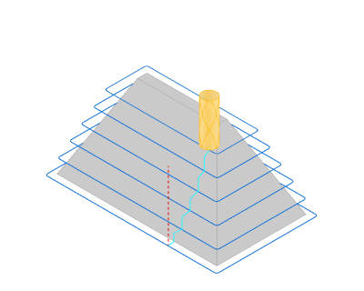 | Bearbeitet Flächen eines Volumenmodells mit horizontalen Wasserlinienbahnen. Besonders geeignet für Modelle oder Teilbereiche mit überwiegend steilen Flächen. Bei komplexen Formen empfiehlt sich die Kombination mit Ebenen- oder Leitkurvenbearbeitung. |
|   |   |
| [Ebenenschruppen](735.md) |   |
| 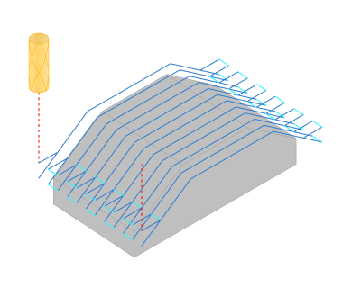 | Entfernt Werkstückmaterial außerhalb des 3D-Modells mit Bahnen in parallelen vertikalen Ebenen. Kleine vorgegebene Z-Zustellungen begrenzen die Werkzeugbelastung. Bei vergleichbaren Einstellungen kommt das Schruppresultat der Fertigteilform meist näher als beim Wasserlinien-Schruppen. Geeignet für ein möglichst formnahes Schruppresultat und für weiche Materialien. |
|   |   |
| [2,5D-Konturieren](10115.md) |   |
| 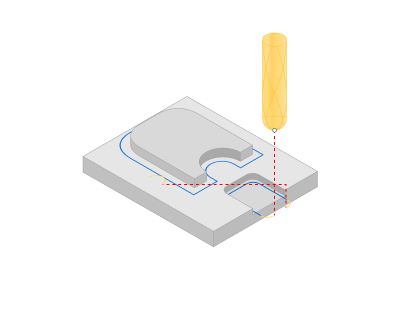 | Erweitert die Konturbearbeitung auf mehrere Höhenstufen. Das Modell besteht aus ebenen Bereichen, die durch geschlossene Profile auf unterschiedlichen Höhen begrenzt werden. Die Bearbeitung erfolgt in horizontalen Schichten; Anzahl und Z-Lage der Durchgänge ergeben sich aus den Bearbeitungsebenen und der Zustellung. |
|   |   |
| [Flache Bereiche schlichten](759.md) |   |
| 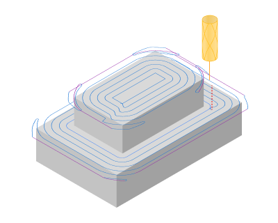 | Schlichtet ebene horizontale Bauteilflächen, die automatisch erkannt werden. Die Bahn besteht aus horizontalen Abschnitten. Alle nicht horizontalen Modellbereiche werden berücksichtigt, um unerwünschte Einschnitte zu vermeiden. |
|   |   |
| [3D-Konturieren](700.md) |   |
| 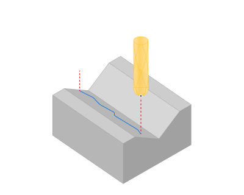 | Erzeugt Werkzeugbewegungen entlang räumlicher Freiformkurven. In der Draufsicht ähnelt die Bahn der 2D-Konturbearbeitung: Werkzeugmittelpunkt oder Werkzeugumfang folgen der Kontur. Die Z-Koordinate jedes Bahnpunkts wird mit einem Versatz aus dem zugehörigen Kurvenpunkt bestimmt. Geeignet beispielsweise für Werkzeugformkanten oder komplex geformte Nuten. |

| <strong>[Erweiterte Fräsverfahren](100171.md)</strong> |   |
|---|---|
| [Kombiniertes Schlichten (Combo Finish)](100126.md) |   |
| 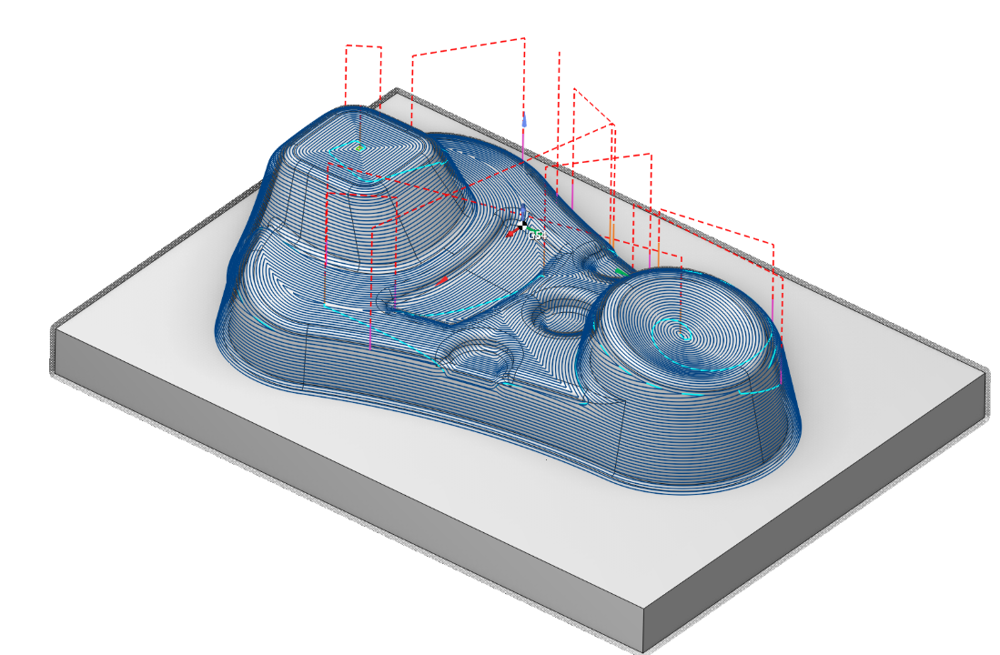 | Kombiniert Ebenen-, Wasserlinien- und Scallop-Schlichtstrategien. |
|   |   |
| [5D-Flächenbearbeitung](10135.md) |   |
| 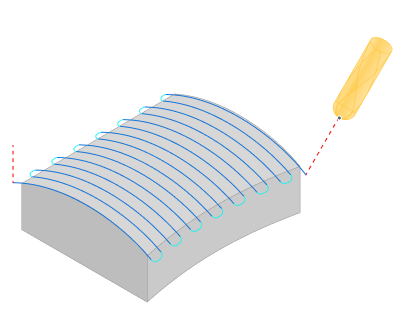 | Schlichtet Flächenmodelle mit verschiedenen Strategien, beispielsweise parallel zu Ebenen oder Kurven sowie durch Morphing. Die Werkzeugachse kann fest, normal zur Fläche, zur Drehachse, durch einen Punkt oder durch eine Kurve ausgerichtet werden. |
|   |   |
| [Schlichten mit konstanter Rautiefe (Scallop)](10118.md) |   |
| 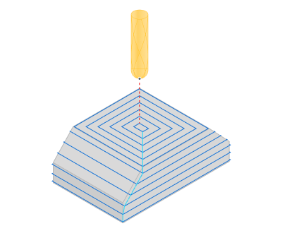 | Die Scallop-Bahn mit konstantem räumlichem Bahnabstand beginnt an Kurven auf den Bauteilflächen. Diese werden wiederholt nach innen versetzt, bis kein weiterer Versatz möglich ist. Das Verfahren hält den Bahnabstand auf der Fläche gleichmäßig und eignet sich zur Hochgeschwindigkeitsbearbeitung komplexer Formen und Freiformmodelle. Es bietet eine schnelle Berechnung und kann eine durchgehende Spiralbahn mit nur einer Ein- und Ausfahrstelle erzeugen. Verrundete Bahnecken unterstützen die Hochgeschwindigkeitsbearbeitung. |
|   |   |
| [3D-Schraubenlinienbearbeitung](10119.md) |   |
| 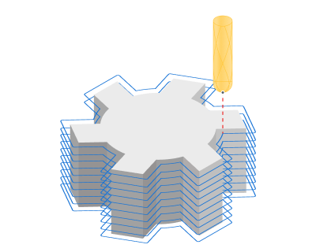 | Bearbeitet zylindrische Bauteile ohne Hinterschnitte. Als Auftragszuweisung wird das gesamte Modell verwendet. Die Operation kann eine durchgehende Spiralbahn für das Modell erzeugen. Bereiche, die nur mit einer zusätzlichen Verbindungsbewegung erreichbar sind, werden nach dem aktuellen Bahnzug bearbeitet. Die Operation regelt weder die Rautiefe noch eine gleichmäßige Höhenänderung. |
|   |   |
| [Morph](10138.md) |   |
| 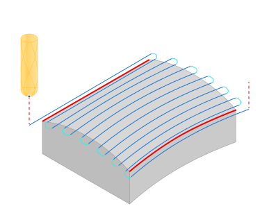 | Erzeugt eine Bahn, die kontinuierlich zwischen zwei vorgegebenen Kurven übergeht, mit schnellen Verbindungsbewegungen. Verfügbare Strategien sind quer, längs und spiralförmig. Unterstützt Bahnen mit drei bis fünf Achsen sowie feste Ausrichtung und Ausrichtung normal zu 4D-Leitkurven, zur Drehachse, zu 5D-Leitkurven oder zu 5D-Flächen. Geeignet unter anderem für Turbinenräder, Schaufeln, Schrauben und komplexe Kanäle. |
|   |   |
| [Wasserlinienbearbeitung von Hinterschnitten](100150.md) |   |
| 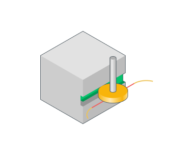 | Erzeugt Wasserlinienbahnen speziell für Hinterschnittwerkzeuge zur Bearbeitung von Aussparungen, Nuten und Hohlräumen. |
|   |   |
| [Flankenfräsen (Swarf)](1040.md) |   |
| 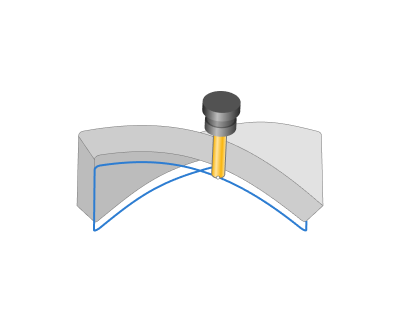 | 5-Achsen-Flankenbearbeitung komplexer Leitflächen mit der Werkzeugseite. Vorwiegend zum Schlichten, mit zusätzlichen Schruppdurchgängen. Die Werkzeugneigung kann automatisch oder manuell über Vektoren entlang der Bahn festgelegt werden. Der Bearbeitungsbereich wird über eine untere Kante oder zwei Kurven definiert. |
|   |   |
| [5D-Wasserlinien-Schruppen](102025.md) |   |
| 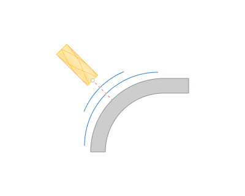 | Spezielle 5-Achsen-Schruppoperation für Taschen mit gekrümmtem Boden auf Grundlage der Wasserlinienbearbeitung. Die Auftragszuweisung besteht aus Bodenflächen (**Floor surfaces**) und einem geschlossenen Bearbeitungsbereich (**Job Zone**). |
|   |   |
| [5D-Bearbeitung anhand von Netzen](10142.md) |   |
| 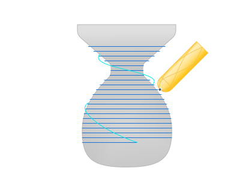 | Vielseitige 5-Achsen-Schlichtoperation für komplexe Formen und Dreiecksnetze (Mesh/STL), beispielsweise Skulpturen, gescannte Modelle und Freiformflächen. Unterstützt Scallop-, 3D-Helix- und wasserlinienähnliche Bahnmuster, automatische oder manuelle Werkzeugausrichtung sowie automatische Kollisionsvermeidung für Werkzeug und Halter. |
|   |   |
| [5D- und 6D-Konturbearbeitung](10129.md) |   |
| 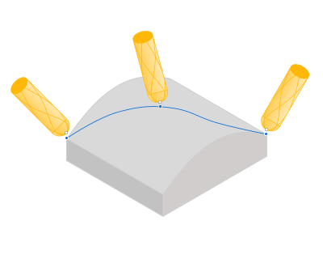 | Erzeugt simultane mehrachsige Bahnen für räumliche Kurven und Flächen. Bietet umfangreiche Strategien zur Werkzeugausrichtung und Begrenzung der Drehachsen. |
|   |   |
| [Konturpolieren](164691982.md) |   |
|  | Schlichtet Bauteilwände und Kanten entlang von Konturen mit einem Scheibenwerkzeug. |

| <strong>[Rotationsbearbeitung](100172.md)</strong> |   |
|---|---|
| [Rotations-Wasserlinienbearbeitung](10143.md) |   |
| 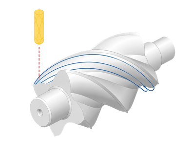 | Rotationsbearbeitung für Nockenwellen, Kurbelwellen, Schneckenwellen, Schaufeln, Zierteile und ähnliche Geometrien. Erfordert mindestens eine kontinuierlich steuerbare Drehachse. |
|   |   |
| [Rotationsschruppen](10137.md) |   |
| 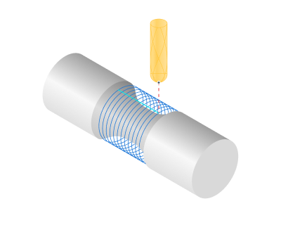 | 4-Achsen-Schruppbearbeitung mit schichtweisem Materialabtrag. Ähnelt dem Wasserlinien-Schruppen, verwendet jedoch konzentrische Zylinder um die Drehachse statt ebener Bearbeitungsschichten. |
|   |   |
| [Rotationsschlichten](10136.md) |   |
| 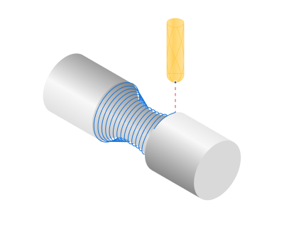 | 4-Achsen-Schlichtoperation für Maschinen mit mindestens einer kontinuierlich steuerbaren Drehachse. Geeignet für Wellen und Rotationskörper, beispielsweise Nockenwellen, Kurbelwellen, Schnecken, Schaufeln und Zierteile. |
|   |   |
| [4D-Morph](10146.md) |   |
| 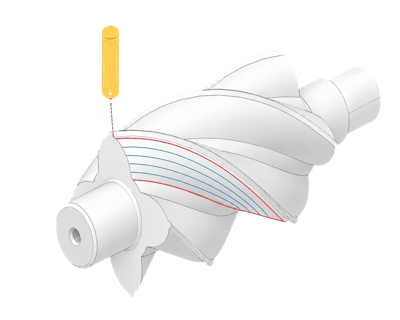 | 4-Achsen-Schlichtvariante der Morphing-Operation für Maschinen mit kontinuierlicher Drehachse in 4X- und 5X-Konfigurationen. Erzeugt glatte Bahnen zwischen zwei Bezugskurven oder Kontaktkurven ausgewählter Bearbeitungsflächen. Synchronisationslinien verbessern die Zuordnung beim Morphing. Unterstützt unter anderem Quer-, Längs- und Spiralstrategien. |
|   |   |
| [4D-Flächenbearbeitung](10145.md) |   |
| 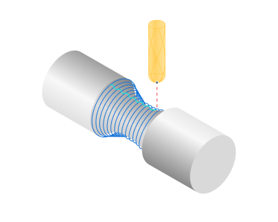 | Aus der 5D-Flächenbearbeitung abgeleitete Schlichtoperation für Maschinen mit kontinuierlicher Drehachse in 4X- und 5X-Konfigurationen. Bearbeitet komplexe Flächen mit ausgeprägter Drehachse oder Längsrichtung. Unterstützt unter anderem Parallel zur Kurve, Morphing zwischen zwei Flächen und Spirale zwischen zwei Flächen sowie die Steuerung der Werkzeugausrichtung. Die 5D-Ausrichtungsstrategien Durch Punkt, Durch Kurve und Senkrecht zur Werkzeugbahn sind nicht verfügbar. |
|   |   |
| [4D-Konturieren](10144.md) |   |
| 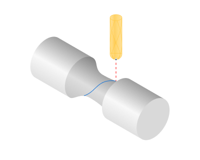 | Erzeugt simultane Bahnen zur Bearbeitung räumlicher Kurven auf Flächen mit ausgeprägter Rotationsachse oder Längsrichtung. Unterstützt einzelne Durchgänge entlang ausgewählter Kurven, mehrere Bahnen entlang isoparametrischer Flächenlinien und die Bearbeitung auf mehreren Ebenen entlang einer Kurve. |

| <strong>[Turbomaschinenfräsen](100173.md)</strong> |   |
|---|---|
| [Laufradbearbeitung](1041.md) |   |
| 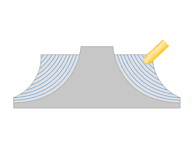 | Effiziente 5-Achsen-Bearbeitung von Blisks und Impellern. Enthält Strategien zum Schruppen, zum Schlichten von Schaufeln und Nabe sowie zur Nachbearbeitung der Verrundungen. Unterstützt die Kollisionskontrolle für Werkzeug, Halter und Werkstück. Die Bearbeitungsbereiche werden über Schaufelflächen, Nabenflächen (Rotationsflächen erforderlich) und Deckflächen definiert. |
|   |   |
| [Schaufelbearbeitung](100127.md) |   |
|  | Schlichtet Schaufelprofile, Fußbereiche, Naben und Kanten. |

| <strong>[Restmaterialbearbeitung](727.md)</strong> |   |
|---|---|
| [Ecken nachbearbeiten](10121.md) |   |
| 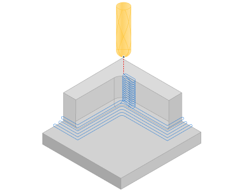 | Verwendet den Durchmesser des vorherigen Werkzeugs und erzeugt Bahnen in Bereichen, in denen dieses Werkzeug Restmaterial hinterlassen würde. |
|   |   |
| [Hohlkehlenbearbeitung (Pencil)](10120.md) |   |
| 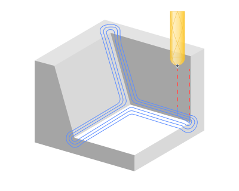 | Erzeugt Bahnen zur Restmaterialbearbeitung entlang der inneren Bauteilecken. |
|   |   |
| [Anfasen](10123.md) |   |
|  | Erzeugt Fasen und Verrundungen oder entfernt Grate entlang von Bauteilkanten. Unterstützt zylindrische, konische und kugelförmige Fräser. Wird häufig als abschließender Arbeitsschritt zum Anfasen, Verrunden, Brechen scharfer Kanten und Entgraten eingesetzt. |

| <strong>[Frühere Operationstypen](123124.md)</strong> |   |
|---|---|
| [Ebenenschlichten](713.md) |   |
|  | Bearbeitet Flächen eines Volumenmodells mit Bahnen in parallelen vertikalen Ebenen. Geeignet für flache Bereiche und für steile Bereiche, wenn die Bahnen entlang der Flächensteigung verlaufen. Bei komplexen Modellen empfiehlt sich die Kombination mit Wasserlinienbearbeitung oder einer zweiten Ebenenoperation mit quer zur ersten Bahnrichtung verlaufenden Bahnen. |
|   |   |
| [Optimiertes Ebenenschlichten](714.md) |   |
|  | Erstellt zwei Ebenenbearbeitungen mit zueinander senkrechten Bahnrichtungen. Die Standardeinstellungen beschränken jede Operation auf die Flächenbereiche, in denen sie ein günstiges Ergebnis erzielt. Dadurch lässt sich eine gleichmäßige Bearbeitungsqualität auch auf komplex geformten Flächen bei geringer Bearbeitungszeit erreichen. |
|   |   |
| [Kombiniertes Schlichten (Complex)](839.md) |   |
|  | Erstellt eine Ebenen- und eine Wasserlinienbearbeitung für ein 3D-Modell. Die Parameter werden so eingestellt, dass flache Bereiche mit Ebenenbahnen und steile Bereiche mit Wasserlinienbahnen bearbeitet werden. Dadurch entsteht eine gleichmäßige Oberflächenqualität. Günstigere Eingriffsbedingungen ermöglichen längere Werkzeuge mit kleinerem Durchmesser. Das Verfahren eignet sich für unterschiedliche Flächenneigungen und verringert die Bearbeitungszeit. |

| <strong>[Bearbeitung auf Schneidmaschinen](10224.md)</strong> |   |
|---|---|
| [Strahlschneiden](326.md) |   |
|  | Schneidet Bauteile aus Blech. Außen- und Innenkonturen können durch geschlossene oder offene Kurven definiert werden. Das Werkzeug folgt diesen Konturen; Innenkonturen werden vor der Außenkontur geschnitten. |
|   |   |
| [4D-Strahlschneiden](10225.md) |   |
|  | 4D-Strahlschneiden für Wasserstrahl-, Laser-, Plasma- und ähnliche Verfahren. Bearbeitet einfache Formen sowie komplexere Elemente mit geneigten Seitenflächen. Die Konturen werden wie beim Drahterodieren definiert; die Bahn wird jedoch als Punkt mit Normalenvektor oder als Punkt mit Maschinen-Drehachsstellungen ausgegeben. |
|   |   |
| [5D-Strahlschneiden](10226.md) |   |
|  | 5D-Strahlschneiden auf räumlich geformten Flächen. Basiert auf der [5D-Konturbearbeitung](10129.md), ohne die für dieses Verfahren nicht benötigte Mehrfachdurchgangsfunktion. |
|   |   |
| [Messerschneiden 2D](10241.md) |   |
|  | Programmiert das Schneiden von Plattenmaterial mit Messern, Band- oder Kreissägen. Spezielle Übergänge an scharfen Bahnecken vermeiden Verformungen des Materials durch abrupte Werkzeugdrehungen. Basiert auf der [2D-Konturbearbeitung](404.md). Der Einsatz eines [Messers](10240.md) erfordert neben den linearen X-, Y- und Z-Achsen eine zusätzliche Drehachse zur Werkzeugausrichtung. |
|   |   |
| [Messerschneiden 6D](10242.md) |   |
|  | Schneidet räumlich geformte Flächen mit einem Messer und basiert auf der [5D-Konturbearbeitung](10129.md). Spezielle Übergänge an scharfen Ecken vermeiden Materialverformungen durch abrupte Messerbewegungen. Die Schneide muss an jedem Bahnpunkt in Bewegungsrichtung zeigen. Dafür sind sechs Freiheitsgrade erforderlich, mindestens drei lineare und drei rotatorische Achsen. Häufig werden Industrieroboter eingesetzt. |

| <strong>[Bearbeitung mit Scheibenwerkzeugen](10277.md)</strong> |   |
|---|---|
| [Schruppen mit Scheibenwerkzeug](10281.md) |   |
|  | Bereitet Steinrohlinge und ähnliche Materialien mit einem Scheibenwerkzeug vor. In den abzutragenden Bereichen werden mehrere Schnitte gesetzt. Die verbleibenden dünnen Materialstege werden anschließend manuell abgeschlagen. Danach erfolgt üblicherweise eine Schlichtbearbeitung mit einem geeigneten Werkzeug. |
|   |   |
| [2D-Sägen mit Scheibenwerkzeug](10279.md) |   |
|  | Schneidet Plattenmaterial mit einem kreisförmigen Werkzeug, beispielsweise einer Kreissäge. |
|   |   |
| [6D-Sägen mit Scheibenwerkzeug](10280.md) |   |
|  | Sägt oder schneidet ebene und räumliche Bauteile mit einem Scheibenwerkzeug. |

| <strong>[Drahterodieren](10244.md)</strong> |   |
|---|---|
| [2D-Konturieren beim Drahterodieren](10246.md) |   |
|  | Erzeugt Drahtbahnen entlang ebener Konturen für die 2D-Bearbeitung sowie mit geneigtem Draht für konische oder räumliche Konturen. Die Ausgangskonturen liegen in einer gemeinsamen Ebene. |
|   |   |
| [4D-Konturieren beim Drahterodieren](10247.md) |   |
|  | Erzeugt Drahtbahnen anhand zweier ebener Konturen gleichzeitig. Die Arbeitskontur in XY bestimmt die Bewegung der unteren Drahtführung; die Leitkontur in UV bestimmt die Bewegung der oberen Drahtführung. Dadurch können oberes und unteres Drahtende unterschiedlichen Bahnen folgen. |

| <strong>[Additive Fertigung](10272.md)</strong> |   |
|---|---|
| [Flächen auftragen](10273.md) |   |
|  | Trägt Material auf das Werkstück auf. Damit lassen sich beispielsweise Schichten mit hoher Härte, Festigkeit, Verschleiß-, Korrosions- oder Wärmebeständigkeit und definierten Reibeigenschaften erzeugen. Auch die Wiederherstellung verschlissener Bauteile und Werkzeuge, etwa Schaufeln, Matrizen, Formen, Zahnräder oder Wellen, ist möglich. Bereichsdefinition und Parameter ähneln dem Taschenfräsen: Kurven und Modellkanten begrenzen den Auftragsbereich. Je nach Basisfläche liegt dieser auf einer Ebene, einem Zylinder oder einer Rotationsfläche. Mit der Projektion der Werkzeugbahn auf das Bauteil sind beliebig geformte Flächen möglich. Parallele und äquidistante Strategien füllen den Bereich. Schichtanzahl und Seitenwinkel der Wände sind einstellbar. |
|   |   |
| [Material entlang von Kurven auftragen](10274.md) |   |
|  | Additive Operation für dünnwandige Modelle. Erzeugt Bahnen von unten nach oben entlang der Kurven der Auftragszuweisung. Die Kurven können auf einer Ebene, einem Zylinder oder einer Rotationsfläche liegen. Mit der Projektion auf das Bauteil ist der Auftrag auf beliebig geformten Flächen möglich. Die Bahn kann schichtweise oder als durchgehende Helix erzeugt werden. |
|   |   |
| [3D-Materialauftrag](10275.md) |   |
|  | Additive Operation auf Grundlage eines 3D-Modells. Ähnelt dem Wasserlinien-Schruppen, arbeitet jedoch von unten nach oben. Das Modell wird in Schichten geschnitten; für jede Ebene wird eine Bahn zum Füllen der Schnittfläche berechnet. Parallele und äquidistante Füllstrategien stehen zur Verfügung. |
|   |   |
| [5D-Auftragsschweißen](10276.md) |   |
|  | Trägt auf 3- oder 5-Achsen-Maschinen Materialschichten auf Bauteilflächen auf. Geeignet für dünnwandige Modelle, den gezielten Auftrag auf einzelnen Flächen mit anschließendem Fräsen sowie für Schutzschichten in stark belasteten Bereichen. Spiralstrategien und zugehörige Parameter vermeiden mehrfaches Überfahren derselben Stelle. Weitere Strategien sind parallel zur Ebene, Morphing und parallel zur Kurve. |
|   |   |
| [Nicht planares Slicing](1052.md) |   |
|  | Erzeugt additive Druckbahnen auf beliebig geformten, nicht ebenen Substraten durch nicht planares Slicing. Bei Bedarf steht auch die klassische planare Schichtbildung mit zusätzlichen Parametern zur Verfügung. |

| <strong>[Schweißen](10270.md)</strong> |   |
|---|---|
| [Punktschweißen](20041.md) |   |
|  | Unterstützt Heftschweißen und Punktschweißen. |
|   |   |
| [5D- und 6D-Schweißen](10271.md) |   |
|  | Berechnet die Schweißnahtgeometrie automatisch und unabhängig vom Typ der Schweißausrüstung, ohne gerätespezifische Befehle für Laser, Lichtbogen, Gasbrenner oder Ultraschallgeräte zu erzeugen. Nach Auswahl der Kante zwischen den zu verschweißenden Bauteilen werden die Ausrichtungswinkel entlang der Kurve berechnet. Der Schweißkopf wird möglichst mittig zwischen den angrenzenden Wänden gehalten, ohne mit ihnen zu kollidieren. Die Simulation zeigt den Materialauftrag an der Kontaktstelle der Schweißkopfspitze. |

| <strong>[Spritzlackieren](10400.md)</strong> |   |
|---|---|
| [Konturgeführtes Sprühen](10400.md) |   |
|  | Konturgeführtes Sprühen auf Grundlage der [6D-Konturbearbeitung](10129.md). Ermöglicht eine flexible Steuerung der Werkzeugposition an jedem Bahnpunkt. |
|   |   |
| [Flächengeführtes Sprühen](10400.md) |   |
|  | Flächengeführtes Sprühen auf Grundlage des [5D-Auftragsschweißens](10276.md). Bietet unterschiedliche Strategien zur Erzeugung von Lackierbahnen auf Flächen. |
|   |   |
| [Morphing-Sprühen](10400.md) |   |
|  | Sprühen mit Morphing-Strategien auf Grundlage der Operation [Morphing](10138.md). |
|   |   |
| [Rotationssprühen](10400.md) |   |
|  | Rotationssprühen auf Grundlage des [Rotationsschlichtens](10136.md). |

| <strong>Hilfsoperationen</strong> |   |
|---|---|
| [Operationsgruppe](844.md) |   |
|  | Ordnet Operationen mit gemeinsamen Parametern in Gruppen und ermöglicht einen hierarchischen Operationsbaum. Änderungen an Gruppenparametern werden an die entsprechenden Parameter der enthaltenen Operationen weitergegeben. |
|   |   |
| Vervielfältigungsgruppe |   |
|  | Definiert Regeln zum Vervielfältigen von Bahnen, die von den enthaltenen Operationen übernommen werden. Einzelne Operationen bearbeiten Bauteilmerkmale; die Gruppe überträgt die Ergebnisse gemäß den Regeln auf gleichartige Merkmale. Die Regeln werden auf der Registerkarte **Transformationen** festgelegt. |
|   |   |
| [Hilfsoperation](10075.md) |   |
|  | Speichert eine bestimmte Folge von CLData-Befehlen als benannte, wiederverwendbare Liste, beispielsweise für bestimmte Maschinentypen oder betriebliche Abläufe. Beispiele sind Spannen eines Futters, Werkzeugwechsel, Anfahren des Reitstocks, Wenden eines Bauteils und Aktivieren eines Werkstückkoordinatensystems G54–G59. |
|   |   |
| [G-Code-basierte Fräs- und Drehoperationen](10379.md) |   |
|  | Erzeugt eine Werkzeugbahn aus dem NC-Programmtext der Auftragszuweisung und dem ausgewählten Interpreter. Der Text kann manuell eingegeben oder aus einer Datei geladen und bearbeitet werden. Unterstützt auch indexierte und simultane Bearbeitung auf 4- und 5-Achsen-Bearbeitungszentren sowie alle Simulationsarten einschließlich additiven Materialauftrags. Ermöglicht die direkte Steuerung der Maschinensimulation mit G-Code, das Prüfen und Optimieren von NC-Programmen, die Umsetzung für andere Steuerungen und die Fehlersuche bei der Entwicklung eigener Interpreter. |
|   |   |
| Formfräser erstellen |   |
|  | Erstellt ein Formfräswerkzeug in ENCY. Zeichnen Sie die Werkzeugkontur als Mantellinie im Zeichenmodus; dazu kann eine Modellkurve übernommen oder eine neue Skizze erstellt werden. Wählen Sie anschließend im Kontextmenü der Werkzeugliste **Save as tool (Als Werkzeug speichern)** und geben Sie Formtyp, Namen und Werkzeugschema an. Die gespeicherte Kontur steht in der Werkzeugbibliothek zur Verfügung und kann im Werkzeugfenster für Kontur- und Profilfräsoperationen ausgewählt werden. |

| <strong>[Operationen zum Bewegen des Bauteils](10402.md)</strong> |   |
|---|---|
| [Aufnehmen und Ablegen (Pick-and-Place)](10404.md) |   |
|  | Variante von Pick-and-Place mit einer Auftragszuweisung aus Punktknoten: Startpunkt, Aufnahmepunkt, Bewegungspunkt relativ zur Aufnahme, Bewegungspunkt relativ zur Ablage, Ablagepunkt und Endpunkt. Die Punkte bilden eine Folge von Bahnabschnitten, beispielsweise Aufnahme → Bewegung → Ablage. |
|   |   |
| Allgemeines Pick-and-Place – <strong>ältere Operation</strong> |   |
|  | Allgemeine Pick-and-Place-Operation zur Steuerung des Greifers beim Bewegen des Werkstücks im Arbeitsraum der Maschine. |
|   |   |
| [Stangenvorschub](10408.md) |   |
|  | Erstmaliger Stangenvorschub in die Spindel. Sollte in einem Langdrehprojekt die erste Operation sein. Positioniert und spannt das Werkstück und legt unter anderem Stangenüberstand, Werkzeugkontaktposition und Anfangsspannung fest. |
|   |   |
| [Arbeiten mit der Gegenspindel](10407.md) |   |
|  | Für Dreh-Fräsmaschinen mit Gegenspindel angepasste Pick-and-Place-Operation. Synchronisiert Haupt- und Gegenspindel, greift das Werkstück mit der Gegenspindel für die weitere Bearbeitung auf beiden Spindeln und bewegt das Bauteil zwischen ihnen. |
|   |   |
| [Werkstückübernahme beim Drehen](10406.md) |   |
|  | Werkstückübergabe zwischen Spindeln für Drehprojekte. Synchronisiert Haupt- und Gegenspindel, übernimmt das Bauteil oder gibt es zurück und übernimmt **Workpiece Connector** sowie **Setup CS** automatisch vom nächsten Bauteil im Projekt. Unterstützt die Zusammenarbeit mit dem Abstechen, die Spannmittelsteuerung über CLData und die Erzeugung von Bewegungsbefehlen **Multigoto/Goto**. |
|   |   |
| Übergabe an die nächste Aufspannung – <strong>ältere Operation</strong> |   |
|  | Spezielle Pick-and-Place-Operation, die die Ablageposition aus der nächsten Aufspannungs- oder Bauteilgruppe übernimmt. Für Roboter und Fräsmaschinen vorgesehen; in Drehprojekten wird die Werkstückübergabe **Turn take over** verwendet. |

| <strong>[Antasten und Messen](1410.md)</strong> |   |
|---|---|
| [Werkzeug messen](1410.md) |   |
|  | Misst und kalibriert Werkzeuge. Erfasst Werkzeuglänge und -radius, prüft auf Werkzeugbruch und bestimmt die Ausgangsabmessungen für die Werkzeugkorrektur. |
|   |   |
| [Bauteil messen](1410.md) |   |
|  | Misst die Werkstückgeometrie, darunter Flächen- und Bohrungsmaße sowie Lage, Ausrichtung und Winkel von Elementen. Bestimmt die tatsächliche Bauteillage zur Korrektur von Versatz und Verdrehung. |
|   |   |
| [Drehwerkzeug messen](1410.md) |   |
|   | Misst und kalibriert Drehwerkzeuge. Erfasst Länge und/oder Radius, prüft auf Werkzeugbruch und ermittelt die tatsächlichen Werkzeugwerte zur Korrektur nachfolgender Operationen. |
|   |   |
| [Bauteil in der Drehaufspannung messen](1410.md) |   |
|   | Misst die Werkstückgeometrie in einer Drehaufspannung, beispielsweise Bohrungen, Stirnflächen und weitere Flächen. Prüft Lage und Ausrichtung in der Spannung, erfasst Maße zur Abweichungskorrektur und erzeugt Messberichte. |

