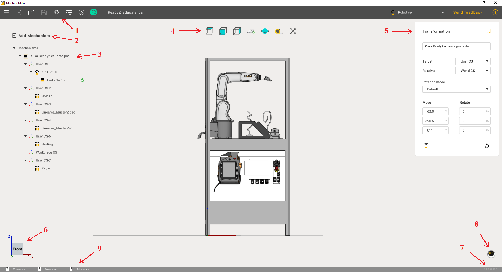
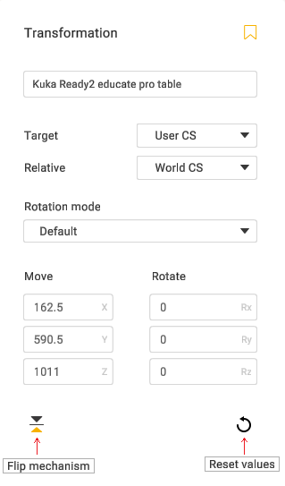

---
title: "Main window"
---

# Main window

Main window contains following areas:

1. Toolbar
2. Add mechanism button
3. Assembly tree
4. View controls
5. Transformation panel
6. Interactive View CS
7. Version info
8. AI Assistant
9. Interface help

Select any mechanism to show **Transformation Panel.** Use transformation panel to change the object's position.

It is possible to change selected mechanism name and save it to the local Mechanisms Library using **Save to library** button.

This panel is also useful for table calibration.

Use  button to flip mechanism position and **Reset** button to zero all fields.
The **Transformation panel** has 3 main functions:

1. Flip mechanism
2. Reset velues

Double click on mechanism to enter Mechanism Edit mode.
