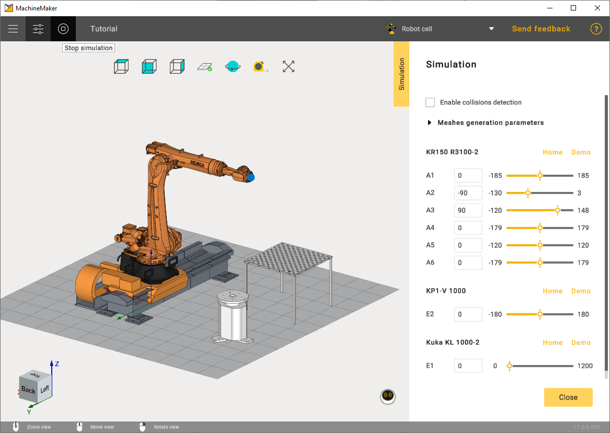
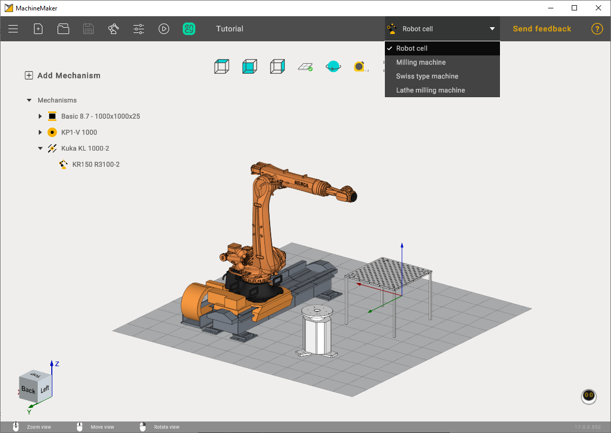

---
title: "Toolbar"
---

# Toolbar

Application toolbar is located in the top panel of the main window.

## Main menu (1)

**Main Menu (1)** contains the following items:

**File** opens a submenu for project operations:

- **New** - create a new project. It is also possible to use **New (1)** button in the toolbar.
- **Open** - open an existing project. It is also possible to use **Open (3)** button in toolbar.
- **Open recent** - show latest projects. Keep mouse over **Open (3)** button to show recent projects.
- **Save** - save current project. MachineMaker will ask for project destination folder when saving the file for the first time. It is also possible to use **Save (4)** button located in the toolbar.
- **Save as** - save current project to another folder
- **Export** - open CAM system with the current Machine. It is also possible to use **CAM system** button located in the toolbar

  It is necessary to add a robot to the assembly to save the project

## Mechanisms Library (5)

Opens a library of mechanisms. The library is categorized into different categories. For robots, milling machines and lathe-milling machines

## Assembly settings (6)

Use **Assembly settings (6)** button to open assembly settings panel.

## Simulation (7)

Use **Simulation (7)** button to validate all mechanisms kinematics.

## Project name (9)

Use double click on project name to change it. Entered project name will be used by CAM system. It is also possible to change project name in settings panel.

## Context switcher (10)

Select the context depending on your tasks.

## Feedback and help

Use **Feedback (11)** button to provide your feedback or ask for assistance.

MachineMaker will automatically attach log files and current project to your request, It is possible to remove any attachment and attach any new file to your request.

Use **Help (12)** button to open this help and tutorial.
