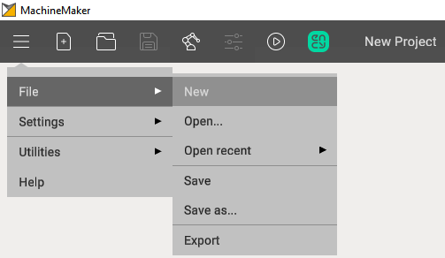

---
title: "Creating a project"
---

# Creating a project

## Starting MachineMaker

MachineMaker can be started directly from the CAM system utilities menu

## Creating a project

MachineMaker automatically creates a new project at startup. It is possible to create a new project any time using **Menu - File - New**

