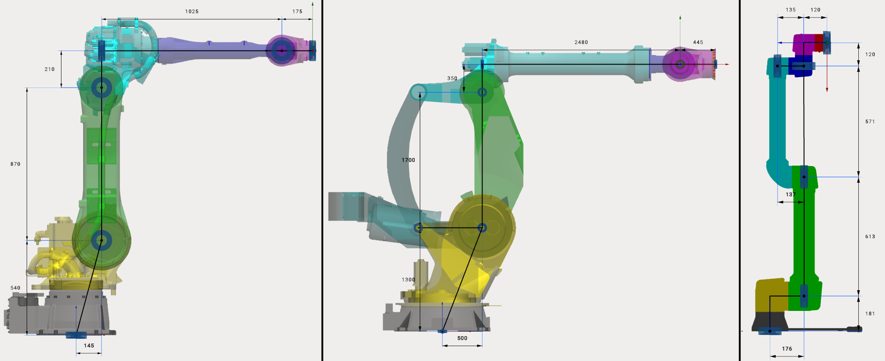

---
title: "Adding a mechanism"
---

# Adding a mechanism

First of all it is necessary to add the desired mechanism to your project using **Add Mechanism** button

## Supported mechanism types

- **Robot** - common industrial 6-axes robotic arm.
- **Heavy-Duty Robot** - high payload robot with additional joints.
- **Cobot** - collaborative 6-axes robotic arm.
- **End effector** - device at the extremity of the robotic arm, designed to interact with the environment. Spindles, Laser Heads, Wire Cutters and etc. Robot can contain any number of end effectors. End effector can be added only after the robot is selected.
- **Composite End effector** - complex devices, contain movable parts. For example gripper with fingers.
- **Fixed object** - any fixed object (controller, enclosure, etc).
- **Table (fixed)** - static table
- **Table (1 axis)** - rotary table (positioner) with 1 axis
- **Table (2 axes)** - rotary table (positioner) with 2 axes
- **Rail** - rail or any another linear axis. Usually allows you to move the robot along the X axis.
- **Portal (2 axes)** - mechanism with 2 linear axes. Usually allows you to move the robot along X-Y axes.
- **Portal (3 axes)** - portal, mechanism with 3 linear axes. Usually allows you to move the robot along X-Y-Z axes.
- **Machine equipment -** Universal equipment with the possibility of configuration.
- **Parametric box -** Cube, with the possibility of changing its length, width, height.
- **Parametric table -** Table, with the possibility of changing its length, width, height, thickness and height of legs.
- **Parametric turn-mill Machining centre -** Parametric machine (Turn).
- **Parametric vertical Machining centre -** Parametric machine (Mill).
- **From file** - allows you to add a mechanism exported to .mmm file. Check "Mechanism library" section for more information about .mmm files

Robots, Heavy-Duty Robots and Cobots have different kinematic schemes:

