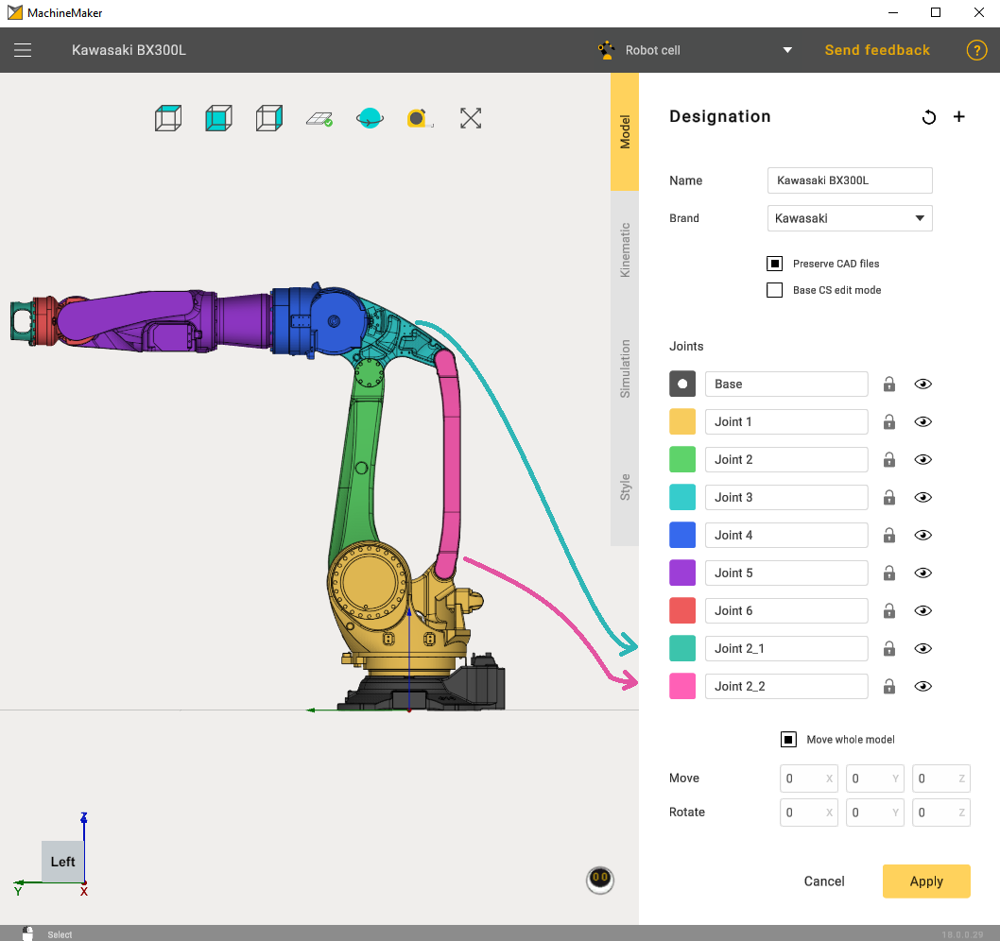
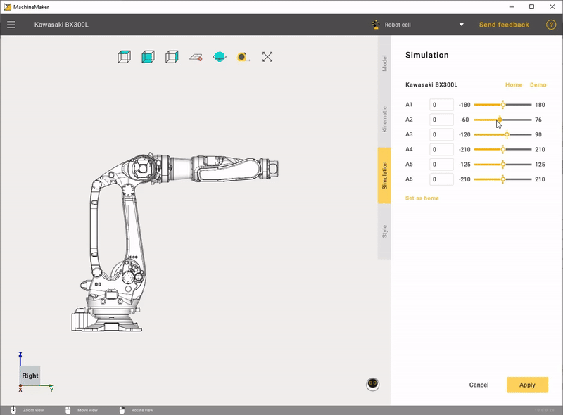
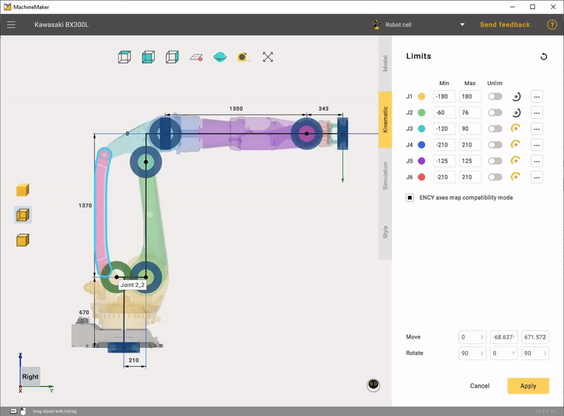

---
title: "Flexible Heavy-Duty Robot"
---

# Flexible Heavy-Duty Robot

The Flexible Heavy-Duty Robot setup is similar to the Heavy-Duty robots. They also have 2 additional joints, but in this case they are moving.

Here, as in the Heavy-Duty Robot setup, the easiest way to set the connector to the correct position is to hold down the left Ctrl button and drag the connector to the anchor point.

