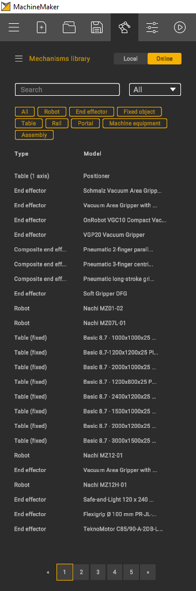
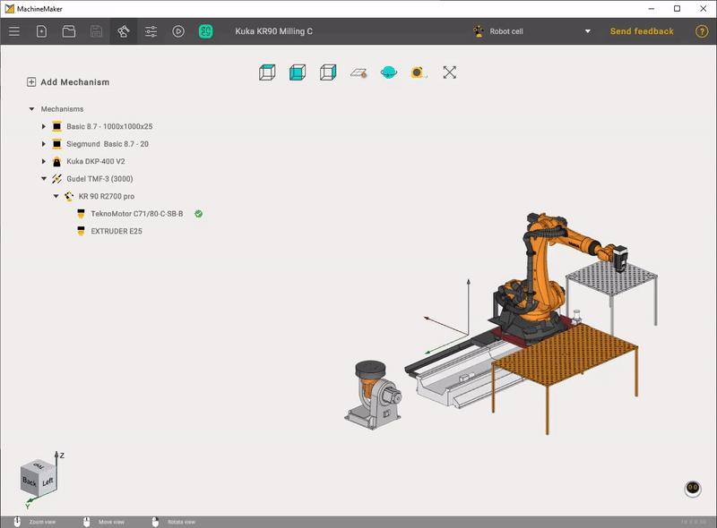

---
title: "Mechanisms Library"
---

# Mechanisms Library

Use  button to open Mechanisms library.

It is possible to switch between a **Local** and **Online** libraries. Any mechanism can be saved to your local library. Select mechanism in assembly and click **Save to** **library** button.

Use **Search** field and OEM field to find a desired machine/robot.

It is also possible to specify the mechanism type.

Finally, click the **Add** button to add selected the mechanism to your assembly.

It is possible to add MachineMaker mechanism file (.mmm) to your local library manually using  menu.

