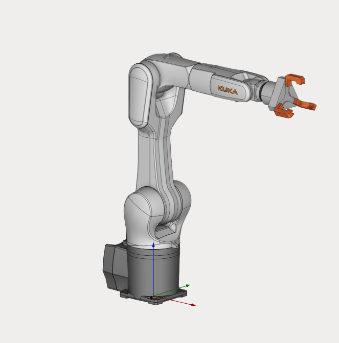

---
title: "Composite End Effector"
---

# Composite End Effector

Download Project here: **[CompositeEndEffector.zip](../assets/b5830ce681e00fa5cbb0f33e17859e6cbe893db21c175c7f52e0da9c63163dde.zip) / [CompositeEndEffectorLinear.zip](../assets/341a345875f95e69e72da27f700a8a6ba44ca8a1d249a73ae7f932092b0b8a6c.zip)**

Composite End Effectors have two types:

1. Rotary
2. Linear

In the case of "Rotary" a special configuration is used for flexible limbs of the mechanism.
For "Linear" only linear axes are used along which the gripper jaws will move.

To learn more about these features, we recommend watching our tutorials on **[rotary](https://www.youtube.com/watch?v=zHQKJ3JOpGE&list=PLnaHZJpWJMKPN2hSDvR1DnxmAuFH4tP42&index=7)** and **[linear](https://www.youtube.com/watch?v=sVA2ds63cKg&list=PLnaHZJpWJMKPN2hSDvR1DnxmAuFH4tP42&index=8)** Composite End Effectors.
