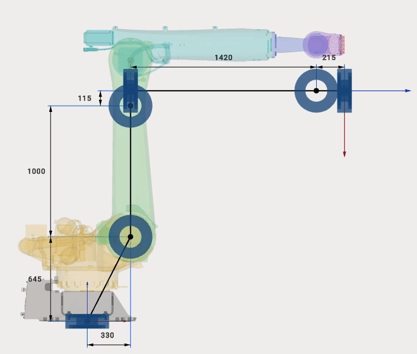
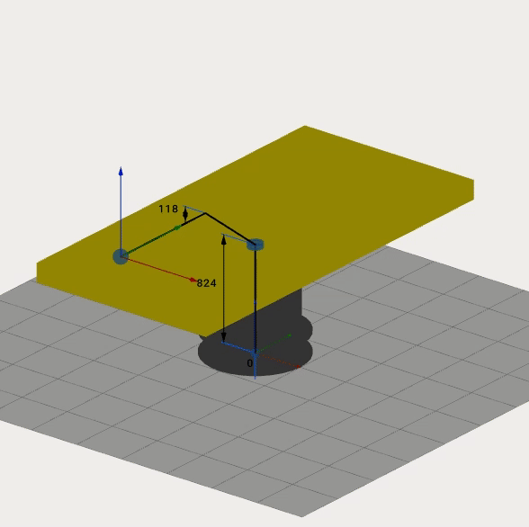
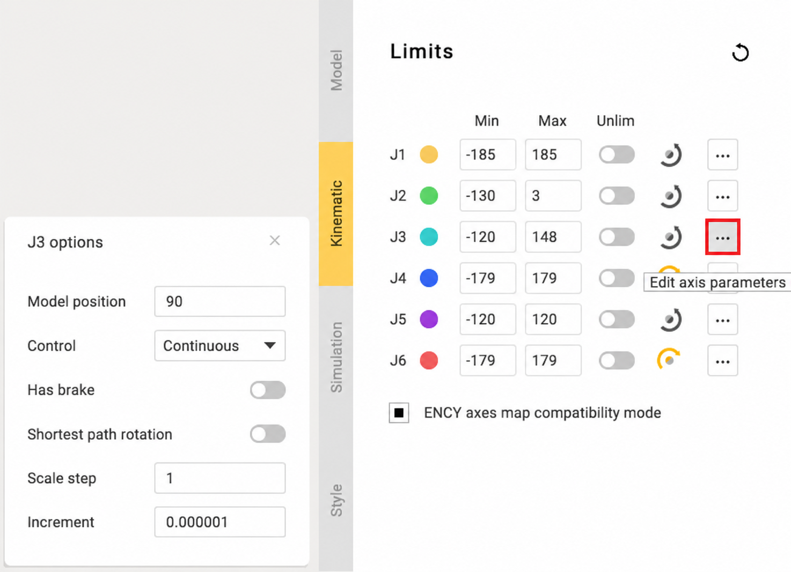
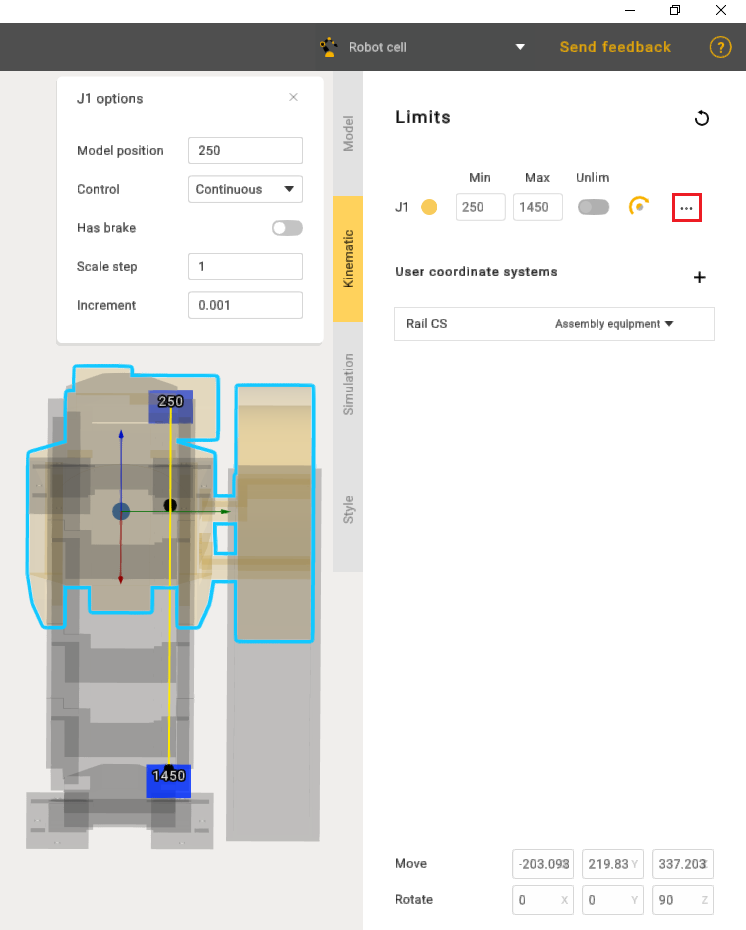

---
title: "Building a kinematic scheme"
---

# Building a kinematic scheme

Click **Kinematic** tab to open kinematic parameters panel.

## Kinematics

MachineMaker shows the current mechanism's 3D model and kinematic scheme. It is necessary to build correct kinematic linkage by specifying connector's positions.

There are three ways to specify connector position:

- Dimensions
- Transformation panel
- Drag&Drop and snap points

### Dimensions

Click to dimension and enter new value.

### Transformation panel

It is also possible to set position of any connector manually. Select connector (blue bearing for rotary joints and blue dot for "assemblies") and enter move and rotate values to the **Transformation Panel** at the right bottom corner.

Use **Mouse Wheel Scroll** to change values on any inputbox or combobox. Hold **Shift** or **Ctrl** keys while scrolling values to change values faster or slower.

### Drag&Drop and snap points

Hold **Left Ctrl** key to enter Drag&Drop mode. Drag any connector (blue bearing for rotary joints and blue dot for "assemblies"). MachineMaker will show small red snap points nearby. Release mouse button to drop object.

## Limits

It is possible to enter limits for each node. You can find this information in DataSheets.

MachineMaker shows joint's minimum and maximum values.

Use  or  buttons to change rotation or movement direction.

Use **Unlim** switcher to allow unlimited rotation for positioners.

## Model Position

Use **Model Position** to set joint values for current position of imported 3D model. These fields allows you to use CAD files of mechanisms, saved in non-zero positions.

For example here is the zero position of Kuka robots:

But [Kuka download center](https://www.kuka.com/en-de/services/downloads) provides only 3D models for non-zero robot position:

So we can just specify **Model Position** values and use 3D models provided by Kuka. It is not necessary to change them on CAD system.

**Model Position** function is also useful for mechanisms with linear axes. For example, when editing rail limits.

