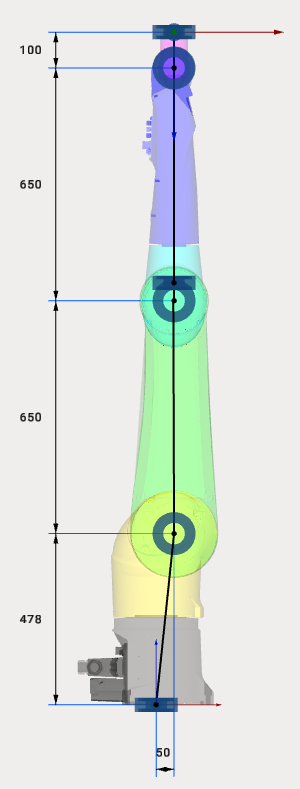

---
title: "Industrial Robots"
---

# Industrial Robots

The easiest way to set the kinematics of a 6-axes industrial robot is to use the robot's DataSheet and specify the 6 dimensions in MachineMaker.

Drag&Drop mode is restricted for Robot kinematics to prevent the impairment of the kinematic scheme.

## Special cases

Some robot manufacturers, like Staubli, provide 3D models and DataSheets with robots set at zero positions. MachineMaker automatically assumes the kinematic linkage of the selected type of robot.

