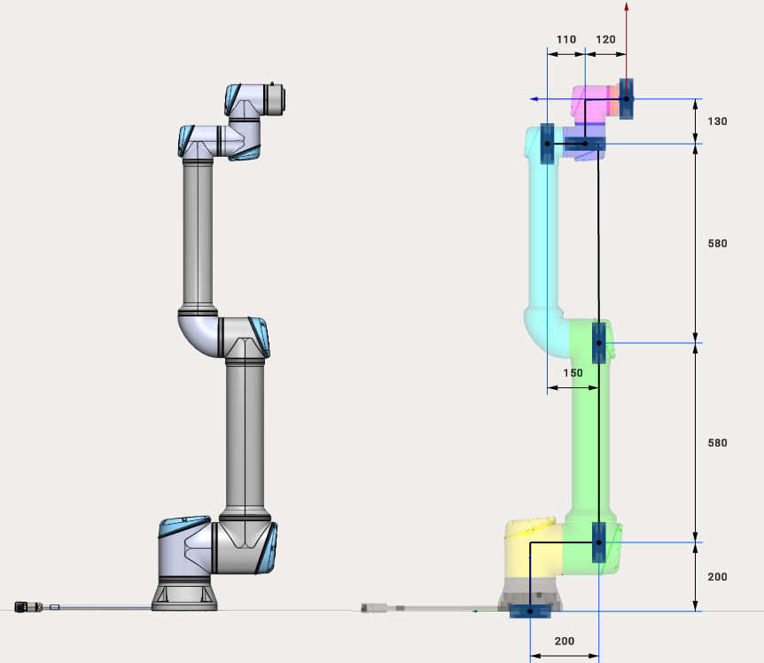

---
title: "Cobot"
---

# Cobot

Cobots (Collaborative robots) have a different template of kinematic schemes. As a rule, at zero position this kind of robots is vertically aligned.

Current version of MachineMaker supports 6-axes Universal and AUBO collaborative robots.

