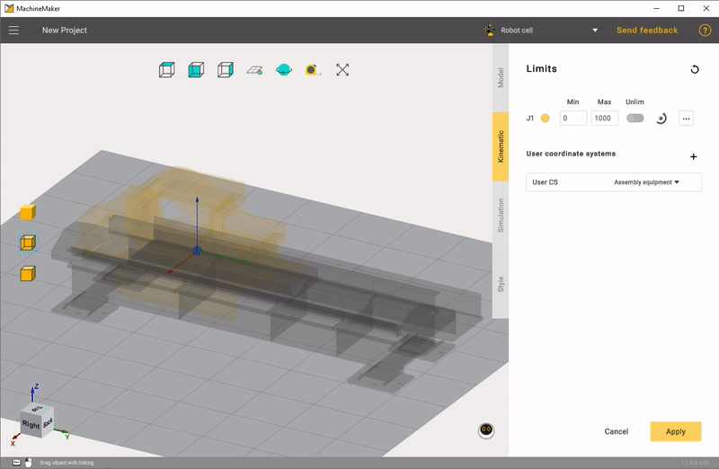

---
title: "Rails and Portals"
---

# Rails and Portals

MachineMaker allows you to add linear rails, 2-axes portals and 3-axes portals.

It is possible to add any number of connectors to the table using  button in the **User Coordinate Systems** panel. Use  button to delete the connector. Use double click to rename the coordinate system.

MachineMaker will use connectors to connect mechanisms with each other when building "Assemblies".

Click on **Limits** to specify Min and Max values. MachineMaker will show minimal and maximal positions of the 3D model.

It is possible to change linear axis direction using transformation panel in the right bottom corner.

