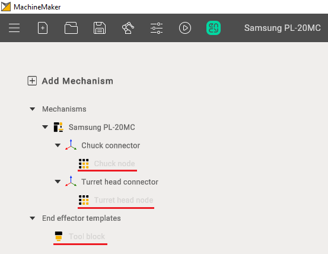

---
title: "Adding a mechanism"
---

<link rel="stylesheet" href="assets/manual.css">

<h1 id="src-131898466">Adding a mechanism</h1>

First of all it is necessary to add the desired mechanism to your project using <i class=""><strong class="">Add Mechanism </strong></i>button  

When adding additional mechanisms, you can double-click on the desired option in the mechanism tree to open a selection of files or use "Add mechanism"

 

<h1 class="heading">Supported mechanism types</h1>
<ul class=""><li class="">
<strong class="">Turret Head Node</strong> - a component enabling tool rotation and positioning during operation, often facilitating tool fixation, tool change, and positional data processing.

</li><li class="">
<strong class="">Chuck Node</strong> - a component for securing workpieces or tools during machining, typically incorporating clamping mechanisms such as collet chucks or hydraulic clamps, with control and adjustment features.

</li><li class="">
<strong class="">Tool Block</strong> - a component for mounting and supporting cutting tools during material processing, designed for various tool types like drills, mills, and inserts, usually equipped with quick-change and adjustment mechanisms.

</li><li class="">
<strong class="">Movable Tool Block</strong> - a device capable of spatial movement to precisely position tools or workpieces during machining operations, often movable along different axes and controlled by mechanical, hydraulic, or electrical systems.

</li></ul>

