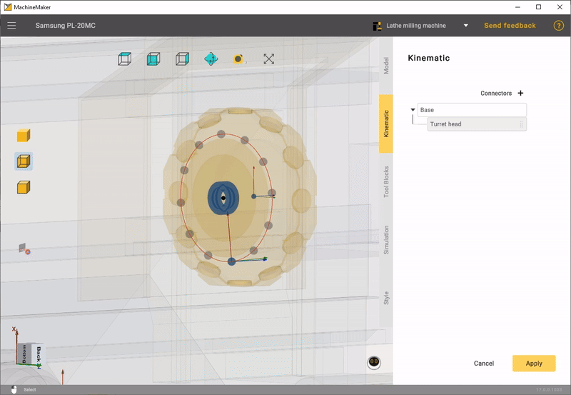
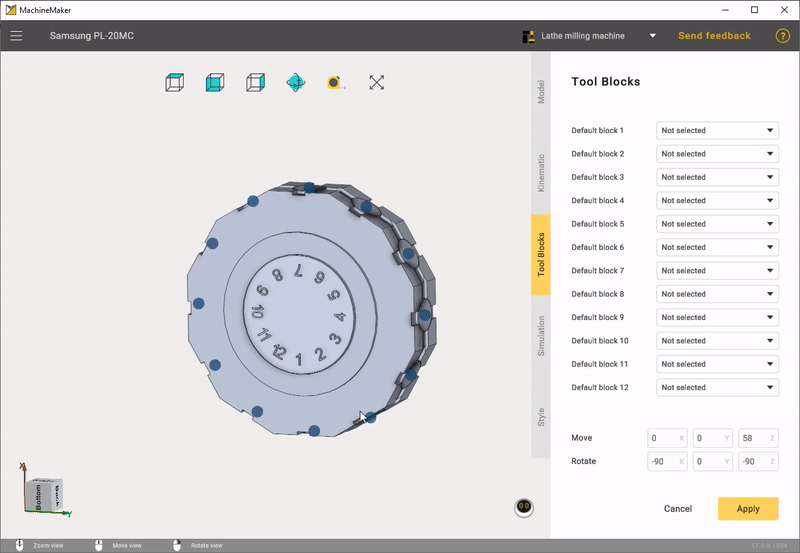
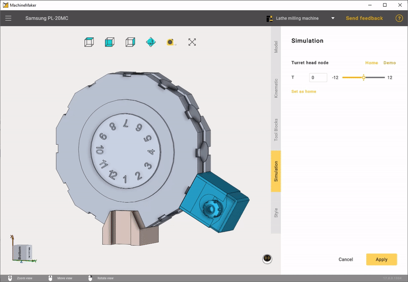

---
title: "Turret head node"
---

<link rel="stylesheet" href="assets/manual.css">

<h1 id="src-131898663">Turret head node</h1>

Next, you need to add a Turret head node.

It is important to position the Base CS on the back of the mechanism.

Next, you need to position the connection points of the blocks. To do this, you can use Interactive mode, which helps you to perform this task quickly. By dragging 1 point it automatically sets other points as well.

The next step is to place the tool blocks on the connecting points. You can add tools in 2 ways: 1) Use the right mouse button; 2) Select the desired tool from the drop-down menu.

On the Simulation tab make sure that the Turret head moves correctly and click apply.

At this point, the build of the lathe milling machine is complete.

