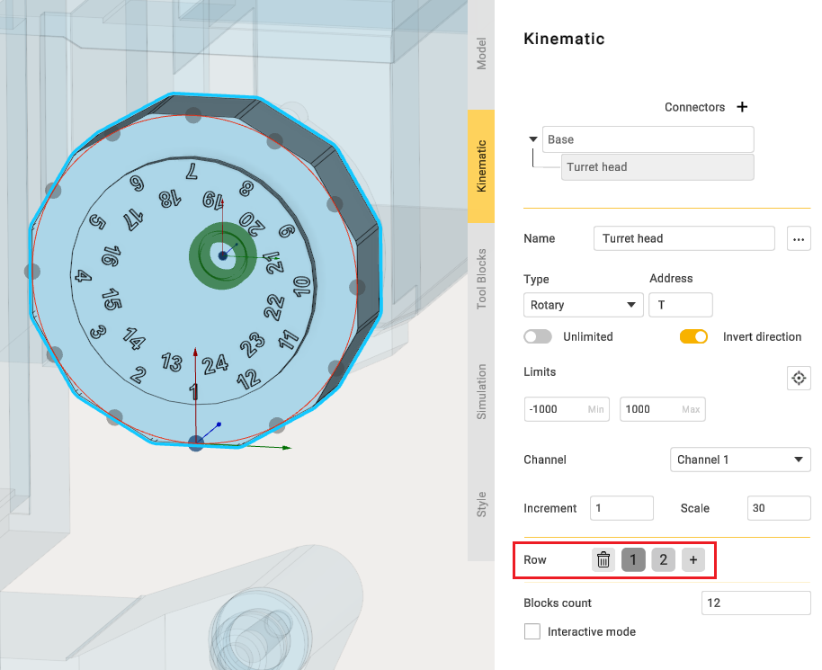
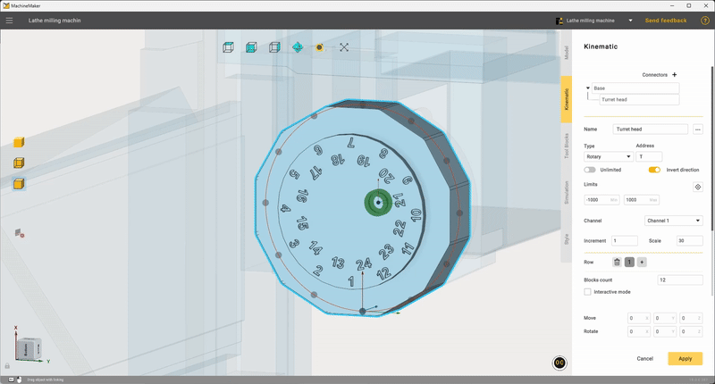
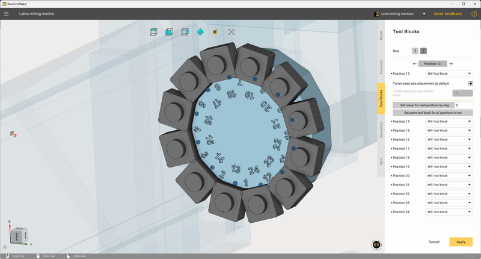

---
title: "Dual-row tool turret"
---

<link rel="stylesheet" href="assets/manual.css">

<h1 id="src-142647526">Dual-row tool turret</h1>

In this chapter, we will look at setting up the dual-row tool turret.

 

Now you can use button 
 in the kinematic settings to add additional rows of connection points for tool placement on the turret. If needed, the added block can also be removed using button 

 

On the "<strong class="">Tool Blocks"</strong> tab, you may see that by default the added tool uses all connection points. If you want to use only some of the points, click the <strong class="">"Set same tool block for all positions in row button"</strong>. This will clear the turret, so you can place the tools as you need.

 You can see the tutorial video at the <a class="external-link" href="https://www.youtube.com/watch?v=5pfjNPZR50A&amp;list=PLnaHZJpWJMKPN2hSDvR1DnxmAuFH4tP42&amp;index=17&amp;ab_channel=ENCYSoftware">link</a>.

