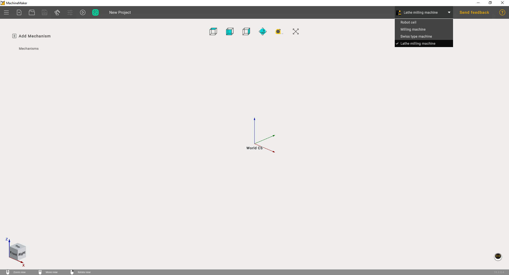

---
title: "Introduction to MachineMaker"
---

# Introduction to MachineMaker

MachineMaker is a standalone application which allows you to create robot cells and CNC machines for CAM system.

You can launch MachineMaker d  irectly from the CAM system utilities menu.

Next, it is necessary to select the correct application context using ***Application Mode*** **Selector.**

