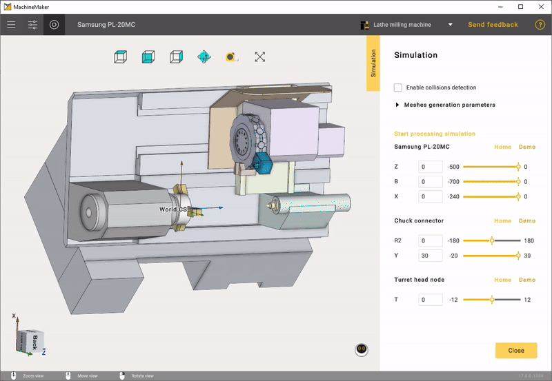

---
title: "Mechanism Simulation and Validation"
---

# Mechanism Simulation and Validation

Select *Simulation* tab to validate the mechanism's kinematics. Use the trackbar to change the axis coordinates or enter values in the input box manually.

 Click ***Demo***button to check all nodes.

If something looks wrong in the simulation, please check the  "Building a kinematic scheme".

If you see nodes collisions, please check the "Grouping elements into nodes".

Use  button on the "Toolbar" to validate whole assembly.
