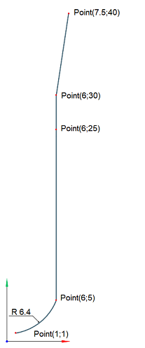
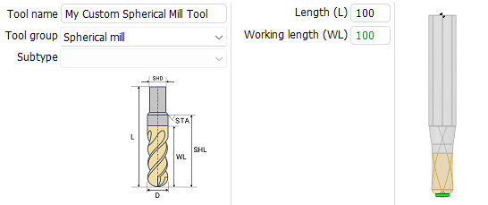

# Working with custom Axial Shape Tools
Custom axial shape tools are generated from a curve drawn from points on a 2D plane. Common tool attributes, such as tool name, tool number, etc., are the same for all subtypes of cutting tools. For example, below is the code for creating a custom axial shape tool in a spherical group of milling tools.

```
//C#
//importer is an instance of IMTI_MachiningToolsImportLibrary 
var tool = importer.CreateCustomAxialShapeTool();
tool.ToolGroup = TMTI_AxialToolGroup.tgSpherical;
tool.OverallLength = 100;
tool.SetName("My Custom Spherical Mill Tool");
tool.SetIdentifier("s001");
tool.SetTeethsCount(2);
tool.SetMagazineNumber(1);
tool.SetToolNumber(1);
tool.SetUnits(TMTI_LinearUnits.luMillimeter);
tool.SetDurability(70);
tool.SetMaxPlungeAngle(90);

var rcv = tool.BeginGeneratrix();
TST2DPoint p = new TST2DPoint() {X = 1, Y = 1};
TST2DPoint pc = new TST2DPoint() {X = 0.0359, Y = 7.3301};
rcv.SetSpanType(TMTI_CurveSpanType.csfWorking);
rcv.StartCurve(p);
p.X = 6; p.Y = 5;
rcv.ArcTo(pc, p, 6.4031);
p.X = 6; p.Y = 25;
rcv.CutTo(p);
rcv.SetSpanType(TMTI_CurveSpanType.csfNonWorking);
p.X = 6; p.Y = 30;
rcv.CutTo(p);
p.X = 7.5; p.Y = 40;
rcv.CutTo(p);

var toolings = tool.GetToolingPoints();
toolings.ToolContactPointType = TMTI_AxialToolContactPointType.cpCustomPoint;
toolings.ToolContactPointsCount = 1;

toolings.ToolingPointCount = 1;
toolings.ToolingPointType[0] = TMTI_AxialToolToolingPointType.tpCustomPoint;
toolings.ToolingPointShift[0] = 1.5;
toolings.ToolingPointLengthCorrectorNumber[0] = 1;
toolings.ToolingPointRadiusCorrectorNumber[0] = 1;

var cond = tool.GetCuttingConditions();
cond.CuttingSpeedMode = TMTI_CuttingSpeedMode.csmRPM;
cond.RotationsPerMinute = 100;
cond.SpindleGearRange = 1;
cond.RotationDirection = TMTI_RotationDirection.rdCW;
cond.FeedUnits = TMTI_FeedUnits.perMinute;
cond.FeedValue = 100;

int tubesCount = cond.Coolant.TubeCount; //20
cond.Coolant.TubeIsOn[0] = true;
cond.Coolant.TubeIsOn[1] = false;
cond.Coolant.TubeIsOn[2] = true;

//after setting the properties, add this tool to your tool library instance
```

Сurve result view:



Code execution result:



## Helpful links:
- [How to work with shaped tools in the CAM interface](https://docs.encycam.com/ENCY/3/en/10343.html)
- [Preparing the machining tools import api environment](PrepEnvPage.md)
- [GitHub: Machining tool import API examples](https://github.com/EncySoftware/cam-api-examples/tree/v3/main/MachiningTools);

## Continue to read:
- [Working with the Tool Holder](ToolHolderPage.md)