# Working with Milling Tools
Milling tools are divided into various subtypes, where the geometry of each subtype is set by its own unique set of parameters. Common tool attributes, such as tool name, tool number, etc., are the same for all subtypes of cutting tools. For example, below is the code for creating a Cylindrical Mill tool:
```
//C#
//importer is an instance of IMTI_MachiningToolsImportLibrary 
var tool = importer.CreateCylindricalMill();
tool.OverallLength = 100;
tool.CuttingDiameter = 10;
tool.WorkingLength = 30;
tool.ShankDiameter = 12;
tool.ShoulderLength = 60;
tool.ShankTaperAngle = 40;

tool.SetName("My Cylindrical mill");
tool.SetIdentifier("m001");
tool.SetTeethsCount(3);
tool.SetMagazineNumber(1);
tool.SetToolNumber(1);
tool.SetUnits(TMTI_LinearUnits.luMillimeter);
tool.SetOverhang(100);
tool.SetDurability(70);
tool.SetMaxPlungeAngle(90);

var toolings = tool.GetToolingPoints();
toolings.ToolContactPointType = TMTI_AxialToolContactPointType.cpCustomPoint;
toolings.ToolContactPointsCount = 1;

toolings.ToolingPointCount = 1;
toolings.ToolingPointType[0] = TMTI_AxialToolToolingPointType.tpCustomPoint;
toolings.ToolingPointShift[0] = 1.5;
toolings.ToolingPointLengthCorrectorNumber[0] = 1;
toolings.ToolingPointRadiusCorrectorNumber[0] = 1;

var cond = tool.GetCuttingConditions();
cond.CuttingSpeedMode = TMTI_CuttingSpeedMode.csmRPM;
cond.RotationsPerMinute = 100;
cond.SpindleGearRange = 1;
cond.RotationDirection = TMTI_RotationDirection.rdCW;
cond.FeedUnits = TMTI_FeedUnits.perMinute;
cond.FeedValue = 100;

int tubesCount = cond.Coolant.TubeCount; //20
cond.Coolant.TubeIsOn[0] = true;
cond.Coolant.TubeIsOn[1] = false;
cond.Coolant.TubeIsOn[2] = true;

//after setting the properties, add this tool to your tool library instance
```
Code execution result:
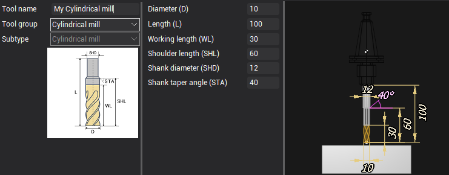

## Milling Tool Geometry Properties

| Tool type | View |
| :--------- | :----: |
| **Cylindrical Mill:** <br>&nbsp; OverallLength (L) <br>&nbsp; CuttingDiameter (D) <br>&nbsp; WorkingLength (WL) <br>&nbsp; ShankDiameter (SHD) <br>&nbsp; ShoulderLength (SHL) <br>&nbsp; ShankTaperAngle (STA) | 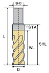 |
| **Spherical Mill:** <br>&nbsp; OverallLength (L) <br>&nbsp; CuttingDiameter (D) <br>&nbsp; WorkingLength (WL) <br>&nbsp; ShankDiameter (SHD) <br>&nbsp; ShoulderLength (SHL) <br>&nbsp; ShankTaperAngle (STA) | 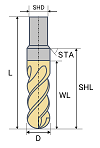 |
| **Torus Mill:** <br>&nbsp; OverallLength (L) <br>&nbsp; CuttingDiameter (D) <br>&nbsp; WorkingLength (WL) <br>&nbsp; ShankDiameter (SHD) <br>&nbsp; ShoulderLength (SHL) <br>&nbsp; ShankTaperAngle (STA) <br>&nbsp; Radius (Rc) | 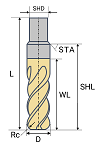 |
| **Double Radial Mill:** <br>&nbsp; OverallLength (L) <br>&nbsp; CuttingDiameter (D) <br>&nbsp; WorkingLength (WL) <br>&nbsp; ShankDiameter (SHD) <br>&nbsp; ShoulderLength (SHL) <br>&nbsp; ShankTaperAngle (STA) <br>&nbsp; Radius (Rc) <br>&nbsp; TipRadius (R) | 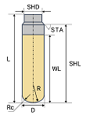 |
| **Limited Double Radial Mill:** <br>&nbsp; OverallLength (L) <br>&nbsp; CuttingDiameter (D) <br>&nbsp; WorkingLength (WL) <br>&nbsp; ShankDiameter (SHD) <br>&nbsp; ShoulderLength (SHL) <br>&nbsp; ShankTaperAngle (STA) <br>&nbsp; Radius (Rc) <br>&nbsp; TipRadius (R) <br>&nbsp; ShapeLength (H) | 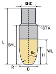 |
| **Conical Mill:** <br>&nbsp; OverallLength (L) <br>&nbsp; CuttingDiameter (D) <br>&nbsp; WorkingLength (WL) <br>&nbsp; ShankDiameter (SHD) <br>&nbsp; ShoulderLength (SHL) <br>&nbsp; ShankTaperAngle (STA) <br>&nbsp; Radius (Rc) <br>&nbsp; TipRadius (R) <br>&nbsp; Angle (A) | 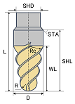 |
| **Limited Conical Mill:** <br>&nbsp; OverallLength (L) <br>&nbsp; CuttingDiameter (D) <br>&nbsp; WorkingLength (WL) <br>&nbsp; ShankDiameter (SHD) <br>&nbsp; ShoulderLength (SHL) <br>&nbsp; ShankTaperAngle (STA) <br>&nbsp; Radius (Rc) <br>&nbsp; TipRadius (R) <br>&nbsp; Angle (A) <br>&nbsp; ShapeLength (H) | 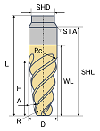 |
| **Engraver:** <br>&nbsp; OverallLength (L) <br>&nbsp; CuttingDiameter (D) <br>&nbsp; WorkingLength (WL) <br>&nbsp; ShankDiameter (SHD) <br>&nbsp; ShoulderLength (SHL) <br>&nbsp; ShankTaperAngle (STA) <br>&nbsp; Angle (A) <br>&nbsp; EndDiameter (d) | 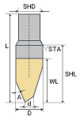 |
| **Drill:** <br>&nbsp; OverallLength (L) <br>&nbsp; CuttingDiameter (D) <br>&nbsp; WorkingLength (WL) <br>&nbsp; ShankDiameter (SHD) <br>&nbsp; ShoulderLength (SHL) <br>&nbsp; ShankTaperAngle (STA) <br>&nbsp; Angle (A) | 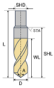 |
| **Two Stage Drill:** <br>&nbsp; OverallLength (L) <br>&nbsp; WorkingLength (WL) <br>&nbsp; Diameter1 (D1) <br>&nbsp; Diameter2 (D2) <br>&nbsp; Length1 (L1) <br>&nbsp; Length2 (L2) <br>&nbsp; Angle1 (a1) <br>&nbsp; Angle2 (a2)| 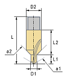 |
| **Spot Drill:** <br>&nbsp; OverallLength (L) <br>&nbsp; CuttingDiameter (D) <br>&nbsp; WorkingLength (WL) <br>&nbsp; ShankDiameter (SHD) <br>&nbsp; ShoulderLength (SHL) <br>&nbsp; ShankTaperAngle (STA) <br>&nbsp; Angle (A) |  |
| **Center Drill:** <br>&nbsp; OverallLength (L) <br>&nbsp; CuttingDiameter (D) <br>&nbsp; WorkingLength (WL) <br>&nbsp; ShankDiameter (SHD) <br>&nbsp; ShoulderLength (SHL) <br>&nbsp; ShankTaperAngle (STA) <br>&nbsp; Angle (A) | 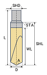 |
| **Reamer:** <br>&nbsp; OverallLength (L) <br>&nbsp; CuttingDiameter (D) <br>&nbsp; WorkingLength (WL) <br>&nbsp; ShankDiameter (SHD) <br>&nbsp; ShoulderLength (SHL) <br>&nbsp; ShankTaperAngle (STA) | 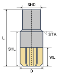 |
| **Counter Sink Drill:** <br>&nbsp; OverallLength (L) <br>&nbsp; CuttingDiameter (D) <br>&nbsp; WorkingLength (WL) <br>&nbsp; ShankDiameter (SHD) <br>&nbsp; ShoulderLength (SHL) <br>&nbsp; ShankTaperAngle (STA) <br>&nbsp; Angle (A) | 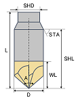 |
| **Flat Tip Countersink:** <br>&nbsp; OverallLength (L) <br>&nbsp; Diameter (D) <br>&nbsp; WorkingLength (WL) <br>&nbsp; ShaftDiameter (DS) <br>&nbsp; TipDiameter (TD) <br>&nbsp; ShoulderLength (SL) <br>&nbsp; TipAngle (A) | 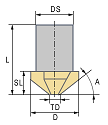 |
| **Counter Bore Drill:** <br>&nbsp; OverallLength (L) <br>&nbsp; CuttingDiameter (D) <br>&nbsp; WorkingLength (WL) <br>&nbsp; ShankDiameter (SHD) <br>&nbsp; ShoulderLength (SHL) <br>&nbsp; ShankTaperAngle (STA) <br>&nbsp; Angle (A) | 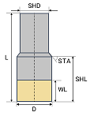 |
| **Pilot Counterbore:** <br>&nbsp; OverallLength (L) <br>&nbsp; Diameter (D) <br>&nbsp; WorkingLength (WL) <br>&nbsp; ShaftDiameter (DS) <br>&nbsp; PilotDiameter (PD) <br>&nbsp; ShoulderLength (SL) <br>&nbsp; FluteLength (FL) <br>&nbsp; PilotLength (PL) <br>&nbsp; PilotRadius (PR) | 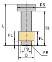 |
| **Boring Bar:** <br>&nbsp; OverallLength (L) <br>&nbsp; CuttingDiameter (D) <br>&nbsp; WorkingLength (WL) <br>&nbsp; ShankDiameter (SHD) <br>&nbsp; ShoulderLength (SHL) <br>&nbsp; ShankTaperAngle (STA) | 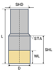 |
| **Back Boring Bar:** <br>&nbsp; OverallLength (L) <br>&nbsp; CuttingDiameter (D) <br>&nbsp; WorkingLength (WL) <br>&nbsp; Height1 (h1) <br>&nbsp; Height2 (h2) <br>&nbsp; Angle1 (a1) <br>&nbsp; Angle2 (a2) <br>&nbsp; StemDiameter (Ds) <br>&nbsp; StemAngle (Sa) <br>&nbsp; StemHeight1 (sh1) <br>&nbsp; StemHeight2 (sh2)| 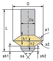 |
| **Tap:** <br>&nbsp; OverallLength (L) <br>&nbsp; CuttingDiameter (D) <br>&nbsp; WorkingLength (WL) <br>&nbsp; ShankDiameter (SHD) <br>&nbsp; ShoulderLength (SHL) <br>&nbsp; ShankTaperAngle (STA) <br>&nbsp; Angle (A) <br>&nbsp; ThreadPitch (TP) | 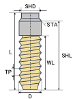 |
| **Thread Mill:** <br>&nbsp; OverallLength (L) <br>&nbsp; CuttingDiameter (D) <br>&nbsp; WorkingLength (WL) <br>&nbsp; StemDiameter (Ds) <br>&nbsp; Pitch (P) <br>&nbsp; PitchCount (c) <br>&nbsp; OD_ID (OD/ID)  | 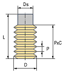 |
| **Negative Radius Mill:** <br>&nbsp; OverallLength (L) <br>&nbsp; CuttingDiameter (D) <br>&nbsp; WorkingLength (WL) <br>&nbsp; ShankDiameter (SHD) <br>&nbsp; ShoulderLength (SHL) <br>&nbsp; ShankTaperAngle (STA) <br>&nbsp; Radius (Rc) | 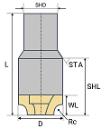 |
| **Knife:** <br>&nbsp; OverallLength (L) <br>&nbsp; Diameter (D) <br>&nbsp; FrontDistance (RD) <br>&nbsp; BackDistance (LD) <br>&nbsp; FrontAngle (RA) <br>&nbsp; BackAngle (LA) <br>&nbsp; AutoDepth (LD) <br>&nbsp; InclinationAngle (IA) | 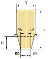 |
| **Saw Blade:** <br>&nbsp; WorkingLength (WL) <br>&nbsp; Diameter (D) <br>&nbsp; Thickness (Th) <br>&nbsp; RoundingRadius (R) | 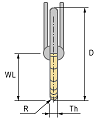 |
| **Undercut Dove Mill:** <br>&nbsp; OverallLength (L) <br>&nbsp; Diameter (D) <br>&nbsp; WorkingLength (WL) <br>&nbsp; Angle (a) <br>&nbsp; CornerRadius (Rc) <br>&nbsp; ShapeLength (H) | 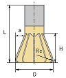 |
| **Undercut Slot Mill:** <br>&nbsp; OverallLength (L) <br>&nbsp; Diameter (D) <br>&nbsp; WorkingLength (WL) <br>&nbsp; ShaftDiameter (d) <br>&nbsp; SideAngle (a) <br>&nbsp; CornerRadius (Rc) <br>&nbsp; ShapeLength (H) | 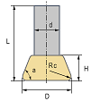 |
| **Undercut Lollipop Mill:** <br>&nbsp; OverallLength (L) <br>&nbsp; Diameter (D) <br>&nbsp; WorkingLength (WL) <br>&nbsp; ShaftDiameter (d)| 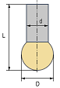 |
| **Undercut Two Angle Mill:** <br>&nbsp; OverallLength (L) <br>&nbsp; Diameter (D) <br>&nbsp; WorkingLength (WL) <br>&nbsp; Height (H) <br>&nbsp; HeadHeight (H2) <br>&nbsp; Angle1 (ang) <br>&nbsp; Angle2 (ang2) <br>&nbsp; SmoothRadius (R) <br>&nbsp; ShaftDiameter (W) | 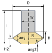 |
| **Undercut Round Groove Mill:** <br>&nbsp; OverallLength (L) <br>&nbsp; Diameter (D) <br>&nbsp; WorkingLength (WL) <br>&nbsp; Radius (R) <br>&nbsp; StemDiameter (Ds) | 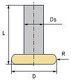 |
| **Undercut Sharp Chamfer Mill:** <br>&nbsp; OverallLength (L) <br>&nbsp; Diameter (D) <br>&nbsp; WorkingLength (WL) <br>&nbsp; Height (S)  <br>&nbsp; Angle (Ang) <br>&nbsp; Width (W)  <br>&nbsp; StemDiameter (Ds) | 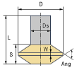 |
| **Undercut Rounded Chamfer Mill:** <br>&nbsp; OverallLength (L) <br>&nbsp; Diameter (D) <br>&nbsp; WorkingLength (WL) <br>&nbsp; Height (S)  <br>&nbsp; Angle (Ang) <br>&nbsp; Radius (R) <br>&nbsp; StemDiameter (Ds) | 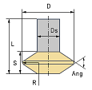 |
| **Undercut Indexable Chamfer Mill:** <br>&nbsp; OverallLength (L) <br>&nbsp; Diameter (D) <br>&nbsp; WorkingLength (WL) <br>&nbsp; StemDiameter (Ds) <br>&nbsp; InsertAngle (Ang) <br>&nbsp; InsertInnerCircleDiameter (IC) <br>&nbsp; InsertCornersCount (CNC) <br>&nbsp; CornerRadius (Re) | 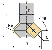 |
| **Undercut Barrel Mill:** <br>&nbsp; OverallLength (L) <br>&nbsp; Diameter (D) <br>&nbsp; WorkingLength (WL) <br>&nbsp; CenterLength (LC) <br>&nbsp; Height (H) <br>&nbsp; StemLength (LH) <br>&nbsp; EdgeR1 (RE1) <br>&nbsp; EdgeR2 (RE2) <br>&nbsp; EdgeR3 (RE3) <br>&nbsp; StemDiameter (DN) <br>&nbsp; ConnectDiameter (DCON) | 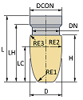 |
| **Undercut Lens Barrel Mill:** <br>&nbsp; OverallLength (L) <br>&nbsp; Diameter (D) <br>&nbsp; WorkingLength (WL) <br>&nbsp; FacetDiameter (FC) <br>&nbsp; EdgeR1 (RE1) <br>&nbsp; EdgeR2 (RE2) <br>&nbsp; Height (H) <br>&nbsp; StemLength (LH) <br>&nbsp; StemDiameter (DN) <br>&nbsp; ConnectDiameter (DCON) <br>&nbsp; Angle (a) | 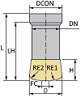 |
| **Undercut Taper Barrel Mill:** <br>&nbsp; OverallLength (L) <br>&nbsp; Diameter (D) <br>&nbsp; WorkingLength (WL) <br>&nbsp; Height (H)  <br>&nbsp; EdgeR1 (RE1) <br>&nbsp; EdgeR2 (RE2) <br>&nbsp; EdgeR3 (RE3) | 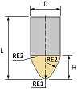 |
| **Jet Cutter:** <br>&nbsp; OverallLength (L) <br>&nbsp; Diameter (D) <br>&nbsp; WorkingLength (WL) <br>&nbsp; ShankDiameter (SHD) <br>&nbsp; ShoulderLength (SHL) <br>&nbsp; ShankTaperAngle (STA) | 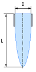 |
| **Taper Jet Cutter:** <br>&nbsp; OverallLength (L) <br>&nbsp; Diameter (D) <br>&nbsp; WorkingLength (WL) <br>&nbsp; JetLength (JL) <br>&nbsp; NozzleDistance (ND) <br>&nbsp; TaperAngle (Ang)| 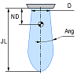 |
| **Plazma Jet Cutter:** <br>&nbsp; OverallLength (L) <br>&nbsp; Diameter (D) <br>&nbsp; WorkingLength (WL) <br>&nbsp; Length (h) <br>&nbsp; Angle (a) | 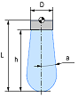 |
| **Laser Beam Cutter:** <br>&nbsp; OverallLength (L) <br>&nbsp; WorkingLength (WL) <br>&nbsp; LensDiameter (LD) <br>&nbsp; FocalDistance (F) <br>&nbsp; CylinderZoneDiameter (CD) <br>&nbsp; CylinderZoneLength (CL) <br>&nbsp; CurvatureRadius (R) <br>&nbsp; LaserBeamLength (BL) | 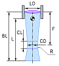 |
| **Single Vacuum Gripper:** <br>&nbsp; OverallLength (L) <br>&nbsp; WorkingLength (WL) <br>&nbsp; Diameter (D) <br>&nbsp; ShaftDiameter (shd) <br>&nbsp; CornerRadius (Rc) <br>&nbsp; ShapeLength (H) | 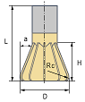 |

## Helpful links:
- [How to work with milling tools in the CAM interface](https://docs.encycam.com/ENCY/3/en/201.html)
- [Preparing the machining tools import api environment](PrepEnvPage.md)
- [GitHub: Machining tool import API examples](https://github.com/EncySoftware/cam-api-examples/tree/v3/main/MachiningTools);

## Continue to read:
- [Working with the Tool Holder](ToolHolderPage.md)