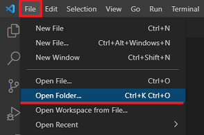
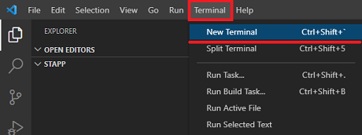
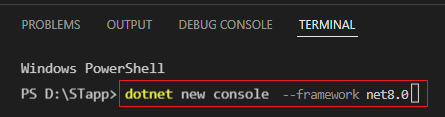
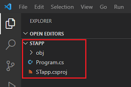
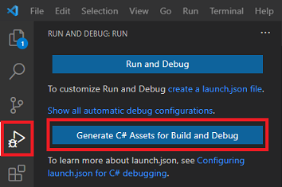
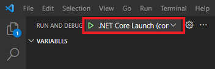

# Preparing the environment

The following is an example of how to prepare environment to work with machining tools import API, using the example of creating a console application in Visual Studio in C#.

1. Download and install the latest **.NET SDK x64** from the [official site](https://dotnet.microsoft.com/en-us/download).
2. To work with the source files, download and install the latest available version of [Visual Studio Code](https://code.visualstudio.com/download).
3. Run the installed Visual Studio Code and install "**C# Dev Kit for Visual Studio Code**" extension.


4. If you have not yet, download and install the latest [ENCY](https://encycam.com/download).
5. In Visual Studio Code, open an existing or create a new directory for your new project. When prompted to "Do you trust the authors of the files in this folder?", click on "Yes, I trust the authors".


6. Open the VS Code terminal view.


7. In the terminal view insert the "**dotnet new console --framework net10.0**" command and press enter (change the **net10.0** version if you have a different SDK version).


- After executing this command, the following source files should appear in your working directory:

- 

- The **.csproj** file will have the same name as the working folder.

8. Open the **.csproj** source file and change its contents as shown below:
```
<Project Sdk="Microsoft.NET.Sdk">
  <PropertyGroup>
    <TargetFramework>net10.0-windows</TargetFramework>
    <OutputType>Exe</OutputType>
  </PropertyGroup>
  
  <ItemGroup>
    <PackageReference Include="EncySoftware.CAMAPI.SDK.Net" Version="3.*" />
  </ItemGroup>
</Project>
```
- Set existing DLL location paths according to your CAM environment. If you cannot find the DLL libraries, make sure the CAM client is installed. 
- Pay attention to the target framework of your solution, it must match the format net10.0-**windows** (or higher SDK version).

9. Open the **Program.cs** source file and change its contents as shown below:
```
using System;
using System.IO;
using MachinigToolsImportTypes;
using STMachiningToolsImportHelper;
using STTypes;

namespace STConsoleApp 
{
  class Program 
  {
    private static string assemblyPath = 
      @"C:\Program Files\[CAM_Path]\" + MTIMachiningToolsImportHelper.DllName;

    static void Main(string[] args)
    {
      if (!File.Exists(assemblyPath)) {
        Console.WriteLine("The {0} source file is not found", assemblyPath);
        return;
      }

      try {
        var importer = MTIMachiningToolsImportHelper.CreateImporter(assemblyPath);
        //Use "importer" to create new tool items, to open an existing or create new machining tools libraries
          
      } 
      catch (Exception ex) {
        Console.WriteLine(ex.Message);
      } 
      finally {
        MTIMachiningToolsImportHelper.FinalizeImporter();
      }
    }
  }
}
```
Change the "assemblyPath" variable to existing the "Bin64" folder location path according to your CAM environment.
Now you can use the "**importer**" instance to create new tool items, to open an existing or create new machining tools libraries, and more.
Pay attention to the call of the **FinalizeImporter** function, this function is always called before exiting the main program.

10. Switch to the "Run and Debug" panel and press to the "Generate C# Assets for Build and Debug" button.


- Now you can start debugging your application:
- 

If you have set all the paths correctly, then this example should work without an error.

:star: **Congratulations**, you have set up your development environment. :star:

## Helpful links:
- [GitHub: Machining tool import API examples](https://github.com/EncySoftware/cam-api-examples/tree/v3/main/MachiningTools);

## Continue to read:
- [Working with the tool library](CreateStoragePage.md)
- [Working with cutting tools](WorkingWithTools.md)
