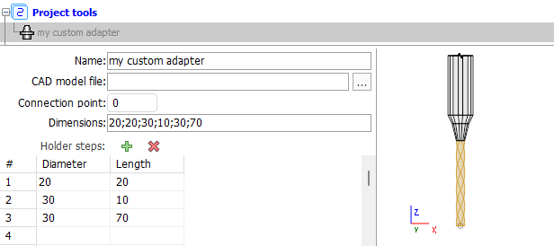

# Tool Holder
The tool holder can be defined in two ways: by installing an existing CAD model tool holder and using the CAM's builder. The CAD model allows you to specify files in *.stl and *.osd formats. The builder allows you to create custom tool holders with a set of dimensions, defining the diameter and length for each of the steps. Below is an example of how to form a tool holder using a CAM's builder:

```
//C#
//importer is an instance of IMTI_MachiningToolsImportLibrary
var tool = importer.CreateCylindricalMill();
tool.SetName("My Cylindrical Mill Tool with custom tool holder");
var adapter = tool.GetStepsAdapter();
adapter.HolderName = "my custom adapter";
adapter.HolderStepCount=3;
adapter.HolderStepDiameter[0] = 20;
adapter.HolderStepHeight[0] = 20;
adapter.HolderStepDiameter[1] = 30;
adapter.HolderStepHeight[1] = 10;
adapter.HolderStepDiameter[2] = 30;
adapter.HolderStepHeight[2] = 70;
```
Code execution result:


For turning tools, you can install the holder using the finished CAD model only.

## Helpful links:
- [How to work with tool holder in the CAM interface](https://docs.encycam.com/ENCY/3/en/10341.html)
- [Preparing the machining tools import api environment](PrepEnvPage.md)
- [GitHub: Machining tool import API examples](https://github.com/EncySoftware/cam-api-examples/tree/v3/main/MachiningTools);

[Return to Home Page](MTIStartPage.md)