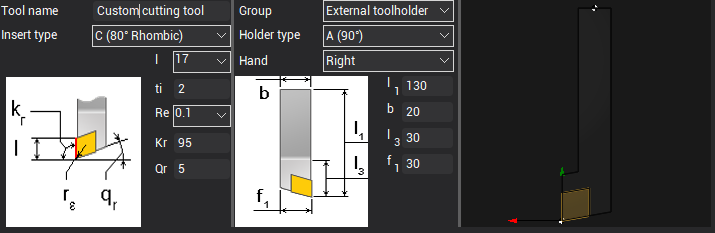

# Working with Turning Tools
Turning tools are formed from two parts: the insert part of the cutting edge and the tool holder type. To create a turning tool, the first thing you need to do is select a group of turning tools. Next, you need to choose a compatible type of tool holder and insert part of the cutting edge. You also need to choose tool hand direction. Common tool attributes, such as tool name, tool number, etc., are the same for all subtypes of cutting tools. For example, below is the code for creating a turn tool with an external holder:

```
//C#
using THDT = MachinigToolsImportTypes.TMTI_TurnToolHolderDimensionTypes;
using TIDT = MachinigToolsImportTypes.TMTI_TurnToolInsertDimensionTypes;
-------------------------------------------------------------
//importer is an instance of IMTI_MachiningToolsImportLibrary
var tool = importer.CreateTurnToolWithExternalHolder();
tool.SetName("My Turn tool");
tool.SetIdentifier("t001");
tool.SetMagazineNumber(1);
tool.SetToolNumber(1);
tool.SetUnits(TMTI_LinearUnits.luMillimeter);
tool.SetDurability(70);

tool.GetHandType().Hand = TMTI_Hand.hRight;

bool isCompatable = tool.SetHolderAndInsertType(
    TMTI_ExternalToolHolderTypes.htA_90deg, 
    TMTI_ExternalToolHolderInsertTypes.itC_80degRhombic);
if (isCompatable) {
    var tdim = tool.GetDimensions();
    tdim.Holder[THDT.hdL1] = 130;
    tdim.Holder[THDT.hdB] = 20;
    tdim.Holder[THDT.hdL3] = 30;
    tdim.Holder[THDT.hdF1] = 30;

    tdim.Insert[TIDT.idL] = 17;
    tdim.Insert[TIDT.idTi] = 2;
    tdim.Insert[TIDT.idRe] = 0.1;
    //if you have changed this property, the holder type is automatically set to undefined
    //tdim.Insert[TIDT.idKr] = 90;
}

var tdir = tool.GetDirections();
tdir.FixingDirection = TMTI_FixingDirection.fdDirect;
tdir.CuttingDirection[TMTI_CuttingDirections.cdS] = true;
tdir.CuttingDirection[TMTI_CuttingDirections.cdE] = true;
tdir.CuttingDirection[TMTI_CuttingDirections.cdSE] = true;

var overh = tool.GetOverhang();
overh.isAutoCalc = false;
overh.Axial = -10;
overh.Radial = 121;
overh.Matching = 1.5;

var tpoints = tool.GetToolingPoints();
tpoints.Corrector[0] = 1;
tpoints.Corrector[1] = 99;
tpoints.TPointX[0] = -2.22;
tpoints.TPointX[1] = 1.11;
tpoints.TPointY[0] = -1.55;
tpoints.TPointY[1] = -0.29;

var cond = tool.GetCuttingConditions();
cond.RotationDirection = TMTI_RotationDirection.rdCCW;
cond.CuttingSpeedMode = TMTI_CuttingSpeedMode.csmCSS;
cond.Coolant.TubeIsOn[0] = false;
cond.Coolant.TubeIsOn[1] = true;
cond.Coolant.TubeIsOn[2] = true;
cond.FeedValue = 2;
//after setting the properties, add this tool to your tool library instance
```

Code execution result:


Possible variants of compatible parts of the tool and their geometric dimensions can be viewed in the CAM interface.

## Helpful links:
- [How to work with turning tools in the CAM interface](https://docs.encycam.com/ENCY/3/en/350.html)
- [Preparing the machining tools import api environment](PrepEnvPage.md)
- [GitHub: Machining tool import API examples](https://github.com/EncySoftware/cam-api-examples/tree/v3/main/MachiningTools);

## Continue to read:
- [Working with the Tool Holder](ToolHolderPage.md)