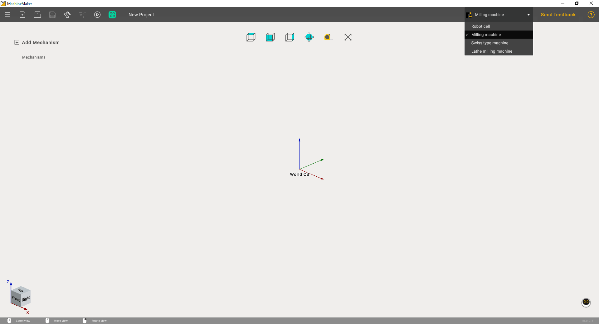
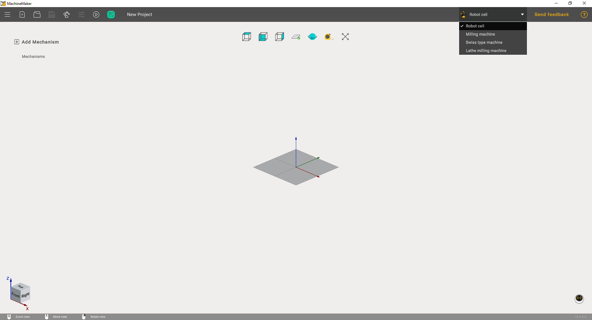

---
title: "MachineMaker 소개"
---

# MachineMaker 소개

MachineMaker는 CAM 시스템용 로봇 셀과 CNC 기계를 만들 수 있는 독립 실행형 애플리케이션입니다.

최신 버전의 MachineMaker에는 다음 OEM의 로봇이 포함되어 있습니다: ABB, Annin, AUBO, Borunte, Comau, Dobot, Doosan, Efort, Eidos, Epson, EVS, Fanuc, Han's, Hyundai, IIMT, Jaka, Kuka, Kawasaki, LNC, Mitsubishi, Motoman, Nachi, Newker, Regal, Siasun, Staubli, STEP, Tormach, uFactory, Universal, Simple.

CAM 시스템의 유틸리티 메뉴에서 MachineMaker를 직접 실행할 수 있습니다.

다음으로 **Application Mode Selector**(애플리케이션 모드 선택기)를 사용하여 올바른 애플리케이션 컨텍스트를 선택해야 합니다.

# [밀링 기계](#tab/machines)

# [로봇](#tab/robots)

# [선삭-밀링 복합 기계](#tab/turnmill)

---

공통 단계는 [인터페이스](128546586.md) 및 [시작하기](129940180.md)에서 설명합니다. 운동학 구조 만들기, 어셈블리 설정 및 예제는 [밀링 기계](../machines/128546571.md), [로봇](../robots/129926358.md), [선삭-밀링 복합 기계](../turnmill/1.md) 섹션에서 설명합니다.
