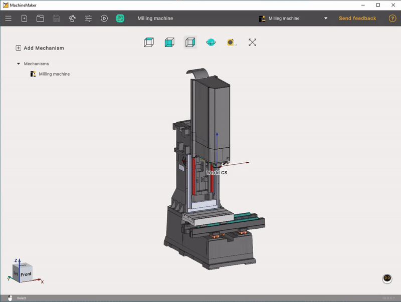
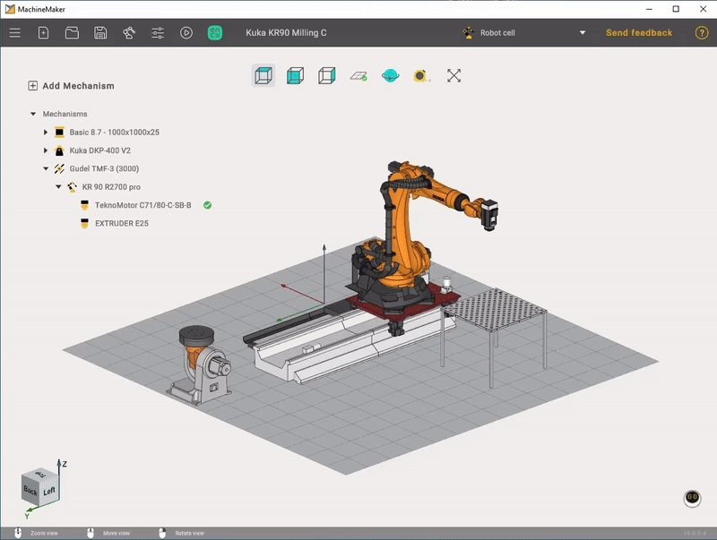
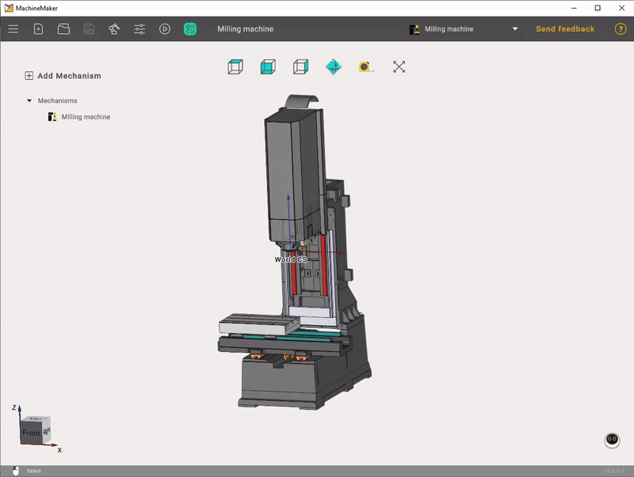
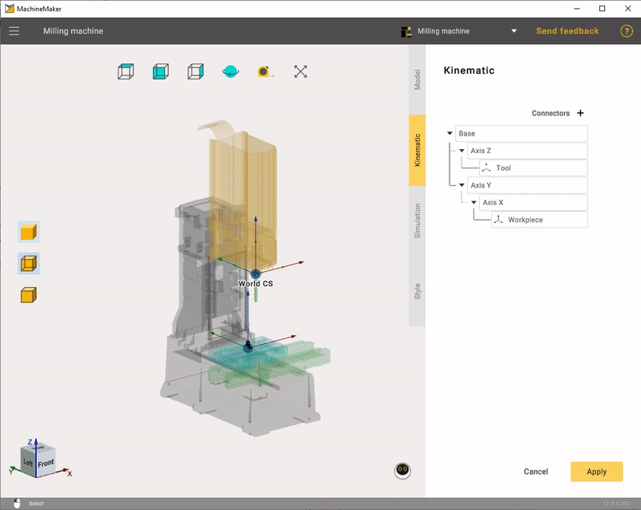
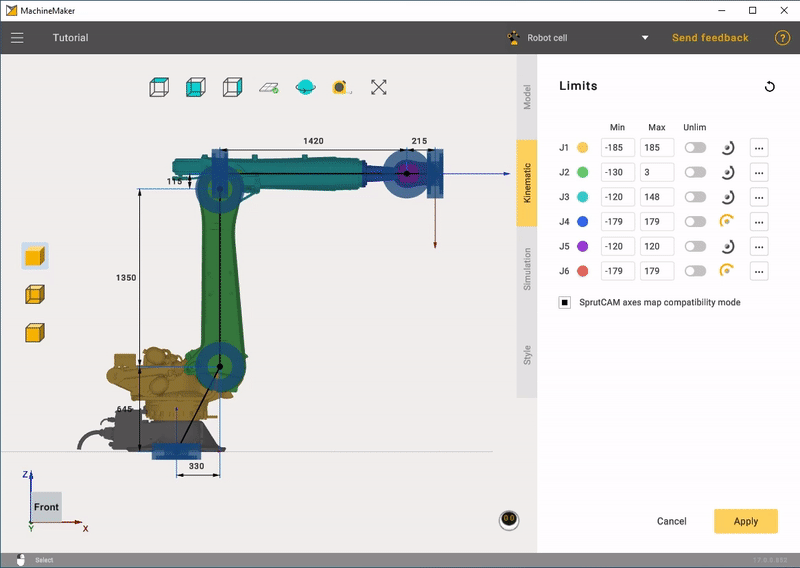
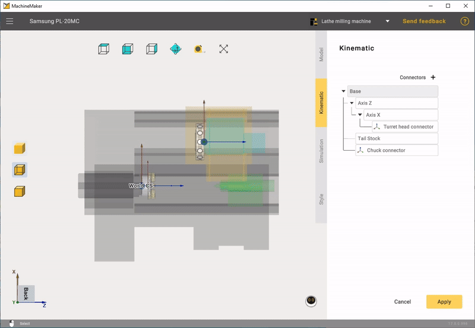

---
title: "3D 탐색"
---

# 3D 탐색

MachineMaker와 3D 탐색 기능을 충분히 활용하려면 스크롤 휠이 있는 3버튼 마우스를 사용하는 것이 좋습니다.

## 인터랙티브 회전

기본 시각화 화면에서 뷰를 회전하려면 마우스 오른쪽 버튼을 누른 채로 커서를 끕니다. 커서를 위아래로 끌면 화면의 수평 축을 중심으로 회전합니다. 커서를 좌우로 끌면 화면의 수직 축을 중심으로 회전합니다.

버튼을 사용하여 자유 회전 모드와 Z축 고정 회전 모드 사이를 전환합니다.

측정 도구를 사용하여 거리를 측정합니다.

로봇 셀에서는  버튼을 사용하면 바닥 표시를 끌 수 있습니다.

# [밀링 기계](#tab/machines)

# [로봇](#tab/robots)

# [선삭-밀링 복합 기계](#tab/turnmill)

---

**Standard views**(표준 뷰) 버튼으로도 시점을 변경할 수 있습니다.

기본 창의 왼쪽 아래 모서리에 있는 인터랙티브 **Global CS**(표준 좌표계)를 사용할 수도 있습니다.

# [밀링 기계](#tab/machines)

# [로봇](#tab/robots)

# [선삭-밀링 복합 기계](#tab/turnmill)

---

그래픽 창에서 **마우스 가운데 버튼**(휠)을 클릭하면 현재 뷰가 가장 가까운 표준 평면으로 회전합니다.

## 인터랙티브 팬

기본 시각화 화면에서 **마우스 가운데 버튼**(휠)을 누른 채로 커서를 끌면 뷰 벡터가 이동합니다.

## 인터랙티브 확대/축소

확대/축소하려면 **마우스 휠 스크롤**을 사용합니다. 마우스 커서가 있는 위치를 기준으로 확대/축소됩니다.

## 시각화 모드

메커니즘 편집 모드에서 시각화 모드를 변경할 수 있습니다.

# [밀링 기계](#tab/machines)

# [로봇](#tab/robots)

# [선삭-밀링 복합 기계](#tab/turnmill)

---
