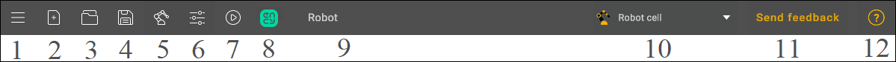
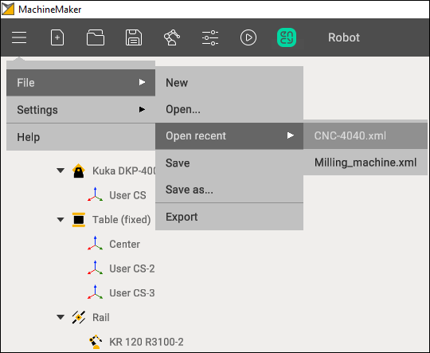
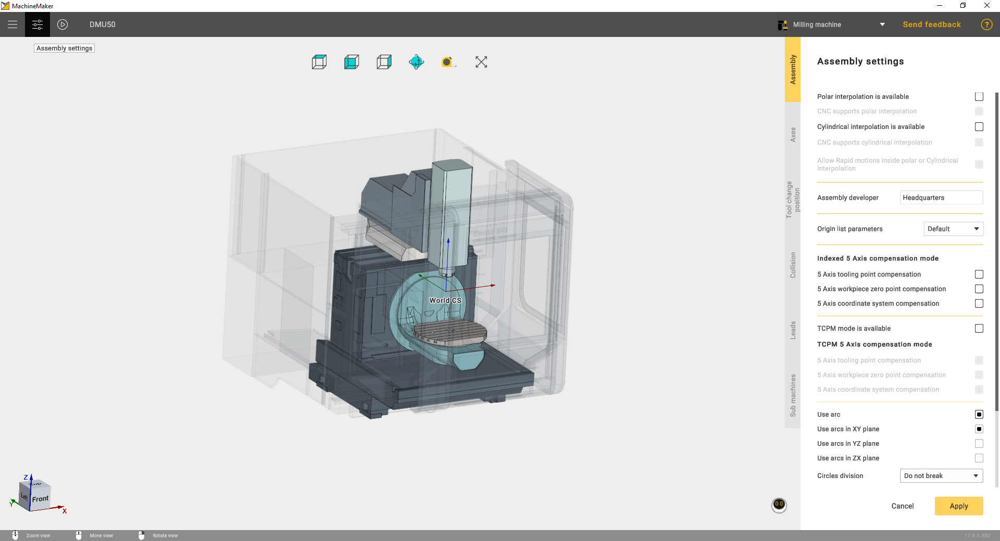
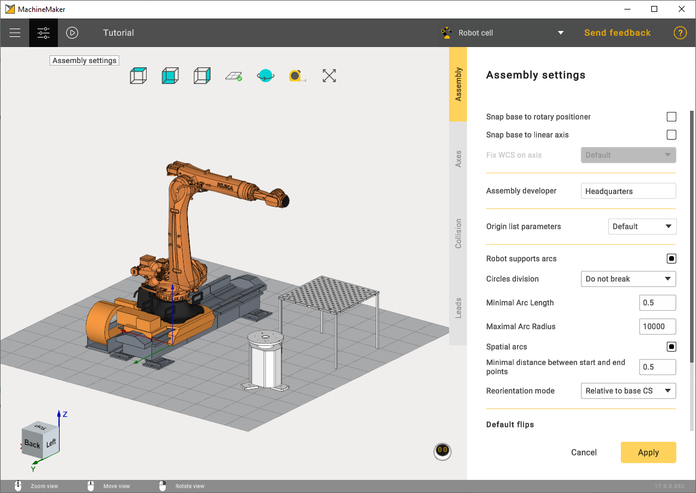
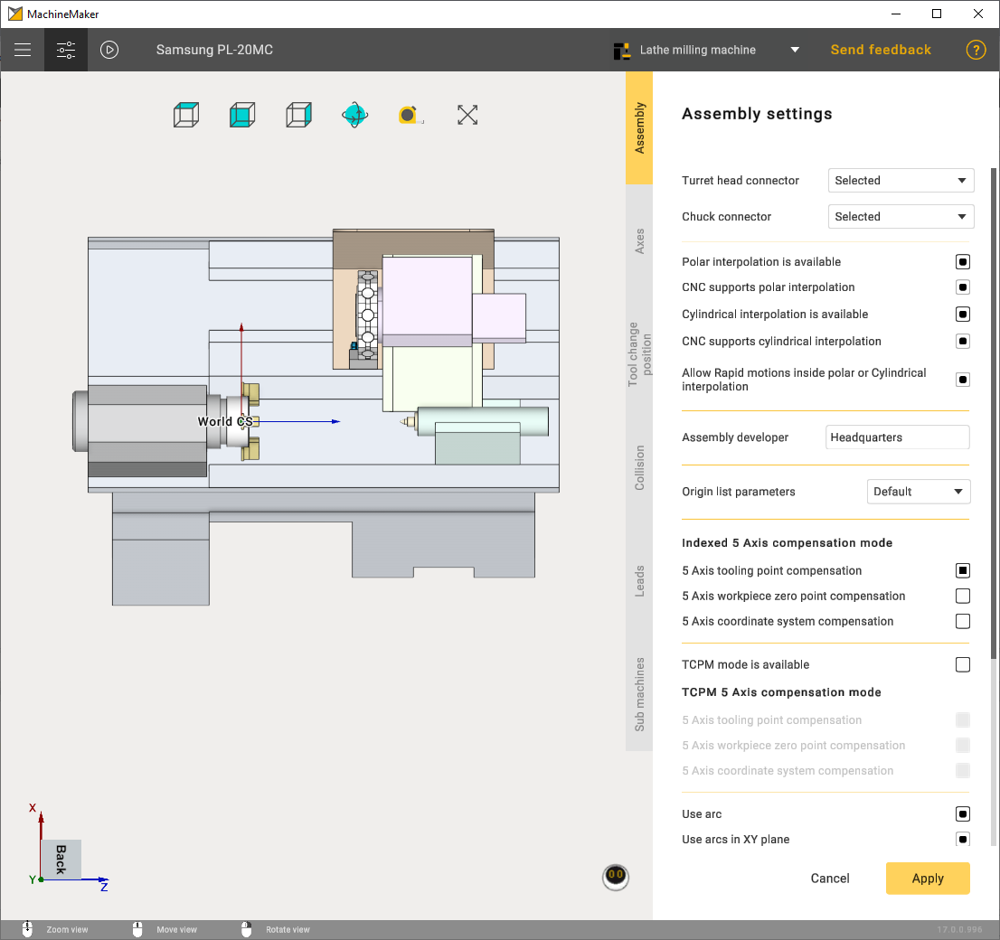
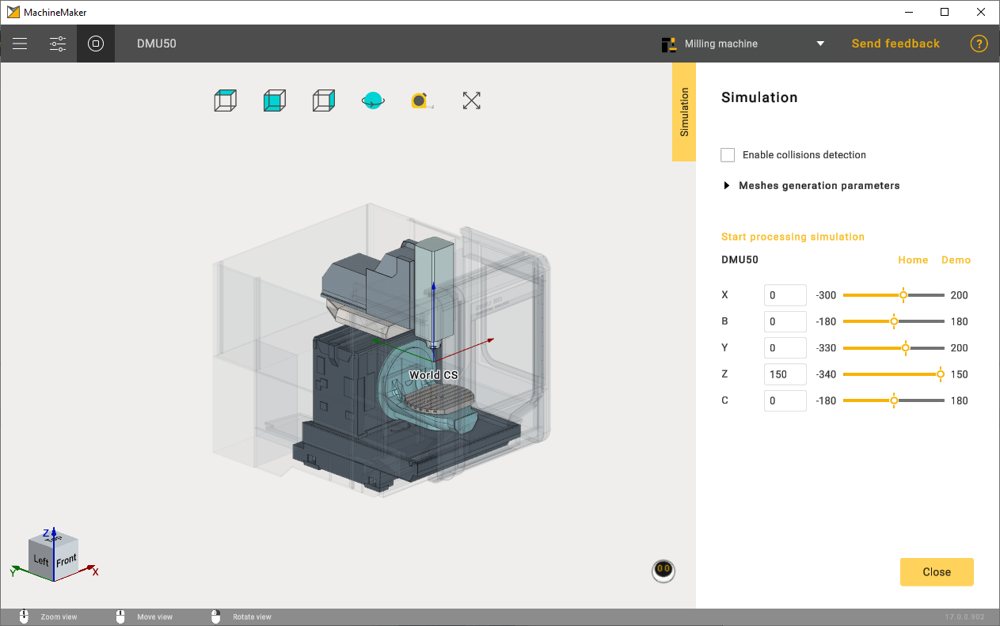
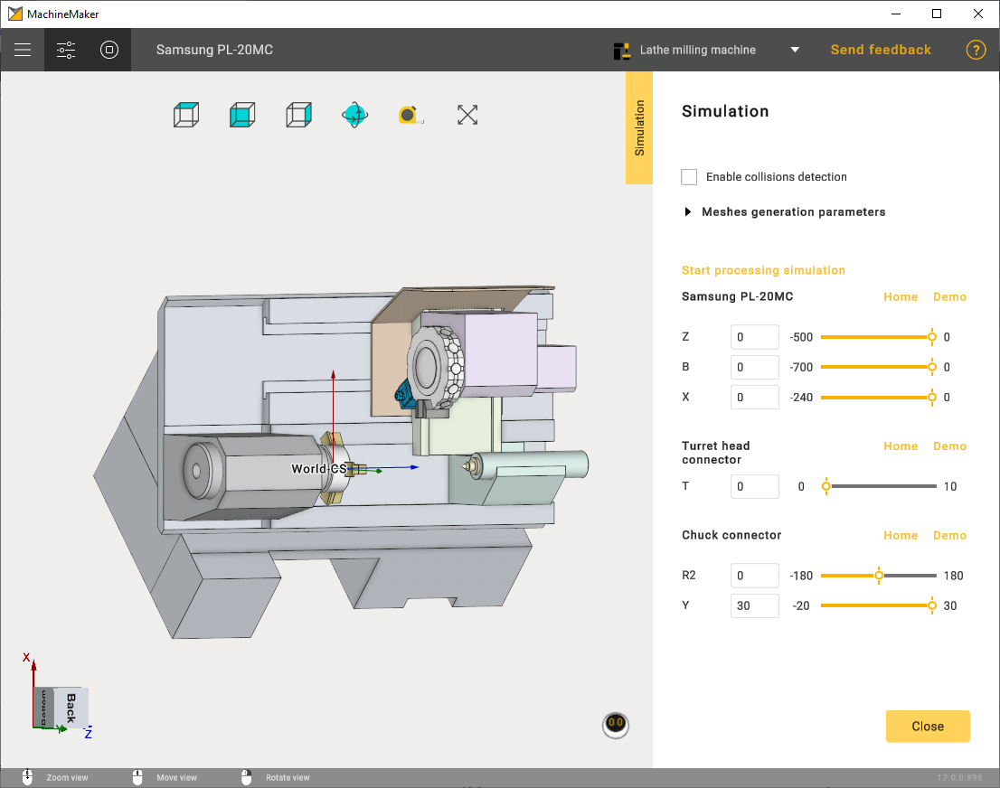
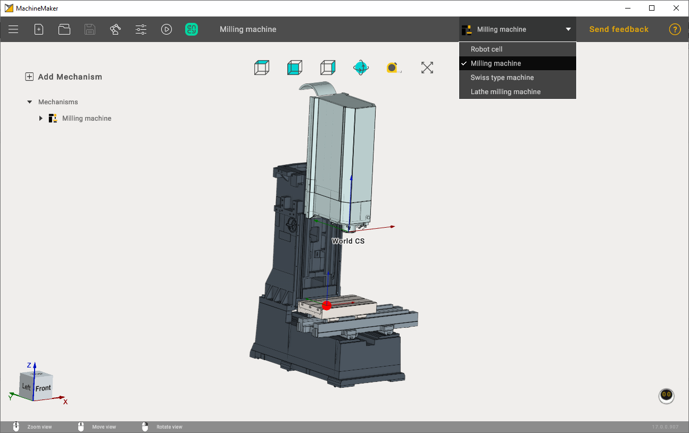
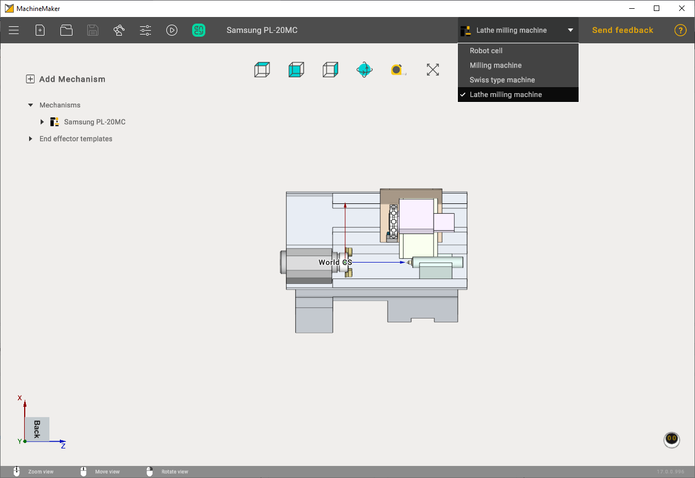
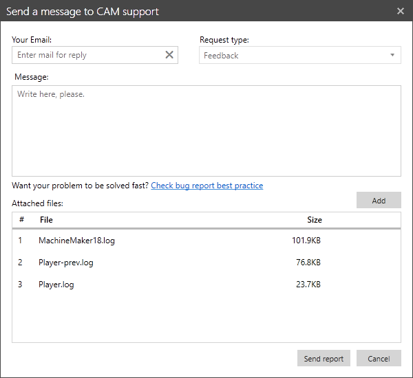

---
title: "도구 모음"
---

# 도구 모음

애플리케이션 도구 모음은 기본 창의 상단 패널에 있습니다.

## 메인 메뉴 (1)

**Main Menu (1)**(메인 메뉴)에는 다음 항목이 있습니다.

**File**(파일)은 프로젝트 작업을 위한 하위 메뉴를 엽니다.

- **New**(새로 만들기) - 새 프로젝트를 만듭니다. 도구 모음의 **New (1)** 버튼을 사용할 수도 있습니다.
- **Open**(열기) - 기존 프로젝트를 엽니다. 도구 모음의 **Open (3)** 버튼을 사용할 수도 있습니다.
- **Open recent**(최근 항목 열기) - 최근 프로젝트를 표시합니다. **Open (3)** 버튼 위에 마우스 포인터를 올려 두면 최근 프로젝트가 표시됩니다.
- **Save**(저장) - 현재 프로젝트를 저장합니다. 파일을 처음 저장할 때 MachineMaker가 프로젝트를 저장할 대상 폴더를 묻습니다. 도구 모음에 있는 **Save (4)** 버튼을 사용할 수도 있습니다.
- **Save as**(다른 이름으로 저장) - 현재 프로젝트를 다른 폴더에 저장합니다.
- **Export**(내보내기) - 현재 기계로 CAM 시스템을 엽니다. 도구 모음에 있는 **CAM system**(CAM 시스템) 버튼을 사용할 수도 있습니다.

  프로젝트를 저장하려면 어셈블리에 메커니즘(로봇 또는 기계)을 추가해야 합니다.

## 메커니즘 라이브러리 (5)

메커니즘 라이브러리를 엽니다. 라이브러리는 로봇, 밀링 기계, 선삭-밀링 복합 기계용 범주로 나뉘어 있습니다. 자세한 내용은 [메커니즘 라이브러리](129932035.md)에서 확인할 수 있습니다.

## 어셈블리 설정 (6)

어셈블리 설정 패널을 열려면 **Assembly settings (6)**(어셈블리 설정) 버튼을 사용합니다.

# [밀링 기계](#tab/machines)

# [로봇](#tab/robots)

# [선삭-밀링 복합 기계](#tab/turnmill)

---

## 시뮬레이션 (7)

**Simulation (7)**(시뮬레이션) 버튼을 사용하여 모든 메커니즘의 운동학을 검증합니다.

# [밀링 기계](#tab/machines)

# [로봇](#tab/robots)

# [선삭-밀링 복합 기계](#tab/turnmill)

---

## 프로젝트 이름 (9)

프로젝트 이름을 변경하려면 프로젝트 이름을 두 번 클릭합니다. 입력한 프로젝트 이름은 CAM 시스템에서 사용됩니다. 설정 패널에서도 프로젝트 이름을 변경할 수 있습니다.

# [밀링 기계](#tab/machines)

# [로봇](#tab/robots)

# [선삭-밀링 복합 기계](#tab/turnmill)

---

## 컨텍스트 전환기 (10)

작업에 따라 컨텍스트를 선택합니다.

# [밀링 기계](#tab/machines)

# [로봇](#tab/robots)

# [선삭-밀링 복합 기계](#tab/turnmill)

---

## 피드백 및 도움말

피드백을 보내거나 지원을 요청하려면 **Feedback (11)**(피드백) 버튼을 사용합니다.

MachineMaker는 요청에 로그 파일과 현재 프로젝트를 자동으로 첨부합니다. 첨부 파일을 제거하거나 새 파일을 요청에 첨부할 수 있습니다.

이 도움말과 튜토리얼을 열려면 **Help (12)**(도움말) 버튼을 사용합니다.
