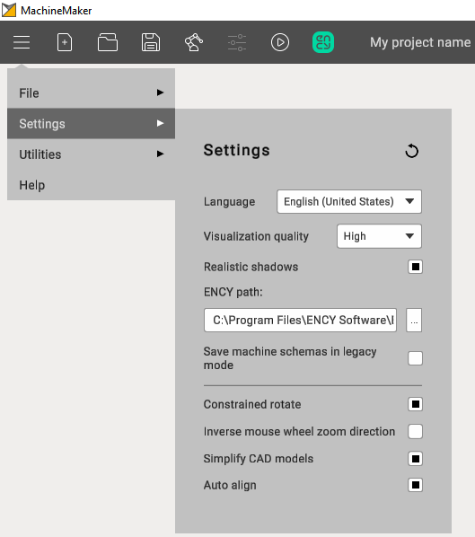

---
title: "Application Settings"
---

# Application Settings

Settings panel can be opened from Main menu.

General

- **Language.** MachineMaker uses CAM system language by default but it is possible to change it here.
- **Visualization quality.** Reduce quality if you have any problems with video memory or MachineMaker does not work smoothly enough. We recommend keeping High quality.
- **ENCY path.** MachineMaker detects installed CAM system automatically. But it is also possible to specify ENCY path here.
- **Constrained rotate** mode allows fixing Z axis during rotation. It is also possible to change this parameter from "Toolbar".
- **Inverse mouse wheel zoom direction.** Change this parameter to inverse zoom behavior on mouse scroll.
- **Simplify CAD models** allows you to reduce 3D model size. See "Prepare 3D models" page for details.
- **Auto Align.** MachineMaker will automatically go through the imported 3D models and try to find optimal position for each new mechanism in assembly.
