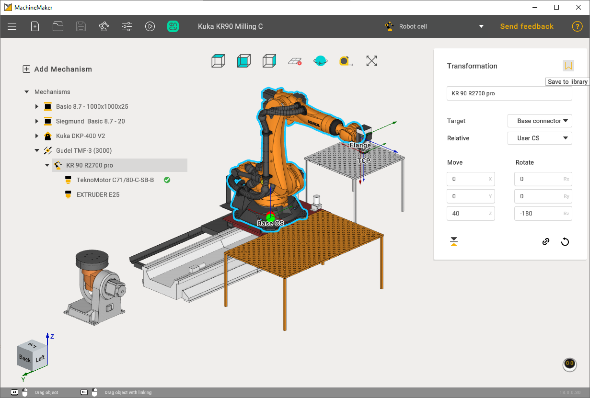
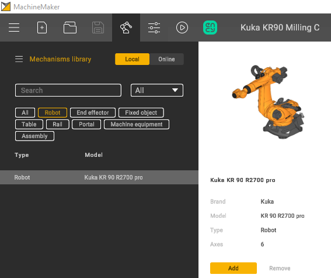
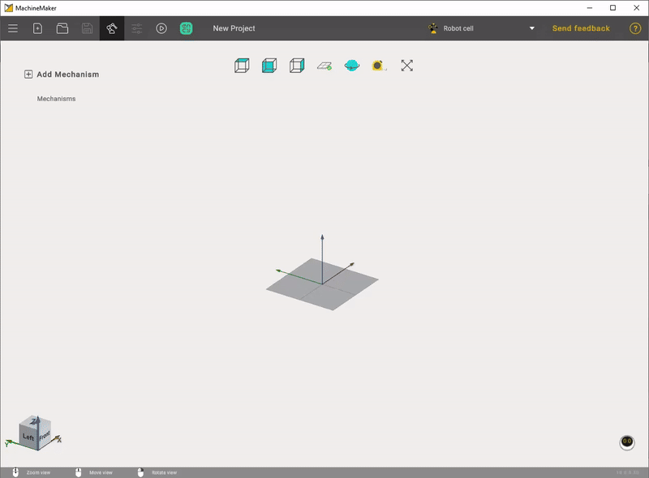
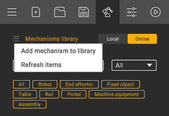

---
title: "메커니즘 라이브러리"
---

# 메커니즘 라이브러리

 버튼을 사용하여 메커니즘 라이브러리를 엽니다.

**Local**(로컬) 라이브러리와 **Online**(온라인) 라이브러리 간에 전환할 수 있습니다. 모든 메커니즘은 로컬 라이브러리에 저장할 수 있습니다. 어셈블리에서 메커니즘을 선택하고 **Save to library**(라이브러리에 저장) 버튼을 클릭합니다.

원하는 기계/로봇을 찾으려면 **Search**(검색) 필드와 OEM 필드를 사용합니다.

메커니즘 유형을 지정할 수도 있습니다.

마지막으로 **Add**(추가) 버튼을 클릭하여 선택한 메커니즘을 어셈블리에 추가합니다.

 메뉴를 사용하여 MachineMaker 메커니즘 파일(.mmm)을 로컬 라이브러리에 직접 추가할 수 있습니다.

