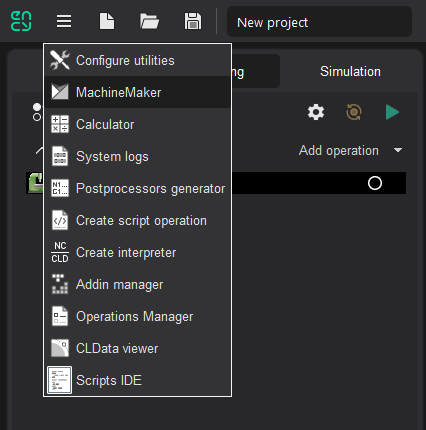

---
title: "프로젝트 만들기"
---

# 프로젝트 만들기

## MachineMaker 시작

MachineMaker는 CAM 시스템의 유틸리티 메뉴에서 바로 시작할 수 있습니다.

## 프로젝트 만들기

MachineMaker는 시작할 때 새 프로젝트를 자동으로 만듭니다. **Menu - File - New**(메뉴 - 파일 - 새로 만들기)를 사용하면 언제든지 새 프로젝트를 만들 수 있습니다.

